# Comparaison des méthodes de localisation

**Prony, ML + BIC, Frank–Wolfe glissant et descente de gradient d'Orano, et pourquoi la descente échoue déjà à deux sources**

Cyril Flury-Hérard — EA recherche — novembre 2026

Branche `travail-sur-le-probleme-inverse`, dossiers `compare/`, `results/`, `figures/`. Tous les chiffres viennent des CSV de `results/` ; aucune méthode n'a été modifiée. Version Markdown du compte rendu `rapport/compte_rendu_comparaison.typ` (PDF : `rapport/compte_rendu_comparaison.pdf`). Toutes les images sont dans `rapport/images/`.

---

> **Résumé**
>
> 1. **Sur le cercle de 64 capteurs, aucune méthode ne dépasse deux sources** dans le cadre du projet ($I_c = 50 S$, $\sigma = 10^{-3}$). À $N = 2$, ML + BIC est la meilleure méthode (erreur médiane $E = 0{,}093$, bon nombre de sources dans 92 % des tirages) ; dès $N = 4$, toutes les méthodes ont une erreur de l'ordre de la taille d'une source manquée.
> 2. **Avec la grille de 512 capteurs dans le hangar, le problème change de nature** : ML + BIC trouve le bon nombre de sources dans 81 à 99 % des tirages jusqu'à $N = 10$, avec une erreur médiane de $6 \cdot 10^{-4}$ à $7 \cdot 10^{-3}$, soit 150 à 800 fois moins que sur le cercle. Le Frank–Wolfe suit, avec une erreur 2 à 10 fois plus grande et un nombre de sources souvent surestimé.
> 3. **La descente de gradient d'Orano échoue déjà à deux sources**, même sans bruit et avec le bon $N$ : 71 % de réussite à $x = 1$ et 2 % à $x = 300$, contre 100 % pour Gauss–Newton parti du même point. Trois causes : un conditionnement $\kappa$ qui croît comme $x^{1,8}$ (le budget de 20 000 itérations ne suffit plus), une projection qui « éteint » une source (son intensité tombe à 0 et le gradient en position s'annule), et, avec la grille, un critère non pondéré plein de minima locaux.
> 4. **Prony est le plus rapide** (1 ms) mais, avec le seuil de rang du projet, il surestime le nombre de sources dès que la source centrale est présente (2,6 fausses sources en moyenne à $N = 2$).

---

## 1. Matériel, logiciels et durées

### 1.1 Machine

Tous les calculs ont été faits sur mon ordinateur portable :

| | |
|---|---|
| **Machine** | ordinateur portable HUAWEI, modèle NBLB-WAX9N |
| **Processeur (puce)** | Intel Core i5-10210U (génération Comet Lake, 2019) : 4 cœurs physiques, 8 fils d'exécution, 1,6 GHz de base, jusqu'à 4,2 GHz en turbo, enveloppe thermique de 15 W |
| **Carte graphique** | Intel UHD Graphics (puce graphique intégrée au processeur, 1 Go de mémoire partagée, pilote 27.20.100.8984) |
| **Mémoire vive** | 7,8 Go |
| **Système** | Windows 11 Famille |
| **Logiciels** | Python 3.14.0, NumPy 2.3.3, SciPy 1.16.2, scikit-learn 1.7.2, PyTorch 2.9.0 (version CPU), Matplotlib, Typst 0.15.1 |

**La carte graphique n'a pas servi.** Une puce Intel UHD intégrée n'a pas de support CUDA, et PyTorch est installé en version CPU. Surtout, les méthodes comparées sont écrites en NumPy/SciPy (optimisation L-BFGS-B, moindres carrés, décompositions de petites matrices) : ce sont des calculs séquentiels sur des matrices de quelques centaines de lignes, que la carte graphique n'accélérerait pas. **Tout le calcul est sur le processeur**, avec un parallélisme par tirage : chaque processus traite un tirage complet, et les bibliothèques d'algèbre linéaire sont limitées à un fil par processus pour éviter la sur-souscription.

### 1.2 Durées réelles

| Calcul | Durée | Processus |
|---|---:|---:|
| Essai rapide (`--quick`, 10 tirages, 3 points par balayage, avec la descente) | 13,9 min | 6 |
| Comparaison complète, cercle (14 400 tâches) | 15,0 min | 6 |
| Comparaison complète, cercle + grille (14 400 tâches) | 78,4 min | 6 |
| Comparaison complète, total avec figures et Typst | 94,2 min | 6 |
| Cas à deux sources : réussite, causes, conditionnement (1 800 tirages) | 80,4 min | 2 |
| Cas à deux sources : bassins d'attraction (864 départs) | 35,7 min | 2 |
| Cas à deux sources : total avec figures | 116,3 min | 2 |

Les deux calculs ont tourné en même temps : 8 processus sur 4 cœurs physiques. **Les temps de calcul mesurés par tirage sont donc des temps « sous charge »**, plus longs (d'environ un facteur 1,5 à 2) que sur une machine au repos ; les comparaisons entre méthodes restent valables, car toutes ont subi la même charge.

Un premier lancement complet incluait la descente de gradient ; il avançait au rythme d'environ 6 h pour l'ensemble, la descente prenant à elle seule plus de 90 % du temps (jusqu'à 12 s par tirage à $N = 10$, contre 0,6 s pour ML + BIC). Je l'ai arrêté et la descente a été retirée des balayages généraux : elle est étudiée en détail dans le cas à deux sources (section 7), qui est le cas où Orano l'a testée.

## 2. Le problème et les méthodes

### 2.1 Le problème

On cherche $N$ sources ponctuelles de plutonium, de positions $z_i$ et d'intensités $I_i > 0$, dans le hangar $D = [0, 10] \times [0, 20]$. Un capteur placé en $s_k$ mesure

$$\Phi_\theta(s_k) = \sum_{i=1}^N \frac{I_i}{\lVert s_k - z_i \rVert^2},$$

plus le signal d'une source centrale connue, d'intensité $I_c$, placée en $c = (5, 10)$. Le bruit est relatif : le capteur lit $y_k^{\text{brut}} (1 + \sigma \varepsilon_k)$ avec $\varepsilon_k \sim \mathcal N(0, 1)$. On retire le signal de la source centrale, mais **son bruit reste** : l'écart type au capteur $k$ vaut $\sigma_k = \sigma y_k^{\text{brut}}$, dominé par la source centrale dès que $I_c$ est grand devant la somme $S = \sum I_i = 100$.

Deux dispositions de capteurs sont comparées :
- **cercle** : 64 capteurs régulièrement répartis sur le cercle de centre $c$ passant par les coins de $D$ (rayon $\sqrt{125} \approx 11{,}2$) ;
- **cercle + grille** : les mêmes 64 capteurs plus une grille régulière de $16 \times 32 = 512$ capteurs dans $D$, soit 576 capteurs.

### 2.2 Les méthodes, telles qu'elles sont dans le dépôt

Les méthodes sont utilisées **sans modification**, avec les réglages déjà présents dans le dépôt.

- **Prony** (`src/particle_sources/inversion/prony.py`, `prony_circle`). Les mesures du cercle sont vues comme une fonction sur le cercle ; ses coefficients de Fourier forment une matrice de Hankel dont le rang est le nombre de sources, et les sources sont les racines d'un polynôme. Le rang est lu avec le seuil relatif `rank_tol = 0.005` de `config/reconstruction.yaml`. **Prony n'utilise que les capteurs du cercle**, y compris dans la configuration cercle + grille.
- **ML + BIC** (`sparse_sources`, `greedy_ml`). Maximum de vraisemblance : moindres carrés pondérés par $1/\sigma_k^2$, résolus par L-BFGS-B (et non par Gauss–Newton), en ajoutant les sources une par une à partir d'une recherche exhaustive sur une grille de positions candidates ; le nombre de sources est choisi par le critère BIC ($k_{\max} = 20$).
- **Frank–Wolfe glissant** (`sliding_frank_wolfe`). Problème BLASSO sur les mesures, capteurs blanchis (divisés par $\sigma_k$) et noyau normalisé, pénalité $\lambda = 1{,}5 \sqrt{M}$ ($M$ = nombre de capteurs), 40 itérations au plus, comme dans `sparse_sources/tester_fw.py`.
- **Descente de gradient d'Orano** (`sparse_sources/orano.py`, `descente_projetee`). Descente de gradient sur $\theta = (z_i, I_i)$ normalisés, pas d'Armijo (le pas est doublé à chaque itération puis divisé par 2 jusqu'à décroissance suffisante), déplacement limité à 5 % du domaine, projection des positions sur $D$ et des intensités sur $\mathbb R_+$, 20 000 itérations au plus. Le critère est la somme des carrés des résidus **non pondérée**, divisée par $\lVert y \rVert^2$. Elle reçoit le vrai $N$ ; les positions de départ sont tirées uniformément dans $D$ et les intensités de départ valent $S/N$.
- **Gauss–Newton** (`orano.gauss_newton`, région de confiance de `scipy.optimize.least_squares`) : même critère que la descente, même point de départ, même $N$. Il sert de **témoin** dans le cas à deux sources : il permet de séparer ce qui vient du critère et ce qui vient de l'algorithme.

## 3. Protocole de comparaison

**Situations.** Pour chaque $N \in \{2, 4, 6, 10\}$ et chaque tirage, les positions $z_i$ sont uniformes dans $D$ et les intensités suivent une loi de Dirichlet de somme $S = 100$. Le générateur aléatoire est initialisé par $(N, \text{tirage})$ seulement : **toutes les méthodes et les deux dispositions de capteurs voient exactement les mêmes sources et le même bruit**. Les différences entre méthodes ne viennent donc pas du hasard des tirages.

**Erreur d'un tirage.** Les sources estimées sont appariées aux vraies par l'algorithme hongrois (appariement qui minimise la somme des distances). Pour chaque vraie source $i$, $d_i = \lVert \hat z_i - z_i \rVert$ et $r_i = |\hat I_i - I_i| / I_i$, plafonnés à $d_i \le 5$ et $r_i \le 1$ ; une source manquée compte $(5, 1)$. L'erreur est

$$E = \frac1N \sum_{i=1}^N (\alpha d_i + \beta r_i), \qquad \alpha = 0{,}75, \quad \beta = 0{,}25.$$

**Ordre de grandeur :** $E \approx 4$ veut dire « tout est faux » ; $E \approx 1$ correspond par exemple à une source sur quatre manquée ; $E < 0{,}01$ veut dire que les sources sont trouvées à quelques centimètres près (le hangar fait 10 × 20). Les fausses sources (sources estimées en trop) ne sont pas dans $E$ : elles sont comptées à part, et la proportion de tirages avec $\hat N = N$ est tracée sous chaque courbe d'erreur.

**Balayages.** Chaque balayage fait varier un paramètre autour du cadre par défaut $I_c = 50 S$, $\sigma = 10^{-3}$ :
- (a) bruit $\sigma \in \{10^{-4}, \dots, 10^{-2}\}$, 7 valeurs régulièrement espacées en échelle log ;
- (b) source centrale $I_c / S \in \{0, 10, 25, 50, 100, 200\}$ ;
- (c) nombre de sources $N$ ;
- (d) temps de calcul.

Chaque point compte 100 tirages, soit 48 points × 100 tirages × 3 méthodes = 14 400 calculs par disposition.

**Timeout.** Un calcul qui dépasse 60 s est arrêté (le processus est tué et relancé) et compté comme un échec complet ($E$ d'une solution vide).

## 4. Résultats avec les capteurs sur le cercle

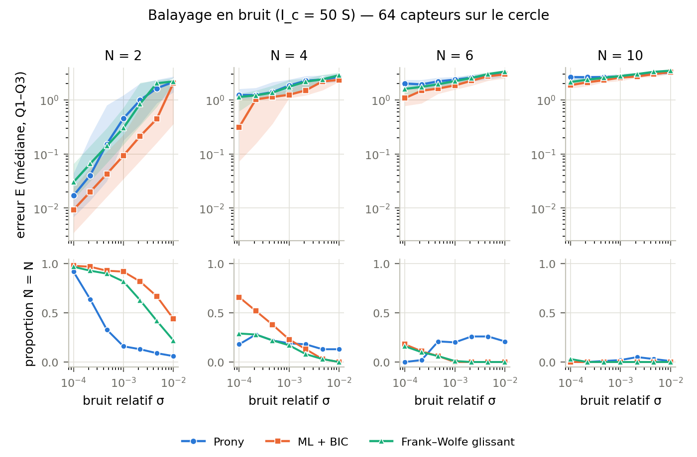

*Figure 1 – Erreur $E$ (médiane, bande entre premier et troisième quartile, échelle log) et proportion de tirages avec $\hat N = N$, en fonction du bruit relatif $\sigma$ ; $I_c = 50 S$, 64 capteurs sur le cercle, 100 tirages par point.*

**À deux sources, le bruit décide de tout.** À $N = 2$ (figure 1), l'erreur médiane de ML + BIC passe de 0,009 à $\sigma = 10^{-4}$ à 2,05 à $\sigma = 10^{-2}$, et celle des autres méthodes suit la même pente : l'erreur est proportionnelle à $\sigma$ tant que les deux sources sont détectées, puis sature quand l'une d'elles disparaît dans le bruit. ML + BIC est meilleur que le Frank–Wolfe et que Prony d'un facteur 2 à 5 sur toute la gamme : à $\sigma = 10^{-3}$, $E = 0{,}093$ contre 0,30 (Frank–Wolfe) et 0,45 (Prony).

**Au-delà de deux sources, le cercle ne suffit plus.** À $N = 4$, même avec le bruit le plus faible ($\sigma = 10^{-4}$), ML + BIC ne trouve le bon nombre de sources que dans 66 % des tirages, et seulement 23 % à $\sigma = 10^{-3}$. À $N = 6$ et $N = 10$, aucune méthode ne descend sous $E \approx 1$ : on retrouve le résultat du compte rendu précédent, le cercle ne mesure qu'une dizaine de paramètres à la précision utile.

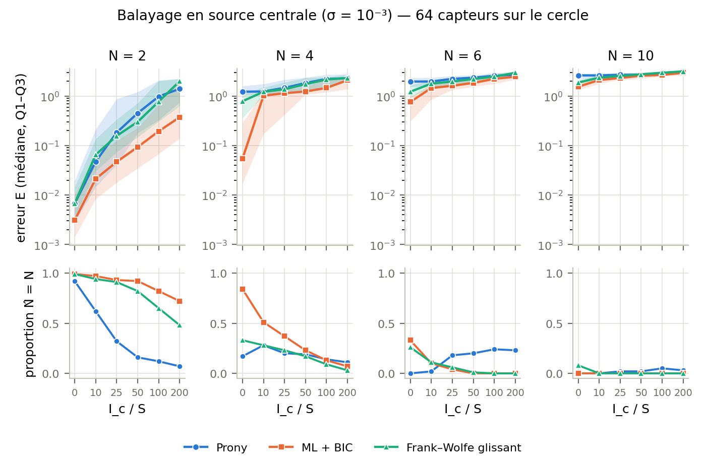

*Figure 2 – Erreur $E$ et proportion de $\hat N = N$ en fonction de l'intensité de la source centrale ($I_c/S = 0$ : pas de source centrale) ; $\sigma = 10^{-3}$, 64 capteurs sur le cercle.*

**La source centrale est le facteur limitant.** Sans source centrale (figure 2, $I_c = 0$), ML + BIC atteint $E = 0{,}003$ à $N = 2$ et retrouve le bon nombre de sources dans 83 % des tirages à $N = 4$. Avec $I_c = 200 S$, l'erreur à $N = 2$ monte à 0,38 et la détection à $N = 4$ tombe à 7 %. C'est logique : le bruit au capteur $k$ vaut $\sigma y_k^{\text{brut}}$, et $y_k^{\text{brut}}$ est dominé par la source centrale ; multiplier $I_c$ par 10 revient à peu près à multiplier $\sigma$ par 10.

**Prony a un comportement à part.** Sa proportion de $\hat N = N$ *augmente* avec $I_c$ à $N = 6$ (de 0 à 23 %) : ce n'est pas une meilleure détection, c'est que Prony renvoie trop de sources (voir section 8), et qu'en présence de bruit fort ce nombre trop grand tombe parfois sur 6.

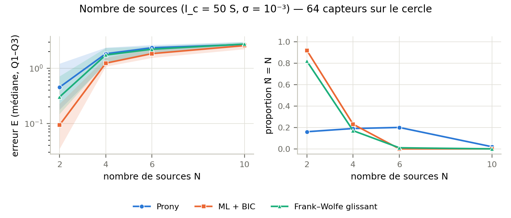

*Figure 3 – Erreur $E$ et proportion de $\hat N = N$ en fonction du nombre de sources, cadre par défaut ($I_c = 50 S$, $\sigma = 10^{-3}$) ; 64 capteurs sur le cercle.*

La figure 3 résume le cadre par défaut : à $N = 2$, ML + BIC 0,093 (92 % de $\hat N = N$), Frank–Wolfe 0,30 (82 %), Prony 0,45 (16 %) ; à $N = 4$, les trois méthodes sont entre 1,2 et 1,8 ; à $N = 10$, entre 2,6 et 2,8, c'est-à-dire que plus de la moitié des sources sont manquées.

## 5. Résultats avec le cercle et la grille

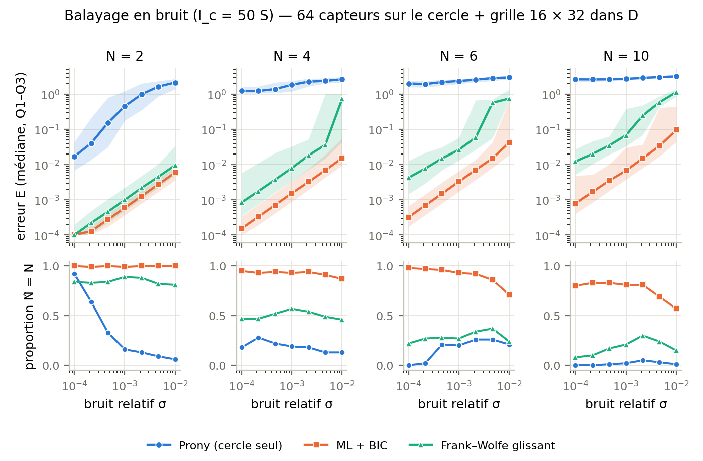

*Figure 4 – Même balayage en bruit que la figure 1, avec en plus 512 capteurs en grille $16 \times 32$ dans $D$ (Prony n'utilise que les capteurs du cercle).*

**La grille fait gagner deux à trois ordres de grandeur.** Avec la grille (figure 4), l'erreur de ML + BIC reste proportionnelle à $\sigma$ pour **tous** les $N$ : à $\sigma = 10^{-3}$, $E = 6 \cdot 10^{-4}$ à $N = 2$ et $6{,}7 \cdot 10^{-3}$ à $N = 10$. Le bon nombre de sources est trouvé dans 93 % des tirages à $N = 4$ et 81 % à $N = 10$. **Les capteurs intérieurs voient chaque source de près** : la grille a un pas de 0,625, donc chaque source a un capteur à moins de 0,45 ; elle y produit un signal plusieurs centaines de fois plus fort que sur les capteurs du cercle, situés à plusieurs mètres, alors que le bruit de la source centrale, lui, ne change pas d'ordre de grandeur.

**Le Frank–Wolfe profite aussi de la grille**, mais moins : $E = 10^{-3}$ à $N = 2$ et 0,068 à $N = 10$, avec une détection exacte du nombre de sources dans seulement 21 à 57 % des tirages à $N \ge 4$. Le Frank–Wolfe ajoute de petites sources parasites près des vraies (la pénalité $\lambda$ ne suffit pas à les supprimer quand il y a 576 capteurs) ; elles ne dégradent presque pas $E$ mais faussent $\hat N$. À $\sigma = 10^{-2}$ et $N \ge 4$, son erreur remonte brusquement (0,74 à $N = 4$, 1,1 à $N = 10$) : il manque alors des sources.

**Prony ne change pas** : il n'utilise que les capteurs du cercle, ses courbes sont identiques dans les deux figures.

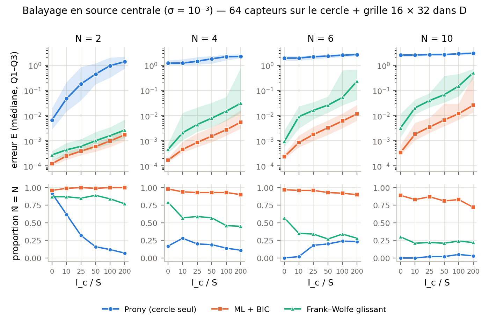

*Figure 5 – Balayage en source centrale avec cercle + grille ; $\sigma = 10^{-3}$.*

Avec la grille, la source centrale reste le facteur limitant (figure 5), mais à un niveau bien plus bas : pour ML + BIC à $N = 6$, $E$ passe de $2{,}3 \cdot 10^{-4}$ sans source centrale à 0,012 avec $I_c = 200 S$, et le bon nombre de sources est trouvé dans au moins 90 % des tirages.

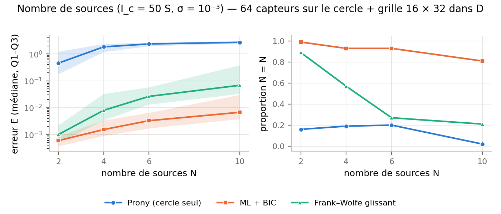

*Figure 6 – Erreur $E$ et proportion de $\hat N = N$ en fonction du nombre de sources, cadre par défaut ; cercle + grille.*

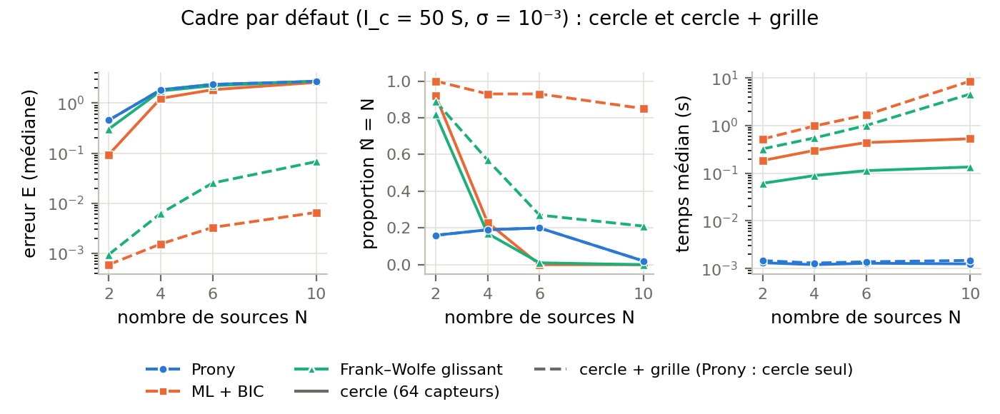

*Figure 7 – Cadre par défaut : erreur $E$ médiane, proportion de $\hat N = N$ et temps médian en fonction de $N$ ; cercle seul (traits pleins) et cercle + grille (pointillés). Prony n'utilise que le cercle dans les deux cas.*

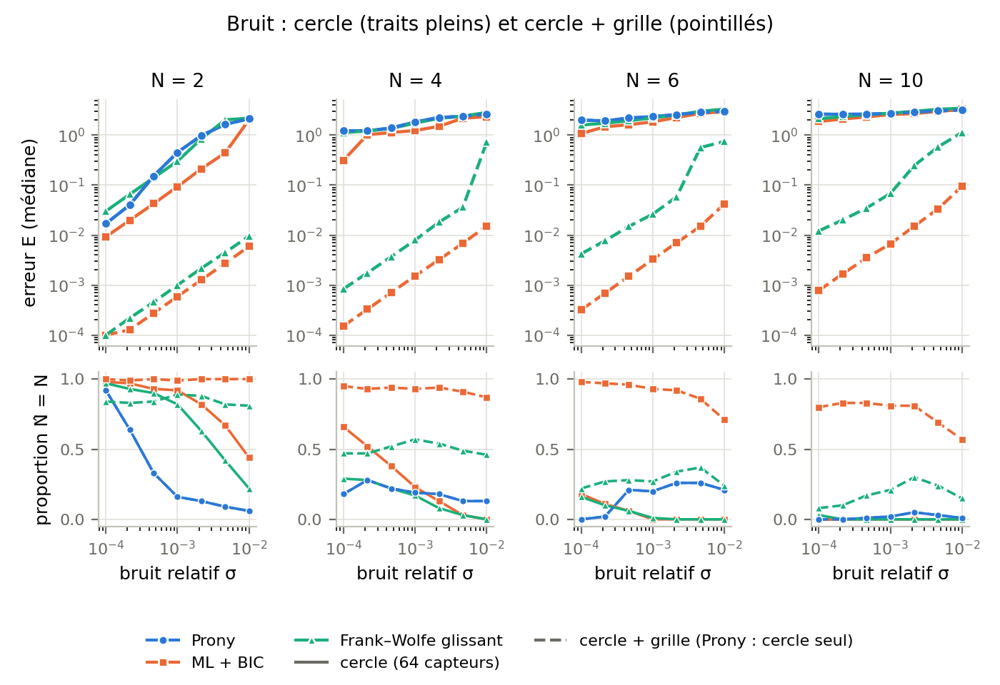

*Figure 8 – Balayage en bruit : cercle seul (traits pleins) et cercle + grille (pointillés), mêmes tirages.*

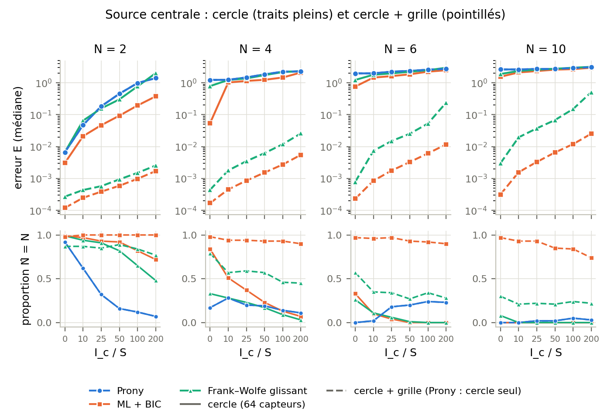

*Figure 9 – Balayage en source centrale : cercle seul (traits pleins) et cercle + grille (pointillés).*

Les figures 7 à 9 superposent les deux dispositions. À $N = 10$ et $\sigma = 10^{-3}$, l'erreur médiane de ML + BIC passe de 2,59 (cercle) à 0,0067 (cercle + grille), celle du Frank–Wolfe de 2,76 à 0,068.

### Tableau de synthèse (cadre par défaut, médianes)

Erreur $E$, erreur de position moyenne $d$ (unités du hangar), erreur relative d'intensité moyenne $r$, proportion de tirages où $\hat N = N$, temps de calcul. Prony n'utilise que les 64 capteurs du cercle.

| Méthode | $N$ | $E$ cercle | $d$ | $r$ | $\hat N = N$ | temps | $E$ cercle + grille | $d$ | $r$ | $\hat N = N$ | temps |
|---|---:|---:|---:|---:|---:|---:|---:|---:|---:|---:|---:|
| Prony | 2 | 0,453 | 0,566 | 0,149 | 16 % | 0,0013 s | 0,453 | 0,566 | 0,149 | 16 % | 0,0014 s |
| | 4 | 1,84 | 2,25 | 0,551 | 19 % | 0,0013 s | 1,84 | 2,25 | 0,551 | 19 % | 0,0013 s |
| | 6 | 2,36 | 2,89 | 0,746 | 20 % | 0,0013 s | 2,36 | 2,89 | 0,746 | 20 % | 0,0014 s |
| | 10 | 2,71 | 3,35 | 0,838 | 2 % | 0,0013 s | 2,71 | 3,35 | 0,838 | 2 % | 0,0014 s |
| ML + BIC | 2 | 0,0932 | 0,113 | 0,0312 | 92 % | 0,21 s | 0,00059 | 0,000496 | 0,00078 | 99 % | 0,55 s |
| | 4 | 1,24 | 1,51 | 0,427 | 23 % | 0,36 s | 0,00153 | 0,00126 | 0,00207 | 93 % | 1,1 s |
| | 6 | 1,85 | 2,26 | 0,618 | 0 % | 0,46 s | 0,00328 | 0,00252 | 0,00477 | 93 % | 1,8 s |
| | 10 | 2,59 | 3,18 | 0,793 | 0 % | 0,61 s | 0,00671 | 0,00485 | 0,0101 | 81 % | 6,9 s |
| Frank–Wolfe glissant | 2 | 0,302 | 0,382 | 0,0468 | 82 % | 0,067 s | 0,000997 | 0,000766 | 0,00129 | 89 % | 0,35 s |
| | 4 | 1,75 | 2,2 | 0,555 | 17 % | 0,1 s | 0,00796 | 0,00487 | 0,0144 | 57 % | 0,61 s |
| | 6 | 2,22 | 2,71 | 0,743 | 1 % | 0,14 s | 0,0263 | 0,014 | 0,0547 | 27 % | 1,1 s |
| | 10 | 2,76 | 3,4 | 0,828 | 0 % | 0,16 s | 0,068 | 0,0385 | 0,123 | 21 % | 3,6 s |

## 6. Temps de calcul

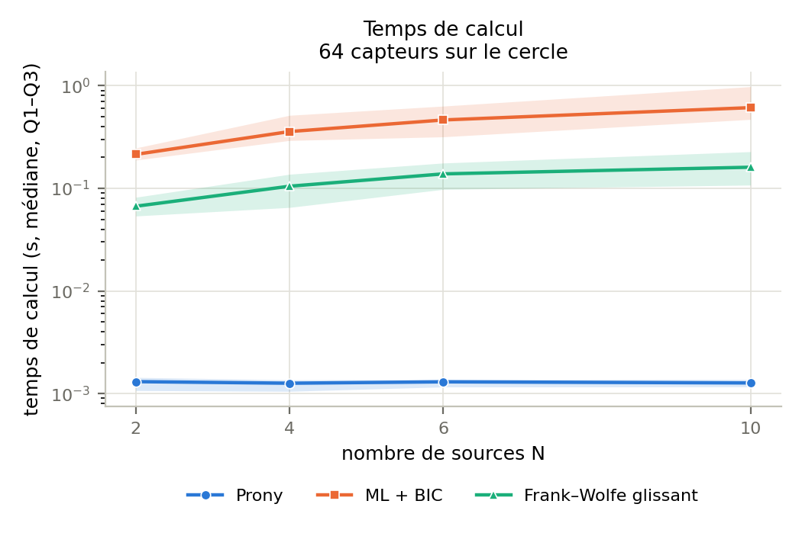
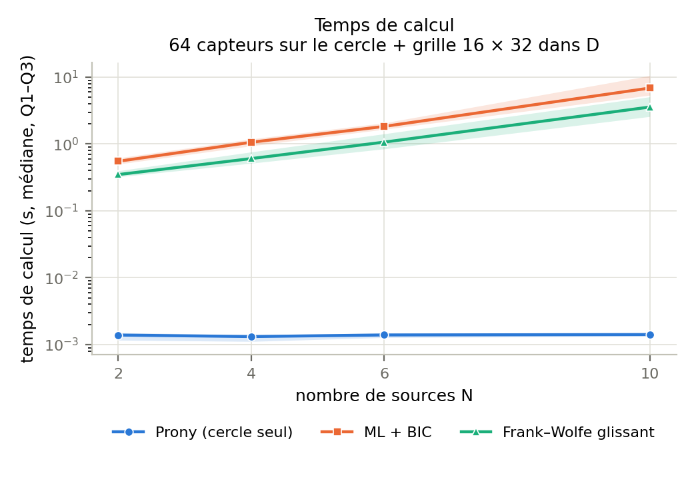

*Figure 10 – Temps de calcul par tirage (médiane et quartiles), génération des données exclue ; cadre par défaut. En haut : cercle ; en bas : cercle + grille. Mesuré avec 8 processus sur 4 cœurs.*

| Méthode | Disposition | $N = 2$ | $N = 4$ | $N = 6$ | $N = 10$ |
|---|---|---:|---:|---:|---:|
| Prony | les deux | 1,3 ms | 1,3 ms | 1,3 ms | 1,4 ms |
| ML + BIC | cercle | 0,21 s | 0,36 s | 0,46 s | 0,61 s |
| ML + BIC | cercle + grille | 0,55 s | 1,1 s | 1,8 s | 6,9 s |
| Frank–Wolfe | cercle | 0,067 s | 0,10 s | 0,14 s | 0,16 s |
| Frank–Wolfe | cercle + grille | 0,35 s | 0,61 s | 1,1 s | 3,6 s |
| Descente (Orano) | cercle, $N = 2$ | 7,3 s | — | — | — |

**Prony est mille fois plus rapide que les autres** (une décomposition de matrice de Hankel de taille fixe : son temps ne dépend pas de $N$). ML + BIC et le Frank–Wolfe ont un coût proportionnel au nombre de capteurs et augmentent avec $N$ ; avec 576 capteurs et $N = 10$, ML + BIC prend 7 s en médiane. **La descente d'Orano est la plus lente** : 7,3 s pour deux sources seulement, parce qu'elle fait presque toujours ses 20 000 itérations (section 7).

**Timeouts (60 s).** Sur 28 800 calculs :
- cercle : 3 timeouts, tous pour ML + BIC (2 à $N = 6$ et 1 à $N = 4$, sans source centrale) ; 0 pour Prony et le Frank–Wolfe ;
- cercle + grille : 88 timeouts pour ML + BIC (dont 78 à $N = 10$, surtout à bruit faible : 16 à $\sigma = 10^{-4}$), 5 pour le Frank–Wolfe (4 à $N = 10$), 0 pour Prony.

Le BIC ajoute des sources tant que la vraisemblance s'améliore assez ; à bruit faible et avec 576 capteurs, chaque ajout est accepté longtemps et chaque optimisation coûte cher. Ces 93 timeouts sur 14 400 calculs (0,6 %) sont comptés comme des échecs complets ; ils pèsent peu sur les médianes. Une partie vient sans doute de la charge de la machine : les temps maximaux observés hors timeout (54 s à $N = 10$ sur le cercle) montrent que certains calculs sont proches de la limite.

## 7. Le cas à deux sources : pourquoi la descente échoue

### 7.1 Dispositif

Orano n'a testé la descente qu'à **deux sources**, en faisant varier le rapport d'intensité $x = I_1 / I_2$. J'ai refait cette expérience avec 100 tirages par valeur de $x \in \{1, 3, 10, 30, 100, 300\}$ : les positions sont celles des tirages à $N = 2$ de la comparaison, et les intensités valent $I_1 = S x / (x + 1)$, $I_2 = S / (x + 1)$. Trois cadres :
- **cas test d'Orano** : cercle, sans bruit, sans source centrale ($\sigma = 0$, $I_c = 0$) ;
- **projet, cercle** : $\sigma = 10^{-3}$, $I_c = 50 S$ ;
- **projet, cercle + grille** : idem avec les 576 capteurs.

Un tirage est une **réussite** si la méthode renvoie exactement 2 sources et que chacune est à moins de 0,1 de la vraie (0,5 % de la largeur du hangar). La descente et Gauss–Newton reçoivent $N = 2$ et partent **du même point**.

Pour chaque échec de la descente, j'ai cherché la cause, dans cet ordre :
1. **source éteinte** : l'intensité d'une source est tombée à 0 (projection sur $\mathbb R_+$) ;
2. **budget épuisé** : les 20 000 itérations sont faites sans atteindre la précision ;
3. **limite statistique** : la perte finale est au plus celle du minimum voisin de la vérité (obtenu par Gauss–Newton parti des vraies sources) : la descente a trouvé le bon minimum, mais avec le bruit ce minimum est à plus de 0,1 des vraies sources, et aucune méthode ne peut faire mieux ;
4. **bloquée au bord** : une source est collée au bord de $D$ ;
5. **minimum local** : tout le reste.

### 7.2 Taux de réussite

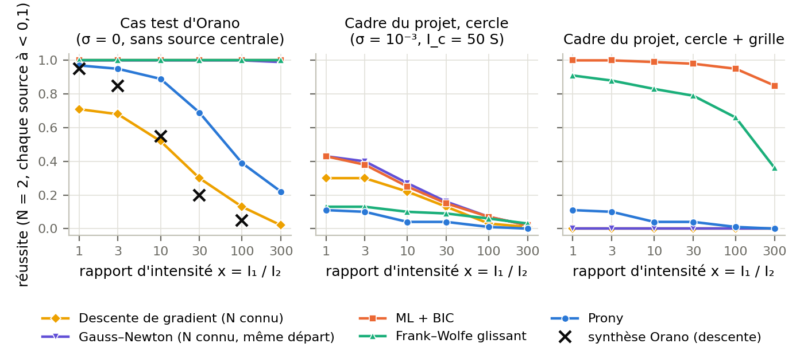

*Figure 11 – Réussite à deux sources ($\hat N = 2$ et chaque source à moins de 0,1) en fonction du rapport d'intensité $x$, 100 tirages par point. Gauss–Newton et la descente reçoivent $N = 2$ et partent du même point. Croix : valeurs de la synthèse Orano.*

| Cadre | Méthode | $x = 1$ | 3 | 10 | 30 | 100 | 300 |
|---|---|---:|---:|---:|---:|---:|---:|
| Orano (synthèse) | descente | 95 % | 85 % | 55 % | 20 % | 5 % | — |
| **cas test d'Orano** | descente | 71 % | 68 % | 52 % | 30 % | 13 % | 2 % |
| | Gauss–Newton | 100 % | 100 % | 100 % | 100 % | 100 % | 99 % |
| | ML + BIC | 100 % | 100 % | 100 % | 100 % | 100 % | 100 % |
| | Frank–Wolfe | 100 % | 100 % | 100 % | 100 % | 100 % | 100 % |
| | Prony | 97 % | 95 % | 89 % | 69 % | 39 % | 22 % |
| **projet, cercle** | descente | 30 % | 30 % | 22 % | 13 % | 3 % | 1 % |
| | Gauss–Newton | 43 % | 40 % | 27 % | 16 % | 7 % | 2 % |
| | ML + BIC | 43 % | 38 % | 25 % | 15 % | 7 % | 2 % |
| | Frank–Wolfe | 13 % | 13 % | 10 % | 9 % | 6 % | 3 % |
| | Prony | 11 % | 10 % | 4 % | 4 % | 1 % | 0 % |
| **projet, cercle + grille** | descente | 0 % | 0 % | 0 % | 0 % | 0 % | 0 % |
| | Gauss–Newton | 0 % | 0 % | 0 % | 0 % | 0 % | 0 % |
| | ML + BIC | 100 % | 100 % | 99 % | 98 % | 95 % | 85 % |
| | Frank–Wolfe | 91 % | 88 % | 83 % | 79 % | 66 % | 36 % |
| | Prony | 11 % | 10 % | 4 % | 4 % | 1 % | 0 % |

**Dans le cas test d'Orano, on retrouve la même tendance qu'Orano** : la réussite de la descente baisse fortement avec $x$ (71 % → 2 %), alors que Gauss–Newton, ML + BIC et le Frank–Wolfe réussissent presque toujours. Mes chiffres sont plus bas qu'Orano à $x$ petit (71 % contre 95 % à $x = 1$) et un peu plus hauts à $x$ grand (30 % contre 20 % à $x = 30$). Les tirages ne sont pas les mêmes (Orano ne précise ni ses positions ni son initialisation) ; ici les positions de départ sont uniformes dans tout le hangar, ce qui est exigeant. **L'ordre de grandeur et la pente sont les mêmes.**

**Le point essentiel est Gauss–Newton** : avec le même critère, le même point de départ et le même $N$, il réussit 100 % des tirages sans bruit jusqu'à $x = 100$. **Le problème de la descente n'est donc ni le critère ni l'initialisation, c'est l'algorithme** : un pas de gradient ne tient pas compte de la courbure, et la courbure est très inégale selon les directions (section 7.4).

**Dans le cadre du projet sur le cercle**, toutes les méthodes s'effondrent, mais pour une autre raison : le bruit. La part des tirages où Gauss–Newton *parti des vraies sources* finit à moins de 0,1 vaut 43/40/27/16/7/2 % : c'est exactement la réussite de Gauss–Newton, et à un ou deux points près celle de ML + BIC (43/38/25/15/7/2 %). **Ces deux méthodes sont à la limite statistique** : aucune méthode ne peut faire mieux avec ces données. La descente (30/30/22/13/3/1 %) reste en dessous.

**Avec la grille, la descente et Gauss–Newton échouent à 100 %, alors que ML + BIC réussit 85 à 100 %.** Pourtant Gauss–Newton parti des vraies sources finit à moins de 0,1 dans 87 à 100 % des tirages : le bon minimum existe et il est précis. C'est donc **l'initialisation** qui échoue : avec le critère non pondéré, la perte est dominée par les quelques capteurs de la grille les plus proches des sources ; elle est hérissée de pics sur les capteurs avec des plateaux entre eux, et la descente s'y arrête loin des vraies sources (figure 14). ML + BIC évite ce piège parce qu'il place chaque source par une recherche exhaustive sur une grille avant d'optimiser, et parce qu'il pondère les capteurs par leur bruit.

### 7.3 Causes des échecs

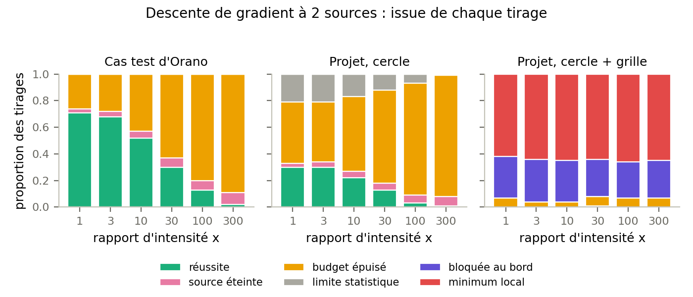

*Figure 12 – Issue de chaque descente, par cadre et par rapport d'intensité $x$ (100 tirages par barre).*

| Cadre (600 descentes) | réussite | budget épuisé | source éteinte | limite stat. | bord | min. local |
|---|---:|---:|---:|---:|---:|---:|
| cas test d'Orano | 236 | 329 | 35 | 0 | 0 | 0 |
| projet, cercle | 99 | 392 | 30 | 79 | 0 | 0 |
| projet, cercle + grille | 0 | 36 | 1 | 0 | 177 | 386 |

La figure 12 montre trois mécanismes différents :

- **Budget épuisé** (sur le cercle, 55 % des descentes du cas test d'Orano). La descente avance, mais trop lentement : à $x = 1$, 26 descentes sur 100 n'ont pas fini en 20 000 itérations ; à $x = 300$, 89 sur 100. Pour ces descentes, l'erreur de position médiane est encore de 3,2 à la fin. Même les descentes réussies prennent 10 900 itérations en médiane.
- **Source éteinte** (6 % des descentes sur le cercle, de 3 % à $x = 1$ à 9 % à $x = 300$). Quand une source est loin de sa cible, la descente fait baisser son intensité ; la projection sur $\mathbb R_+$ la met à 0. Or le gradient par rapport à la position d'une source est proportionnel à son intensité ($\partial \Phi / \partial z_i = I_i \nabla_z G$) : **une source d'intensité nulle ne bouge plus jamais**. C'est un piège propre à la paramétrisation $(z_i, I_i)$ avec projection.
- **Bloquée au bord et minimum local** (grille, 94 % des descentes). Avec la grille, la descente s'arrête vite (774 itérations en médiane) parce que le pas d'Armijo devient négligeable : elle est dans un minimum local dont la perte est en médiane 1 400 fois celle du bon minimum. Dans 30 % des cas, une source est même collée au bord de $D$.

### 7.4 Conditionnement


*Figure 13 – À gauche : conditionnement $\kappa$ de $J^\top J$ (critère d'Orano, paramètres normalisés) aux vraies sources, en fonction de $x$ ; droite de pente 2 en référence. À droite : itérations de la descente en fonction de $\kappa$, cas test d'Orano.*

Le nombre d'itérations d'une descente de gradient sur une cuvette quadratique est proportionnel au conditionnement $\kappa = \lambda_{\max} / \lambda_{\min}$ de la hessienne (ici $J^\top J$, $J$ jacobienne du résidu). La figure 13 montre la médiane de $\kappa$ aux vraies sources : $7 \cdot 10^3$ à $x = 1$, $8 \cdot 10^3$ à $x = 10$, $4{,}7 \cdot 10^4$ à $x = 30$, $4 \cdot 10^5$ à $x = 100$ et $3{,}6 \cdot 10^6$ à $x = 300$. **Pour $x \ge 10$, la pente en échelle log-log vaut 1,8**, proche du $\kappa \ge c x^2$ annoncé par Orano. L'explication est simple : la position de la source faible n'agit sur les mesures qu'à travers $I_2 \nabla G$, donc la colonne correspondante de $J$ est $x$ fois plus petite que celle de la source forte, et la valeur propre associée de $J^\top J$ est $x^2$ fois plus petite.

Le panneau de droite montre le lien directement : **le nombre d'itérations d'une descente réussie croît avec $\kappa$**, de 800 itérations pour $\kappa \approx 10^2$ à 20 000 pour $\kappa \approx 3 \cdot 10^3$ ; 90 % des descentes réussies ont $\kappa < 1{,}1 \cdot 10^4$, et au-delà presque toutes les descentes épuisent leur budget. Les sources éteintes, elles, apparaissent pour tous les $\kappa$ : c'est un autre mécanisme.

Avec $\kappa \approx 4 \cdot 10^5$ à $x = 100$, une descente de gradient demande de l'ordre de $\kappa$ itérations pour réduire l'erreur d'un facteur $e$ dans la direction la plus plate : **20 000 itérations ne peuvent pas suffire**. Gauss–Newton, qui résout le système $J^\top J \delta = -J^\top r$ à chaque pas, n'est pas sensible à $\kappa$ de la même manière : il converge en quelques dizaines d'itérations (11 à 34 ms).

Avec la grille, $\kappa$ est encore plus grand ($1{,}4 \cdot 10^5$ à $x = 1$, $10^7$ à $x = 300$) : les capteurs très proches d'une source rendent le critère extrêmement raide dans certaines directions.

### 7.5 Paysage de la perte

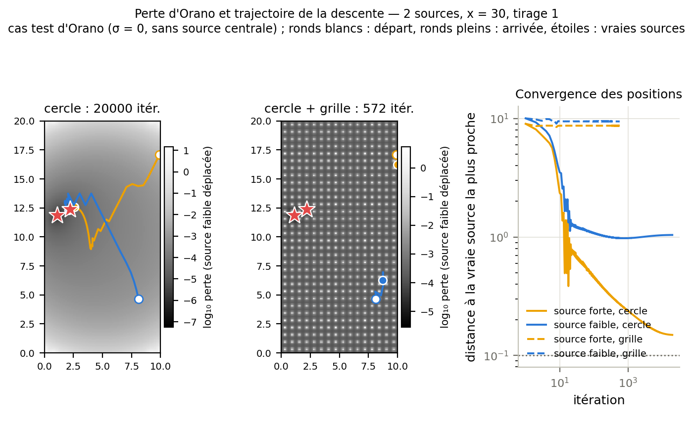

*Figure 14 – Perte d'Orano en fonction de la position de la source faible (l'autre source et les intensités à leur vraie valeur) et trajectoire de la descente, sur le cercle et sur cercle + grille ; cas test d'Orano, $x = 30$, tirage 1. À droite, distance de chaque source estimée à la vraie source la plus proche au fil des itérations.*

La figure 14 rend visibles les deux mécanismes. **Sur le cercle**, la perte vue depuis la source faible est une vallée large et très plate : la descente y entre vite, puis avance à petits pas, et la distance à la vraie source ne décroît que lentement au fil des itérations. Dans l'exemple tracé ($x = 30$, sources à 1,2 l'une de l'autre), la source forte arrive à 0,15 de sa cible, mais la source faible reste à 1 de la sienne après 20 000 itérations. **Avec la grille**, la carte est hérissée d'un pic sur chacun des 512 capteurs (la perte explose quand la source déplacée passe sur un capteur, à cause de la singularité en $1/r^2$), avec un plateau entre les pics. Le puits de la source faible est minuscule et invisible à cette échelle. La descente s'arrête au bout de 572 itérations, ses deux sources toujours à environ 9 de leurs cibles et l'une collée au bord droit : le pas d'Armijo est devenu négligeable sans que le gradient indique la direction des vraies sources.

### 7.6 Bassins d'attraction


*Figure 15 – Bassins d'attraction : issue de la descente selon la position de départ de la source 1 (la source 2 part toujours du même point), sur une grille de $12 \times 24$ départs ; croix : départs depuis lesquels Gauss–Newton échoue (il n'y en a aucun).*

Pour trois situations, j'ai relancé la descente depuis $12 \times 24 = 288$ positions de départ de la source 1, la source 2 partant toujours du même point (figure 15) :
- **cas test d'Orano, $x = 1$, tirage 1** (deux sources à 1,2 l'une de l'autre, $\kappa = 8{,}5 \cdot 10^6$) : la descente réussit depuis 32 départs sur 288 (11 %), toujours dans une bande étroite ; elle épuise son budget depuis 240 départs et éteint une source depuis 16 départs, tous près du bas du hangar ;
- **même tirage, $x = 30$** : la descente ne réussit depuis **aucun** départ (273 budgets épuisés, 15 sources éteintes) ;
- **cadre du projet, $x = 1$, tirage 7** (sources éloignées de 14,8, $\kappa = 2 \cdot 10^4$) : la descente réussit depuis 92 départs (32 %), tous dans la moitié basse du hangar, du côté de la source la plus proche de son départ fixe.

**Gauss–Newton réussit depuis les 288 départs dans les trois situations.** Il n'y a donc pas de mauvais minimum local dans ces cas : **depuis n'importe quel départ, il existe un chemin vers la bonne solution, et c'est la descente qui ne le parcourt pas assez vite**. Les zones « source éteinte » sont celles où une source part loin de toute vraie source et près du bord : la descente fait d'abord baisser son intensité pour réduire le résidu, la projection la met à 0, et elle ne bouge plus.

### 7.7 Distance entre les sources


*Figure 16 – Réussite en fonction de la distance entre les deux sources, cas test d'Orano, $x = 1$ et $x = 30$.*

Deux sources proches sont plus difficiles à séparer (figure 16). Dans le cas test d'Orano à $x = 1$, la descente réussit dans 1 cas sur 7 quand les sources sont à moins de 2 l'une de l'autre, 43 % entre 2 et 4, et environ 80 % au-delà de 4. À $x = 30$, elle ne réussit jamais quand les sources sont à moins de 4 l'une de l'autre, et dans 27 à 48 % des cas au-delà. Une source faible proche d'une source forte est « cachée » dans son signal : le gradient par rapport à sa position est minuscule devant celui de la source forte.

### 7.8 Temps

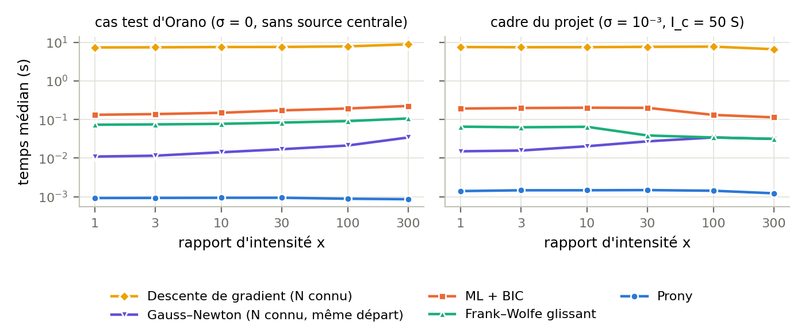

*Figure 17 – Temps de calcul médian par tirage en fonction de $x$.*

Dans le cas test d'Orano, les temps médians sont de 7,3 à 8,8 s pour la descente, 11 à 34 ms pour Gauss–Newton, 0,13 à 0,22 s pour ML + BIC, 73 à 106 ms pour le Frank–Wolfe et 1 ms pour Prony (figure 17). Gauss–Newton est donc 200 à 700 fois plus rapide que la descente, et réussit beaucoup plus souvent. Orano annonçait 59 ms pour Gauss–Newton et 10 à 25 ms pour « Prony + ML » : nos ordres de grandeur sont les mêmes.

### 7.9 Ce qu'il faut retenir du cas à deux sources

> **Bilan.** La descente de gradient d'Orano échoue pour deux raisons qui s'additionnent :
> 1. **une raison d'algorithme** : le pas de gradient ignore la courbure, alors que $\kappa$ croît comme $x^{1,8}$ ; le budget d'itérations est épuisé avant la convergence. Gauss–Newton, avec le même critère et le même départ, règle ce problème (100 % sans bruit jusqu'à $x = 100$) ;
> 2. **une raison de paramétrisation** : la projection des intensités sur $\mathbb R_+$ peut éteindre une source, qui ne bouge alors plus jamais.
>
> Avec la grille, s'y ajoute **une raison de critère** : la perte non pondérée a des minima locaux partout, que ni la descente ni Gauss–Newton ne peuvent éviter à partir d'un départ aléatoire. Il faut une bonne initialisation, ce que fait ML + BIC avec sa recherche sur grille.
>
> Dans le cadre bruité du projet sur le cercle, la limite n'est plus l'algorithme mais l'information : Gauss–Newton et ML + BIC sont à la limite statistique, et seule une meilleure géométrie des capteurs permet de faire mieux.

## 8. Anomalies et limites

- **Prony surestime le nombre de sources.** Avec le seuil de rang du projet (`rank_tol = 0.005`), Prony renvoie en moyenne 2,6 fausses sources à $N = 2$ et 1,4 à $N = 4$ dans le cadre par défaut, et 4,3 à 4,8 sources au lieu de 2 dans le cadre bruité à deux sources. Sans bruit (cas test d'Orano), c'est l'inverse : à $x$ grand, il ne voit souvent qu'une source (1,24 source en moyenne à $x = 300$), parce que la source faible passe sous le seuil. Le seuil fixe n'est adapté ni au bruit du projet ni aux grands rapports d'intensité ; je ne l'ai pas modifié, conformément à la consigne.
- **La descente a été retirée des balayages généraux**, à cause de sa lenteur (environ 6 h de calcul prévues, dont plus de 90 % pour elle). Elle n'apparaît que dans le cas à deux sources. Dans l'essai rapide (10 tirages), elle donnait déjà $E \approx 3{,}8$ avec la grille : elle s'y arrête dans un minimum local au bout de quelques centaines d'itérations.
- **ML + BIC utilise L-BFGS-B**, pas Gauss–Newton : la synthèse d'Orano parle de « Prony + ML » optimisé par Gauss–Newton ; le code du dépôt optimise la vraisemblance par L-BFGS-B. Les conclusions ne changent pas (même minimum), seuls les temps diffèrent.
- **Temps sous charge** : 8 processus sur 4 cœurs physiques (voir les durées). Les temps absolus sont surestimés d'un facteur 1,5 à 2 environ ; les rapports entre méthodes sont fiables.
- **Timeouts** : 3 (cercle) et 93 (cercle + grille, dont 88 pour ML + BIC) sur 14 400 calculs par disposition, comptés comme des échecs complets.
- **Échelle des figures** : l'axe des erreurs est en échelle log avec un plancher à $10^{-4}$ ; à $N = 2$ avec la grille et $\sigma = 10^{-4}$, la médiane de ML + BIC ($5{,}9 \cdot 10^{-5}$) est sous ce plancher et apparaît à $10^{-4}$.
- **Aucun bug évident** n'a été trouvé dans les méthodes : en particulier, le blanchiment du noyau du Frank–Wolfe (`sparse_sources/kernel.py`) est cohérent avec la conversion des intensités en unités physiques.
- **Compilation Typst** : la version Typst de ce compte rendu et le squelette `rapport/comparaison.typ` compilent sans erreur ni avertissement avec Typst 0.15.1.

## 9. Reproduire les résultats

```
python -m compare.run --all                 # comparaison complète (≈ 1 h 30 ici)
python -m compare.run --all --quick         # essai rapide, 10 tirages (≈ 15 min)
python -m compare.run --figures             # retracer figures, tableau et squelette depuis les CSV
python -m compare.run --all --methodes prony ml_bic fw descente   # avec la descente (≈ 6 h)
python -m compare.deux_sources --all        # cas à deux sources (≈ 2 h avec 2 processus)
python -m compare.annexe                    # annexe chiffrée (Typst et Markdown)
cd rapport && typst compile --root .. compte_rendu_comparaison.typ   # PDF du compte rendu
```

Options : `--n-trials` (100 par défaut), `--alpha`, `--beta` (0,75 et 0,25), `--timeout` (60 s), `--n-proc`. Les calculs reprennent où ils s'étaient arrêtés : `results/brut_<config>.csv` est écrit au fil de l'eau. Après avoir retracé les figures, recopier les PNG dans `rapport/images/` :

```
cp figures/comparaison/*.png figures/deux_sources/*.png rapport/images/
```

**Fichiers produits.**
- `results/brut_cercle.csv`, `results/brut_grille.csv` : une ligne par (point, tirage, méthode) ;
- `results/<balayage>_<config>.csv` : lignes de chaque balayage, avec $E$ ;
- `results/deux_sources/rapport.csv`, `bassins.csv`, `bassins_situations.json` ;
- `figures/comparaison/*.pdf|png`, `figures/deux_sources/*.pdf|png` ;
- `rapport/images/*.png` : toutes les images, dans un seul dossier ;
- `figures/comparaison/synthese.typ` : tableau de synthèse ;
- `rapport/comparaison.typ` (et `.pdf`) : squelette de la partie « Comparaison » ;
- `rapport/compte_rendu_comparaison.typ` (et `.pdf`) et ce fichier `rapport/compte_rendu_comparaison.md`.

---

<!-- ANNEXE : début (généré par python -m compare.annexe) -->

## Annexe : valeurs numériques des figures

Toutes les valeurs ci-dessous sont recalculées depuis results/ (sources estimées de chaque tirage dans results/sources/) par python -m compare.annexe ; ce sont exactement celles qui sont tracées.

Métrique (δ = 0,1) : les sources estimées, puis les vraies sources, sont fusionnées par regroupement hiérarchique à lien simple au seuil δ (intensité = somme, position = barycentre pondéré par les intensités) ; appariement hongrois ; E = (1/N') Σ (0,75 d_i + 0,25 r_i) sur les N' vraies sources fusionnées, d_i ≤ 5, r_i ≤ 1, source manquée = (5, 1) ; le nombre de sources estimé n'entre pas dans E. Masse parasite (à part) = somme des intensités des sources estimées non appariées / S. Agrégation : moyenne sur les 100 tirages et intervalle de confiance à 95 % par bootstrap (2 000 rééchantillonnages) ; la médiane est donnée à titre de comparaison, ainsi que la médiane de l'ancienne métrique (sans fusion, médiane). « N̂ = N » : proportion de tirages où le nombre brut de sources estimées vaut N. Médiane [Q1 ; Q3] : temps et conditionnement.

### A.1 Paramètres communs à toutes les figures

| Paramètre | Valeur |
|---|---|
| Hangar D | [0, 10] × [0, 20] |
| Centre c (source centrale) | (5, 10) |
| Cercle de capteurs | 64 capteurs, centre c, rayon √125 ≈ 11,18 |
| Grille de capteurs | 16 × 32 = 512 capteurs dans D (pas 0,625) |
| Somme des intensités S | 100 (intensités ~ S · Dirichlet(1, …, 1)) |
| Nombres de sources N | 2, 4, 6, 10 |
| Bruit relatif σ (balayage a) | 1·10⁻⁴ / 2,15·10⁻⁴ / 4,64·10⁻⁴ / 0,001 / 0,00215 / 0,00464 / 0,01 |
| I_c / S (balayage b) | 0 / 10 / 25 / 50 / 100 / 200 |
| Cadre par défaut | σ = 10⁻³, I_c = 50 S = 5 000 |
| Tirages par point | 100 (graine : (N, tirage, flux, 20261123)) |
| Erreur E | (1/N) Σ (α d_i + β r_i), α = 0,75, β = 0,25 |
| Plafonds (source manquée) | d = 5, r = 1 |
| Timeout | 60 s par tirage et par méthode ; les tirages arrêtés à 60 s ont été relancés une fois avec 300 s (4 processus) ; 300 s dans le cas à deux sources |
| Prony | seuil de rang rank_tol = 0,005 ; capteurs du cercle seulement |
| ML + BIC | L-BFGS-B, ajout glouton, k_max = 20 |
| Frank–Wolfe glissant | blanchi, noyau normalisé, λ = 1,5 √M, 40 itérations au plus |
| Descente d'Orano | 20 000 itérations au plus, Armijo c = 10⁻⁴, pas initial 10⁻², déplacement ≤ 5 % du domaine, intensités initiales S / N |
| Cas à deux sources | x = I₁ / I₂ ∈ {1, 3, 10, 30, 100, 300}, I₁ = S x / (x + 1), I₂ = S / (x + 1) ; réussite : N̂ = 2 et d_max < 0,1 |
| Cadres à deux sources | Orano : σ = 0, I_c = 0 ; projet : σ = 10⁻³, I_c = 50 S |
| Réussite d'Orano (synthèse) | 95 / 85 / 55 / 20 / 5 % pour x = 1 / 3 / 10 / 30 / 100 |

### A.2 Balayage en bruit (fig_balayages, ligne du haut)

I_c = 50 S.

#### Bruit — cercle

| N | σ | Méthode | E moyenne [IC 95 %] | E médiane | masse parasite [IC 95 %] | N̂ = N | E ancienne (médiane) |
|---:|---:|---|---:|---:|---:|---:|---:|
| 2 | 1·10⁻⁴ | Prony | 0,196 [0,0987 ; 0,311] | 0,017 | 0 [0 ; 0] | 92 % | 0,017 |
| 2 | 1·10⁻⁴ | ML + BIC | 0,0516 [0,0219 ; 0,0991] | 0,00927 | 3,92·10⁻⁵ [0 ; 1,18·10⁻⁴] | 98 % | 0,00927 |
| 2 | 1·10⁻⁴ | Frank–Wolfe | 0,123 [0,0665 ; 0,194] | 0,0301 | 1,25·10⁻⁵ [0 ; 3,75·10⁻⁵] | 97 % | 0,0301 |
| 2 | 2,15·10⁻⁴ | Prony | 0,289 [0,183 ; 0,408] | 0,0402 | 6,9·10⁻⁴ [1,99·10⁻⁴ ; 0,00135] | 64 % | 0,0402 |
| 2 | 2,15·10⁻⁴ | ML + BIC | 0,0978 [0,0474 ; 0,166] | 0,0198 | 8,18·10⁻⁵ [0 ; 2,45·10⁻⁴] | 97 % | 0,0198 |
| 2 | 2,15·10⁻⁴ | Frank–Wolfe | 0,235 [0,143 ; 0,332] | 0,0657 | 2,69·10⁻⁵ [0 ; 8,06·10⁻⁵] | 93 % | 0,0657 |
| 2 | 4,64·10⁻⁴ | Prony | 0,558 [0,408 ; 0,705] | 0,153 | 0,00569 [0,00145 ; 0,0128] | 33 % | 0,153 |
| 2 | 4,64·10⁻⁴ | ML + BIC | 0,206 [0,118 ; 0,305] | 0,0425 | 1,65·10⁻⁴ [0 ; 4,95·10⁻⁴] | 93 % | 0,0425 |
| 2 | 4,64·10⁻⁴ | Frank–Wolfe | 0,373 [0,263 ; 0,497] | 0,141 | 5,75·10⁻⁵ [0 ; 1,72·10⁻⁴] | 90 % | 0,141 |
| 2 | 0,001 | Prony | 0,792 [0,632 ; 0,958] | 0,453 | 0,0247 [0,00888 ; 0,0465] | 16 % | 0,453 |
| 2 | 0,001 | ML + BIC | 0,317 [0,209 ; 0,43] | 0,0932 | 3,15·10⁻⁴ [0 ; 9,45·10⁻⁴] | 92 % | 0,0932 |
| 2 | 0,001 | Frank–Wolfe | 0,63 [0,486 ; 0,774] | 0,302 | 1,22·10⁻⁴ [0 ; 3,66·10⁻⁴] | 82 % | 0,302 |
| 2 | 0,00215 | Prony | 1,18 [1 ; 1,36] | 0,986 | 0,0487 [0,0235 ; 0,0788] | 13 % | 0,986 |
| 2 | 0,00215 | ML + BIC | 0,606 [0,45 ; 0,759] | 0,212 | 5,59·10⁻⁴ [0 ; 0,00168] | 82 % | 0,212 |
| 2 | 0,00215 | Frank–Wolfe | 1,14 [0,966 ; 1,32] | 0,845 | 2,55·10⁻⁴ [0 ; 7,64·10⁻⁴] | 63 % | 0,845 |
| 2 | 0,00464 | Prony | 1,71 [1,51 ; 1,9] | 1,64 | 0,0598 [0,0312 ; 0,0936] | 9 % | 1,64 |
| 2 | 0,00464 | ML + BIC | 0,986 [0,807 ; 1,18] | 0,443 | 9,26·10⁻⁴ [0 ; 0,00278] | 67 % | 0,443 |
| 2 | 0,00464 | Frank–Wolfe | 1,66 [1,46 ; 1,85] | 2,03 | 5,14·10⁻⁴ [0 ; 0,00154] | 42 % | 2,03 |
| 2 | 0,01 | Prony | 2,08 [1,88 ; 2,27] | 2,14 | 0,0844 [0,0528 ; 0,121] | 6 % | 2,14 |
| 2 | 0,01 | ML + BIC | 1,54 [1,34 ; 1,75] | 2,05 | 0,00159 [0 ; 0,00476] | 44 % | 2,05 |
| 2 | 0,01 | Frank–Wolfe | 2,15 [1,98 ; 2,31] | 2,19 | 0 [0 ; 0] | 22 % | 2,19 |
| 4 | 1·10⁻⁴ | Prony | 1,27 [1,13 ; 1,4] | 1,23 | 0 [0 ; 0] | 18 % | 1,23 |
| 4 | 1·10⁻⁴ | ML + BIC | 0,592 [0,476 ; 0,71] | 0,314 | 0,0022 [0 ; 0,00586] | 66 % | 0,314 |
| 4 | 1·10⁻⁴ | Frank–Wolfe | 1,06 [0,947 ; 1,17] | 1,13 | 0,042 [0,023 ; 0,0649] | 29 % | 1,13 |
| 4 | 2,15·10⁻⁴ | Prony | 1,33 [1,18 ; 1,47] | 1,23 | 3,11·10⁻⁵ [5,79·10⁻⁶ ; 6,51·10⁻⁵] | 28 % | 1,23 |
| 4 | 2,15·10⁻⁴ | ML + BIC | 0,793 [0,67 ; 0,918] | 1,02 | 0 [0 ; 0] | 52 % | 1,02 |
| 4 | 2,15·10⁻⁴ | Frank–Wolfe | 1,24 [1,12 ; 1,35] | 1,21 | 0,0323 [0,0148 ; 0,0533] | 28 % | 1,21 |
| 4 | 4,64·10⁻⁴ | Prony | 1,52 [1,36 ; 1,66] | 1,39 | 0,00119 [5,56·10⁻⁴ ; 0,00201] | 22 % | 1,39 |
| 4 | 4,64·10⁻⁴ | ML + BIC | 1,06 [0,92 ; 1,2] | 1,13 | 0 [0 ; 0] | 38 % | 1,13 |
| 4 | 4,64·10⁻⁴ | Frank–Wolfe | 1,48 [1,36 ; 1,61] | 1,36 | 0,017 [0,00492 ; 0,0322] | 22 % | 1,36 |
| 4 | 0,001 | Prony | 1,83 [1,68 ; 1,97] | 1,84 | 0,00337 [0,00151 ; 0,00621] | 19 % | 1,84 |
| 4 | 0,001 | ML + BIC | 1,3 [1,17 ; 1,45] | 1,24 | 0 [0 ; 0] | 23 % | 1,24 |
| 4 | 0,001 | Frank–Wolfe | 1,81 [1,68 ; 1,95] | 1,75 | 0,00352 [0 ; 0,0106] | 17 % | 1,75 |
| 4 | 0,00215 | Prony | 2,22 [2,07 ; 2,37] | 2,26 | 0,0059 [0,00293 ; 0,0101] | 18 % | 2,26 |
| 4 | 0,00215 | ML + BIC | 1,66 [1,52 ; 1,81] | 1,5 | 0 [0 ; 0] | 13 % | 1,5 |
| 4 | 0,00215 | Frank–Wolfe | 2,13 [2 ; 2,27] | 2,17 | 0 [0 ; 0] | 8 % | 2,17 |
| 4 | 0,00464 | Prony | 2,41 [2,28 ; 2,54] | 2,38 | 0,0316 [0,0166 ; 0,05] | 13 % | 2,38 |
| 4 | 0,00464 | ML + BIC | 2,1 [1,97 ; 2,23] | 2,19 | 0 [0 ; 0] | 3 % | 2,19 |
| 4 | 0,00464 | Frank–Wolfe | 2,46 [2,33 ; 2,57] | 2,4 | 0 [0 ; 0] | 3 % | 2,4 |
| 4 | 0,01 | Prony | 2,65 [2,52 ; 2,78] | 2,65 | 0,024 [0,0107 ; 0,0413] | 13 % | 2,65 |
| 4 | 0,01 | ML + BIC | 2,43 [2,3 ; 2,55] | 2,34 | 0 [0 ; 0] | 0 % | 2,34 |
| 4 | 0,01 | Frank–Wolfe | 2,83 [2,73 ; 2,93] | 2,85 | 0 [0 ; 0] | 0 % | 2,85 |
| 6 | 1·10⁻⁴ | Prony | 1,95 [1,84 ; 2,07] | 2,01 | 0 [0 ; 0] | 0 % | 2,01 |
| 6 | 1·10⁻⁴ | ML + BIC | 1,14 [1,04 ; 1,25] | 1,08 | 0 [0 ; 0] | 18 % | 1,08 |
| 6 | 1·10⁻⁴ | Frank–Wolfe | 1,56 [1,47 ; 1,66] | 1,6 | 0,0091 [0,00344 ; 0,0159] | 16 % | 1,6 |
| 6 | 2,15·10⁻⁴ | Prony | 1,95 [1,84 ; 2,07] | 1,93 | 2,03·10⁻⁶ [0 ; 6,1·10⁻⁶] | 2 % | 1,93 |
| 6 | 2,15·10⁻⁴ | ML + BIC | 1,35 [1,25 ; 1,46] | 1,48 | 0 [0 ; 0] | 11 % | 1,48 |
| 6 | 2,15·10⁻⁴ | Frank–Wolfe | 1,75 [1,67 ; 1,85] | 1,74 | 0,00621 [0,001 ; 0,0134] | 10 % | 1,74 |
| 6 | 4,64·10⁻⁴ | Prony | 2,2 [2,09 ; 2,31] | 2,2 | 0,00286 [3,73·10⁻⁵ ; 0,00842] | 21 % | 2,2 |
| 6 | 4,64·10⁻⁴ | ML + BIC | 1,62 [1,51 ; 1,72] | 1,62 | 0 [0 ; 0] | 6 % | 1,62 |
| 6 | 4,64·10⁻⁴ | Frank–Wolfe | 1,98 [1,88 ; 2,08] | 1,95 | 0,00332 [0 ; 0,00988] | 6 % | 1,95 |
| 6 | 0,001 | Prony | 2,34 [2,25 ; 2,45] | 2,36 | 5,22·10⁻⁴ [2,26·10⁻⁴ ; 8,8·10⁻⁴] | 20 % | 2,36 |
| 6 | 0,001 | ML + BIC | 1,91 [1,8 ; 2,03] | 1,85 | 0 [0 ; 0] | 0 % | 1,85 |
| 6 | 0,001 | Frank–Wolfe | 2,25 [2,15 ; 2,34] | 2,22 | 0 [0 ; 0] | 1 % | 2,22 |
| 6 | 0,00215 | Prony | 2,55 [2,45 ; 2,66] | 2,57 | 0,00379 [6,04·10⁻⁴ ; 0,00834] | 26 % | 2,57 |
| 6 | 0,00215 | ML + BIC | 2,22 [2,12 ; 2,32] | 2,26 | 0 [0 ; 0] | 0 % | 2,26 |
| 6 | 0,00215 | Frank–Wolfe | 2,57 [2,48 ; 2,65] | 2,54 | 0 [0 ; 0] | 0 % | 2,54 |
| 6 | 0,00464 | Prony | 2,81 [2,7 ; 2,93] | 2,87 | 0,00254 [9,89·10⁻⁴ ; 0,00478] | 26 % | 2,87 |
| 6 | 0,00464 | ML + BIC | 2,62 [2,52 ; 2,71] | 2,73 | 0 [0 ; 0] | 0 % | 2,73 |
| 6 | 0,00464 | Frank–Wolfe | 2,96 [2,88 ; 3,05] | 3 | 0 [0 ; 0] | 0 % | 3 |
| 6 | 0,01 | Prony | 2,99 [2,9 ; 3,08] | 2,98 | 0,00259 [0,00134 ; 0,00413] | 21 % | 2,98 |
| 6 | 0,01 | ML + BIC | 2,88 [2,79 ; 2,97] | 2,97 | 0 [0 ; 0] | 0 % | 2,97 |
| 6 | 0,01 | Frank–Wolfe | 3,27 [3,2 ; 3,34] | 3,32 | 0 [0 ; 0] | 0 % | 3,32 |
| 10 | 1·10⁻⁴ | Prony | 2,61 [2,55 ; 2,68] | 2,63 | 0 [0 ; 0] | 0 % | 2,63 |
| 10 | 1·10⁻⁴ | ML + BIC | 1,89 [1,8 ; 1,97] | 1,87 | 0 [0 ; 0] | 0 % | 1,87 |
| 10 | 1·10⁻⁴ | Frank–Wolfe | 2,14 [2,06 ; 2,21] | 2,14 | 4,67·10⁻⁶ [0 ; 1,4·10⁻⁵] | 3 % | 2,14 |
| 10 | 2,15·10⁻⁴ | Prony | 2,6 [2,53 ; 2,67] | 2,62 | 0 [0 ; 0] | 0 % | 2,62 |
| 10 | 2,15·10⁻⁴ | ML + BIC | 2,1 [2,02 ; 2,18] | 2,11 | 0 [0 ; 0] | 0 % | 2,11 |
| 10 | 2,15·10⁻⁴ | Frank–Wolfe | 2,33 [2,25 ; 2,41] | 2,36 | 0 [0 ; 0] | 0 % | 2,36 |
| 10 | 4,64·10⁻⁴ | Prony | 2,63 [2,56 ; 2,69] | 2,64 | 0 [0 ; 0] | 1 % | 2,64 |
| 10 | 4,64·10⁻⁴ | ML + BIC | 2,32 [2,25 ; 2,4] | 2,32 | 0 [0 ; 0] | 0 % | 2,32 |
| 10 | 4,64·10⁻⁴ | Frank–Wolfe | 2,52 [2,45 ; 2,6] | 2,56 | 0 [0 ; 0] | 0 % | 2,56 |
| 10 | 0,001 | Prony | 2,74 [2,67 ; 2,81] | 2,71 | 0 [0 ; 0] | 2 % | 2,71 |
| 10 | 0,001 | ML + BIC | 2,52 [2,44 ; 2,59] | 2,59 | 0 [0 ; 0] | 0 % | 2,59 |
| 10 | 0,001 | Frank–Wolfe | 2,76 [2,69 ; 2,84] | 2,76 | 0 [0 ; 0] | 0 % | 2,76 |
| 10 | 0,00215 | Prony | 2,92 [2,85 ; 3] | 2,9 | 0 [0 ; 0] | 5 % | 2,9 |
| 10 | 0,00215 | ML + BIC | 2,76 [2,7 ; 2,83] | 2,71 | 0 [0 ; 0] | 0 % | 2,71 |
| 10 | 0,00215 | Frank–Wolfe | 2,97 [2,91 ; 3,03] | 3 | 0 [0 ; 0] | 0 % | 3 |
| 10 | 0,00464 | Prony | 3,09 [3,03 ; 3,16] | 3,07 | 1,05·10⁻⁷ [0 ; 3,15·10⁻⁷] | 3 % | 3,07 |
| 10 | 0,00464 | ML + BIC | 2,97 [2,9 ; 3,03] | 3 | 0 [0 ; 0] | 0 % | 3 |
| 10 | 0,00464 | Frank–Wolfe | 3,25 [3,19 ; 3,31] | 3,3 | 0 [0 ; 0] | 0 % | 3,3 |
| 10 | 0,01 | Prony | 3,22 [3,16 ; 3,29] | 3,2 | 4,31·10⁻⁷ [0 ; 1,24·10⁻⁶] | 1 % | 3,2 |
| 10 | 0,01 | ML + BIC | 3,21 [3,14 ; 3,27] | 3,28 | 0 [0 ; 0] | 0 % | 3,28 |
| 10 | 0,01 | Frank–Wolfe | 3,49 [3,45 ; 3,54] | 3,45 | 0 [0 ; 0] | 0 % | 3,45 |

#### Bruit — cercle + grille

| N | σ | Méthode | E moyenne [IC 95 %] | E médiane | masse parasite [IC 95 %] | N̂ = N | E ancienne (médiane) |
|---:|---:|---|---:|---:|---:|---:|---:|
| 2 | 1·10⁻⁴ | Prony | 0,196 [0,0987 ; 0,311] | 0,017 | 0 [0 ; 0] | 92 % | 0,017 |
| 2 | 1·10⁻⁴ | ML + BIC | 1,29·10⁻⁴ [7,92·10⁻⁵ ; 2·10⁻⁴] | 5,92·10⁻⁵ | 0 [0 ; 0] | 100 % | 5,92·10⁻⁵ |
| 2 | 1·10⁻⁴ | Frank–Wolfe | 4,97·10⁻⁴ [2,5·10⁻⁴ ; 8,15·10⁻⁴] | 9,54·10⁻⁵ | 1,49·10⁻⁴ [4,17·10⁻⁵ ; 2,84·10⁻⁴] | 84 % | 9,84·10⁻⁵ |
| 2 | 2,15·10⁻⁴ | Prony | 0,289 [0,183 ; 0,408] | 0,0402 | 6,9·10⁻⁴ [1,99·10⁻⁴ ; 0,00135] | 64 % | 0,0402 |
| 2 | 2,15·10⁻⁴ | ML + BIC | 2,8·10⁻⁴ [1,7·10⁻⁴ ; 4,38·10⁻⁴] | 1,27·10⁻⁴ | 0 [0 ; 0] | 100 % | 1,27·10⁻⁴ |
| 2 | 2,15·10⁻⁴ | Frank–Wolfe | 0,00149 [6,44·10⁻⁴ ; 0,00267] | 2,06·10⁻⁴ | 0,00108 [1,37·10⁻⁴ ; 0,00278] | 83 % | 2,19·10⁻⁴ |
| 2 | 4,64·10⁻⁴ | Prony | 0,558 [0,408 ; 0,705] | 0,153 | 0,00569 [0,00145 ; 0,0128] | 33 % | 0,153 |
| 2 | 4,64·10⁻⁴ | ML + BIC | 6,24·10⁻⁴ [3,67·10⁻⁴ ; 0,00101] | 2,74·10⁻⁴ | 0 [0 ; 0] | 100 % | 2,74·10⁻⁴ |
| 2 | 4,64·10⁻⁴ | Frank–Wolfe | 0,00288 [0,00133 ; 0,00478] | 4,37·10⁻⁴ | 0,00101 [1,34·10⁻⁴ ; 0,00243] | 84 % | 4,56·10⁻⁴ |
| 2 | 0,001 | Prony | 0,792 [0,632 ; 0,958] | 0,453 | 0,0247 [0,00888 ; 0,0465] | 16 % | 0,453 |
| 2 | 0,001 | ML + BIC | 0,00161 [7,97·10⁻⁴ ; 0,0029] | 5,9·10⁻⁴ | 0 [0 ; 0] | 100 % | 5,9·10⁻⁴ |
| 2 | 0,001 | Frank–Wolfe | 0,00687 [0,00335 ; 0,0116] | 9,38·10⁻⁴ | 0,00157 [1,68·10⁻⁴ ; 0,00387] | 89 % | 9,97·10⁻⁴ |
| 2 | 0,00215 | Prony | 1,18 [1 ; 1,36] | 0,986 | 0,0487 [0,0235 ; 0,0788] | 13 % | 0,986 |
| 2 | 0,00215 | ML + BIC | 0,00387 [0,00184 ; 0,00641] | 0,00127 | 0 [0 ; 0] | 100 % | 0,00127 |
| 2 | 0,00215 | Frank–Wolfe | 0,0478 [0,00632 ; 0,109] | 0,00198 | 0,00227 [2,77·10⁻⁴ ; 0,00548] | 88 % | 0,00217 |
| 2 | 0,00464 | Prony | 1,71 [1,51 ; 1,9] | 1,64 | 0,0598 [0,0312 ; 0,0936] | 9 % | 1,64 |
| 2 | 0,00464 | ML + BIC | 0,0066 [0,00386 ; 0,00984] | 0,00274 | 0 [0 ; 0] | 100 % | 0,00274 |
| 2 | 0,00464 | Frank–Wolfe | 0,148 [0,0499 ; 0,251] | 0,00428 | 0,00462 [9,97·10⁻⁴ ; 0,00941] | 82 % | 0,00449 |
| 2 | 0,01 | Prony | 2,08 [1,88 ; 2,27] | 2,14 | 0,0844 [0,0528 ; 0,121] | 6 % | 2,14 |
| 2 | 0,01 | ML + BIC | 0,0119 [0,00812 ; 0,0165] | 0,00595 | 0 [0 ; 0] | 100 % | 0,00595 |
| 2 | 0,01 | Frank–Wolfe | 0,294 [0,172 ; 0,435] | 0,00957 | 0,00203 [1,04·10⁻⁵ ; 0,00502] | 81 % | 0,00957 |
| 4 | 1·10⁻⁴ | Prony | 1,27 [1,13 ; 1,4] | 1,23 | 0 [0 ; 0] | 18 % | 1,23 |
| 4 | 1·10⁻⁴ | ML + BIC | 0,0108 [2,7·10⁻⁴ ; 0,0313] | 1,52·10⁻⁴ | 1,13·10⁻⁵ [1,26·10⁻²⁰ ; 3,4·10⁻⁵] | 95 % | 1,52·10⁻⁴ |
| 4 | 1·10⁻⁴ | Frank–Wolfe | 0,0252 [0,00376 ; 0,056] | 6,42·10⁻⁴ | 0,00201 [4,85·10⁻⁴ ; 0,00439] | 47 % | 8,39·10⁻⁴ |
| 4 | 2,15·10⁻⁴ | Prony | 1,33 [1,18 ; 1,47] | 1,23 | 3,11·10⁻⁵ [5,79·10⁻⁶ ; 6,51·10⁻⁵] | 28 % | 1,23 |
| 4 | 2,15·10⁻⁴ | ML + BIC | 0,021 [5,81·10⁻⁴ ; 0,0512] | 3,28·10⁻⁴ | 2,44·10⁻⁵ [2,63·10⁻²⁰ ; 7,31·10⁻⁵] | 94 % | 3,28·10⁻⁴ |
| 4 | 2,15·10⁻⁴ | Frank–Wolfe | 0,0379 [0,00783 ; 0,0766] | 0,00136 | 0,003 [0,00104 ; 0,00615] | 47 % | 0,00175 |
| 4 | 4,64·10⁻⁴ | Prony | 1,52 [1,36 ; 1,66] | 1,39 | 0,00119 [5,56·10⁻⁴ ; 0,00201] | 22 % | 1,39 |
| 4 | 4,64·10⁻⁴ | ML + BIC | 0,0222 [0,00125 ; 0,0524] | 7,07·10⁻⁴ | 5,24·10⁻⁵ [5,3·10⁻²⁰ ; 1,57·10⁻⁴] | 94 % | 7,07·10⁻⁴ |
| 4 | 4,64·10⁻⁴ | Frank–Wolfe | 0,0518 [0,0191 ; 0,0926] | 0,00294 | 0,00222 [0,00122 ; 0,00351] | 52 % | 0,00371 |
| 4 | 0,001 | Prony | 1,83 [1,68 ; 1,97] | 1,84 | 0,00337 [0,00151 ; 0,00621] | 19 % | 1,84 |
| 4 | 0,001 | ML + BIC | 0,0332 [0,00305 ; 0,073] | 0,00153 | 1,12·10⁻⁴ [9,85·10⁻²⁰ ; 3,37·10⁻⁴] | 93 % | 0,00153 |
| 4 | 0,001 | Frank–Wolfe | 0,0775 [0,0354 ; 0,127] | 0,00624 | 0,00456 [0,00233 ; 0,00715] | 57 % | 0,00796 |
| 4 | 0,00215 | Prony | 2,22 [2,07 ; 2,37] | 2,26 | 0,0059 [0,00293 ; 0,0101] | 18 % | 2,26 |
| 4 | 0,00215 | ML + BIC | 0,0367 [0,00656 ; 0,0763] | 0,00322 | 7,22·10⁻⁵ [0 ; 1,97·10⁻⁴] | 94 % | 0,00322 |
| 4 | 0,00215 | Frank–Wolfe | 0,136 [0,0763 ; 0,208] | 0,0149 | 0,0105 [0,00611 ; 0,0155] | 54 % | 0,0181 |
| 4 | 0,00464 | Prony | 2,41 [2,28 ; 2,54] | 2,38 | 0,0316 [0,0166 ; 0,05] | 13 % | 2,38 |
| 4 | 0,00464 | ML + BIC | 0,075 [0,0336 ; 0,126] | 0,00687 | 1,81·10⁻⁴ [0 ; 5,29·10⁻⁴] | 91 % | 0,00687 |
| 4 | 0,00464 | Frank–Wolfe | 0,372 [0,274 ; 0,481] | 0,0346 | 0,00834 [0,00406 ; 0,0136] | 49 % | 0,0362 |
| 4 | 0,01 | Prony | 2,65 [2,52 ; 2,78] | 2,65 | 0,024 [0,0107 ; 0,0413] | 13 % | 2,65 |
| 4 | 0,01 | ML + BIC | 0,152 [0,0881 ; 0,227] | 0,0153 | 1·10⁻⁴ [0 ; 3,01·10⁻⁴] | 87 % | 0,0153 |
| 4 | 0,01 | Frank–Wolfe | 0,659 [0,533 ; 0,795] | 0,726 | 0,00602 [0,00177 ; 0,0115] | 46 % | 0,726 |
| 6 | 1·10⁻⁴ | Prony | 1,95 [1,84 ; 2,07] | 2,01 | 0 [0 ; 0] | 0 % | 2,01 |
| 6 | 1·10⁻⁴ | ML + BIC | 6,38·10⁻⁴ [4,7·10⁻⁴ ; 8,45·10⁻⁴] | 3,19·10⁻⁴ | 2,38·10⁻⁶ [0 ; 6,67·10⁻⁶] | 98 % | 3,19·10⁻⁴ |
| 6 | 1·10⁻⁴ | Frank–Wolfe | 0,0133 [0,0059 ; 0,027] | 0,00262 | 0,00257 [0,00106 ; 0,0045] | 22 % | 0,00422 |
| 6 | 2,15·10⁻⁴ | Prony | 1,95 [1,84 ; 2,07] | 1,93 | 2,03·10⁻⁶ [0 ; 6,1·10⁻⁶] | 2 % | 1,93 |
| 6 | 2,15·10⁻⁴ | ML + BIC | 0,0016 [0,00106 ; 0,00234] | 6,9·10⁻⁴ | 5,13·10⁻⁶ [0 ; 1,44·10⁻⁵] | 98 % | 6,9·10⁻⁴ |
| 6 | 2,15·10⁻⁴ | Frank–Wolfe | 0,0207 [0,0113 ; 0,0351] | 0,00618 | 0,00674 [0,00327 ; 0,0112] | 27 % | 0,00771 |
| 6 | 4,64·10⁻⁴ | Prony | 2,2 [2,09 ; 2,31] | 2,2 | 0,00286 [3,73·10⁻⁵ ; 0,00842] | 21 % | 2,2 |
| 6 | 4,64·10⁻⁴ | ML + BIC | 0,00959 [0,00226 ; 0,024] | 0,0015 | 1,11·10⁻⁵ [0 ; 3,09·10⁻⁵] | 97 % | 0,0015 |
| 6 | 4,64·10⁻⁴ | Frank–Wolfe | 0,0394 [0,0205 ; 0,0632] | 0,0121 | 0,00918 [0,00509 ; 0,0143] | 28 % | 0,015 |
| 6 | 0,001 | Prony | 2,34 [2,25 ; 2,45] | 2,36 | 5,22·10⁻⁴ [2,26·10⁻⁴ ; 8,8·10⁻⁴] | 20 % | 2,36 |
| 6 | 0,001 | ML + BIC | 0,0324 [0,0115 ; 0,0599] | 0,00328 | 5,76·10⁻⁵ [0 ; 1,44·10⁻⁴] | 93 % | 0,00328 |
| 6 | 0,001 | Frank–Wolfe | 0,117 [0,078 ; 0,159] | 0,0253 | 0,0111 [0,00693 ; 0,0162] | 27 % | 0,0263 |
| 6 | 0,00215 | Prony | 2,55 [2,45 ; 2,66] | 2,57 | 0,00379 [6,04·10⁻⁴ ; 0,00834] | 26 % | 2,57 |
| 6 | 0,00215 | ML + BIC | 0,0451 [0,0181 ; 0,0777] | 0,00703 | 8,74·10⁻⁵ [0 ; 2,06·10⁻⁴] | 92 % | 0,00703 |
| 6 | 0,00215 | Frank–Wolfe | 0,283 [0,217 ; 0,352] | 0,0584 | 0,0156 [0,0089 ; 0,025] | 34 % | 0,0584 |
| 6 | 0,00464 | Prony | 2,81 [2,7 ; 2,93] | 2,87 | 0,00254 [9,89·10⁻⁴ ; 0,00478] | 26 % | 2,87 |
| 6 | 0,00464 | ML + BIC | 0,116 [0,0741 ; 0,164] | 0,015 | 8,71·10⁻⁵ [0 ; 2,61·10⁻⁴] | 86 % | 0,015 |
| 6 | 0,00464 | Frank–Wolfe | 0,466 [0,389 ; 0,544] | 0,575 | 0,0138 [0,00709 ; 0,0233] | 37 % | 0,567 |
| 6 | 0,01 | Prony | 2,99 [2,9 ; 3,08] | 2,98 | 0,00259 [0,00134 ; 0,00413] | 21 % | 2,98 |
| 6 | 0,01 | ML + BIC | 0,249 [0,186 ; 0,317] | 0,042 | 1,08·10⁻⁴ [0 ; 3,25·10⁻⁴] | 71 % | 0,042 |
| 6 | 0,01 | Frank–Wolfe | 0,894 [0,797 ; 0,989] | 0,747 | 0,00434 [0,00161 ; 0,00781] | 24 % | 0,747 |
| 10 | 1·10⁻⁴ | Prony | 2,61 [2,55 ; 2,68] | 2,63 | 0 [0 ; 0] | 0 % | 2,63 |
| 10 | 1·10⁻⁴ | ML + BIC | 0,0164 [0,00476 ; 0,0317] | 6,19·10⁻⁴ | 2,27·10⁻⁴ [2,24·10⁻¹⁶ ; 5,75·10⁻⁴] | 94 % | 6,19·10⁻⁴ |
| 10 | 1·10⁻⁴ | Frank–Wolfe | 0,0302 [0,0187 ; 0,0442] | 0,00896 | 0,012 [0,00759 ; 0,0169] | 8 % | 0,0118 |
| 10 | 2,15·10⁻⁴ | Prony | 2,6 [2,53 ; 2,67] | 2,62 | 0 [0 ; 0] | 0 % | 2,62 |
| 10 | 2,15·10⁻⁴ | ML + BIC | 0,0178 [0,00659 ; 0,0331] | 0,00129 | 1,22·10⁻⁴ [0 ; 3,65·10⁻⁴] | 95 % | 0,00129 |
| 10 | 2,15·10⁻⁴ | Frank–Wolfe | 0,0574 [0,038 ; 0,0793] | 0,0184 | 0,0166 [0,0105 ; 0,024] | 10 % | 0,0201 |
| 10 | 4,64·10⁻⁴ | Prony | 2,63 [2,56 ; 2,69] | 2,64 | 0 [0 ; 0] | 1 % | 2,64 |
| 10 | 4,64·10⁻⁴ | ML + BIC | 0,0279 [0,0126 ; 0,0459] | 0,00286 | 6,81·10⁻⁴ [0 ; 0,00192] | 93 % | 0,00286 |
| 10 | 4,64·10⁻⁴ | Frank–Wolfe | 0,0852 [0,0607 ; 0,113] | 0,0342 | 0,0222 [0,0146 ; 0,0316] | 17 % | 0,0349 |
| 10 | 0,001 | Prony | 2,74 [2,67 ; 2,81] | 2,71 | 0 [0 ; 0] | 2 % | 2,71 |
| 10 | 0,001 | ML + BIC | 0,0539 [0,0331 ; 0,0771] | 0,00654 | 7,1·10⁻⁴ [4,04·10⁻⁵ ; 0,00178] | 85 % | 0,00654 |
| 10 | 0,001 | Frank–Wolfe | 0,172 [0,135 ; 0,211] | 0,0678 | 0,0222 [0,014 ; 0,0329] | 21 % | 0,068 |
| 10 | 0,00215 | Prony | 2,92 [2,85 ; 3] | 2,9 | 0 [0 ; 0] | 5 % | 2,9 |
| 10 | 0,00215 | ML + BIC | 0,087 [0,0585 ; 0,117] | 0,0151 | 1,9·10⁻⁴ [0 ; 4,76·10⁻⁴] | 81 % | 0,0151 |
| 10 | 0,00215 | Frank–Wolfe | 0,295 [0,245 ; 0,347] | 0,246 | 0,0171 [0,0114 ; 0,0231] | 30 % | 0,246 |
| 10 | 0,00464 | Prony | 3,09 [3,03 ; 3,16] | 3,07 | 1,05·10⁻⁷ [0 ; 3,15·10⁻⁷] | 3 % | 3,07 |
| 10 | 0,00464 | ML + BIC | 0,154 [0,118 ; 0,192] | 0,0336 | 7,81·10⁻⁵ [0 ; 2,34·10⁻⁴] | 69 % | 0,0336 |
| 10 | 0,00464 | Frank–Wolfe | 0,639 [0,565 ; 0,714] | 0,584 | 0,00736 [0,00415 ; 0,0112] | 24 % | 0,584 |
| 10 | 0,01 | Prony | 3,22 [3,16 ; 3,29] | 3,2 | 4,31·10⁻⁷ [0 ; 1,24·10⁻⁶] | 1 % | 3,2 |
| 10 | 0,01 | ML + BIC | 0,276 [0,224 ; 0,332] | 0,0949 | 2,59·10⁻⁵ [0 ; 7,77·10⁻⁵] | 57 % | 0,0949 |
| 10 | 0,01 | Frank–Wolfe | 1,15 [1,07 ; 1,24] | 1,12 | 0 [0 ; 0] | 15 % | 1,13 |

### A.3 Balayage en source centrale (fig_balayages, ligne du bas)

σ = 10⁻³.

#### Source centrale — cercle

| N | I_c / S | Méthode | E moyenne [IC 95 %] | E médiane | masse parasite [IC 95 %] | N̂ = N | E ancienne (médiane) |
|---:|---:|---|---:|---:|---:|---:|---:|
| 2 | 0 | Prony | 0,178 [0,0789 ; 0,295] | 0,00667 | 0 [0 ; 0] | 92 % | 0,00667 |
| 2 | 0 | ML + BIC | 0,0316 [0,00823 ; 0,0749] | 0,00307 | 0 [0 ; 0] | 99 % | 0,00307 |
| 2 | 0 | Frank–Wolfe | 0,0413 [0,0158 ; 0,087] | 0,00671 | 0 [0 ; 0] | 99 % | 0,00671 |
| 2 | 10 | Prony | 0,278 [0,174 ; 0,393] | 0,0473 | 5,8·10⁻⁴ [1,37·10⁻⁴ ; 0,00127] | 62 % | 0,0473 |
| 2 | 10 | ML + BIC | 0,124 [0,0541 ; 0,211] | 0,0212 | 8,26·10⁻⁵ [0 ; 2,48·10⁻⁴] | 97 % | 0,0212 |
| 2 | 10 | Frank–Wolfe | 0,228 [0,138 ; 0,325] | 0,0652 | 0 [0 ; 0] | 94 % | 0,0652 |
| 2 | 25 | Prony | 0,626 [0,462 ; 0,793] | 0,183 | 0,0084 [0,00163 ; 0,0198] | 32 % | 0,183 |
| 2 | 25 | ML + BIC | 0,214 [0,126 ; 0,315] | 0,0468 | 1,79·10⁻⁴ [0 ; 5,38·10⁻⁴] | 93 % | 0,0468 |
| 2 | 25 | Frank–Wolfe | 0,388 [0,276 ; 0,512] | 0,157 | 0 [0 ; 0] | 91 % | 0,157 |
| 2 | 50 | Prony | 0,792 [0,632 ; 0,958] | 0,453 | 0,0247 [0,00888 ; 0,0465] | 16 % | 0,453 |
| 2 | 50 | ML + BIC | 0,317 [0,209 ; 0,43] | 0,0932 | 3,15·10⁻⁴ [0 ; 9,45·10⁻⁴] | 92 % | 0,0932 |
| 2 | 50 | Frank–Wolfe | 0,63 [0,486 ; 0,774] | 0,302 | 1,22·10⁻⁴ [0 ; 3,66·10⁻⁴] | 82 % | 0,302 |
| 2 | 100 | Prony | 1,19 [1,01 ; 1,38] | 0,982 | 0,0518 [0,0255 ; 0,084] | 12 % | 0,982 |
| 2 | 100 | ML + BIC | 0,589 [0,433 ; 0,744] | 0,194 | 5,28·10⁻⁴ [0 ; 0,00158] | 82 % | 0,194 |
| 2 | 100 | Frank–Wolfe | 1,08 [0,907 ; 1,25] | 0,772 | 4,48·10⁻⁴ [0 ; 0,00134] | 65 % | 0,772 |
| 2 | 200 | Prony | 1,59 [1,4 ; 1,8] | 1,41 | 0,0487 [0,0238 ; 0,0788] | 7 % | 1,41 |
| 2 | 200 | ML + BIC | 0,88 [0,708 ; 1,07] | 0,375 | 8,4·10⁻⁴ [0 ; 0,00252] | 72 % | 0,375 |
| 2 | 200 | Frank–Wolfe | 1,54 [1,36 ; 1,72] | 2,01 | 0,00104 [0 ; 0,00312] | 48 % | 2,01 |
| 4 | 0 | Prony | 1,28 [1,13 ; 1,41] | 1,23 | 0 [0 ; 0] | 17 % | 1,23 |
| 4 | 0 | ML + BIC | 0,301 [0,213 ; 0,394] | 0,0543 | 0,00208 [5,91·10⁻⁷ ; 0,00624] | 84 % | 0,0543 |
| 4 | 0 | Frank–Wolfe | 0,79 [0,691 ; 0,884] | 0,788 | 0,0383 [0,0219 ; 0,0563] | 33 % | 0,788 |
| 4 | 10 | Prony | 1,34 [1,19 ; 1,48] | 1,24 | 2,09·10⁻⁵ [2,01·10⁻⁶ ; 4,8·10⁻⁵] | 28 % | 1,24 |
| 4 | 10 | ML + BIC | 0,808 [0,684 ; 0,932] | 1,02 | 0 [0 ; 0] | 51 % | 1,02 |
| 4 | 10 | Frank–Wolfe | 1,25 [1,13 ; 1,36] | 1,23 | 0,0322 [0,0149 ; 0,053] | 28 % | 1,23 |
| 4 | 25 | Prony | 1,54 [1,39 ; 1,68] | 1,47 | 0,00214 [8,76·10⁻⁴ ; 0,00376] | 20 % | 1,47 |
| 4 | 25 | ML + BIC | 1,08 [0,94 ; 1,22] | 1,15 | 0 [0 ; 0] | 37 % | 1,15 |
| 4 | 25 | Frank–Wolfe | 1,52 [1,4 ; 1,65] | 1,37 | 0,0137 [0,00281 ; 0,028] | 23 % | 1,37 |
| 4 | 50 | Prony | 1,83 [1,68 ; 1,97] | 1,84 | 0,00337 [0,00151 ; 0,00621] | 19 % | 1,84 |
| 4 | 50 | ML + BIC | 1,3 [1,17 ; 1,45] | 1,24 | 0 [0 ; 0] | 23 % | 1,24 |
| 4 | 50 | Frank–Wolfe | 1,81 [1,68 ; 1,95] | 1,75 | 0,00352 [0 ; 0,0106] | 17 % | 1,75 |
| 4 | 100 | Prony | 2,18 [2,03 ; 2,32] | 2,23 | 0,0113 [0,0043 ; 0,0208] | 14 % | 2,23 |
| 4 | 100 | ML + BIC | 1,63 [1,49 ; 1,78] | 1,47 | 0 [0 ; 0] | 13 % | 1,47 |
| 4 | 100 | Frank–Wolfe | 2,08 [1,95 ; 2,21] | 2,17 | 0 [0 ; 0] | 9 % | 2,17 |
| 4 | 200 | Prony | 2,35 [2,22 ; 2,49] | 2,29 | 0,0244 [0,0109 ; 0,0421] | 11 % | 2,29 |
| 4 | 200 | ML + BIC | 1,95 [1,82 ; 2,09] | 2,1 | 0 [0 ; 0] | 7 % | 2,1 |
| 4 | 200 | Frank–Wolfe | 2,37 [2,24 ; 2,49] | 2,33 | 0 [0 ; 0] | 3 % | 2,33 |
| 6 | 0 | Prony | 1,95 [1,84 ; 2,07] | 1,97 | 0 [0 ; 0] | 0 % | 1,97 |
| 6 | 0 | ML + BIC | 0,76 [0,665 ; 0,859] | 0,764 | 0,00178 [0 ; 0,00455] | 33 % | 0,764 |
| 6 | 0 | Frank–Wolfe | 1,31 [1,22 ; 1,41] | 1,23 | 0,022 [0,00952 ; 0,04] | 26 % | 1,23 |
| 6 | 10 | Prony | 1,97 [1,86 ; 2,09] | 1,98 | 2,32·10⁻⁶ [0 ; 6,95·10⁻⁶] | 2 % | 1,98 |
| 6 | 10 | ML + BIC | 1,36 [1,25 ; 1,48] | 1,46 | 0 [0 ; 0] | 10 % | 1,46 |
| 6 | 10 | Frank–Wolfe | 1,78 [1,69 ; 1,87] | 1,79 | 0,00318 [7,79·10⁻⁵ ; 0,00795] | 11 % | 1,79 |
| 6 | 25 | Prony | 2,22 [2,11 ; 2,33] | 2,24 | 5,77·10⁻⁴ [5,61·10⁻⁵ ; 0,00153] | 18 % | 2,24 |
| 6 | 25 | ML + BIC | 1,65 [1,55 ; 1,77] | 1,62 | 0 [0 ; 0] | 4 % | 1,62 |
| 6 | 25 | Frank–Wolfe | 2,02 [1,93 ; 2,11] | 1,98 | 8,24·10⁻⁵ [0 ; 2,47·10⁻⁴] | 6 % | 1,98 |
| 6 | 50 | Prony | 2,34 [2,25 ; 2,45] | 2,36 | 5,22·10⁻⁴ [2,26·10⁻⁴ ; 8,8·10⁻⁴] | 20 % | 2,36 |
| 6 | 50 | ML + BIC | 1,91 [1,8 ; 2,03] | 1,85 | 0 [0 ; 0] | 0 % | 1,85 |
| 6 | 50 | Frank–Wolfe | 2,25 [2,15 ; 2,34] | 2,22 | 0 [0 ; 0] | 1 % | 2,22 |
| 6 | 100 | Prony | 2,53 [2,44 ; 2,63] | 2,58 | 0,00247 [5,66·10⁻⁴ ; 0,00585] | 24 % | 2,58 |
| 6 | 100 | ML + BIC | 2,18 [2,07 ; 2,29] | 2,23 | 0 [0 ; 0] | 0 % | 2,23 |
| 6 | 100 | Frank–Wolfe | 2,51 [2,43 ; 2,6] | 2,48 | 0 [0 ; 0] | 0 % | 2,48 |
| 6 | 200 | Prony | 2,74 [2,63 ; 2,85] | 2,72 | 0,00304 [0,00117 ; 0,00561] | 23 % | 2,72 |
| 6 | 200 | ML + BIC | 2,5 [2,41 ; 2,6] | 2,48 | 0 [0 ; 0] | 0 % | 2,48 |
| 6 | 200 | Frank–Wolfe | 2,88 [2,78 ; 2,97] | 2,97 | 0 [0 ; 0] | 0 % | 2,97 |
| 10 | 0 | Prony | 2,61 [2,55 ; 2,68] | 2,63 | 0 [0 ; 0] | 0 % | 2,63 |
| 10 | 0 | ML + BIC | 1,59 [1,52 ; 1,67] | 1,55 | 0 [0 ; 0] | 0 % | 1,55 |
| 10 | 0 | Frank–Wolfe | 1,9 [1,83 ; 1,98] | 1,88 | 0,00301 [9,59·10⁻⁵ ; 0,00872] | 8 % | 1,88 |
| 10 | 10 | Prony | 2,61 [2,54 ; 2,68] | 2,62 | 0 [0 ; 0] | 0 % | 2,62 |
| 10 | 10 | ML + BIC | 2,11 [2,03 ; 2,19] | 2,11 | 0 [0 ; 0] | 0 % | 2,11 |
| 10 | 10 | Frank–Wolfe | 2,35 [2,27 ; 2,43] | 2,36 | 0 [0 ; 0] | 0 % | 2,36 |
| 10 | 25 | Prony | 2,67 [2,61 ; 2,74] | 2,71 | 0 [0 ; 0] | 2 % | 2,71 |
| 10 | 25 | ML + BIC | 2,34 [2,27 ; 2,42] | 2,34 | 0 [0 ; 0] | 0 % | 2,34 |
| 10 | 25 | Frank–Wolfe | 2,56 [2,49 ; 2,63] | 2,57 | 0 [0 ; 0] | 0 % | 2,57 |
| 10 | 50 | Prony | 2,74 [2,67 ; 2,81] | 2,71 | 0 [0 ; 0] | 2 % | 2,71 |
| 10 | 50 | ML + BIC | 2,52 [2,44 ; 2,59] | 2,59 | 0 [0 ; 0] | 0 % | 2,59 |
| 10 | 50 | Frank–Wolfe | 2,76 [2,69 ; 2,84] | 2,76 | 0 [0 ; 0] | 0 % | 2,76 |
| 10 | 100 | Prony | 2,92 [2,85 ; 2,99] | 2,92 | 0 [0 ; 0] | 5 % | 2,92 |
| 10 | 100 | ML + BIC | 2,73 [2,67 ; 2,8] | 2,68 | 0 [0 ; 0] | 0 % | 2,68 |
| 10 | 100 | Frank–Wolfe | 2,94 [2,88 ; 3] | 2,97 | 0 [0 ; 0] | 0 % | 2,97 |
| 10 | 200 | Prony | 3,08 [3,02 ; 3,16] | 3,08 | 0 [0 ; 0] | 3 % | 3,08 |
| 10 | 200 | ML + BIC | 2,92 [2,85 ; 2,99] | 2,97 | 0 [0 ; 0] | 0 % | 2,97 |
| 10 | 200 | Frank–Wolfe | 3,17 [3,11 ; 3,22] | 3,17 | 0 [0 ; 0] | 0 % | 3,17 |

#### Source centrale — cercle + grille

| N | I_c / S | Méthode | E moyenne [IC 95 %] | E médiane | masse parasite [IC 95 %] | N̂ = N | E ancienne (médiane) |
|---:|---:|---|---:|---:|---:|---:|---:|
| 2 | 0 | Prony | 0,178 [0,0789 ; 0,295] | 0,00667 | 0 [0 ; 0] | 92 % | 0,00667 |
| 2 | 0 | ML + BIC | 1,6·10⁻⁴ [1,33·10⁻⁴ ; 1,94·10⁻⁴] | 1,2·10⁻⁴ | 2,85·10⁻⁸ [0 ; 8,55·10⁻⁸] | 98 % | 1,2·10⁻⁴ |
| 2 | 0 | Frank–Wolfe | 0,00274 [3,22·10⁻⁴ ; 0,00709] | 2,7·10⁻⁴ | 0,00207 [8,74·10⁻⁵ ; 0,00562] | 87 % | 2,72·10⁻⁴ |
| 2 | 10 | Prony | 0,278 [0,174 ; 0,393] | 0,0473 | 5,8·10⁻⁴ [1,37·10⁻⁴ ; 0,00127] | 62 % | 0,0473 |
| 2 | 10 | ML + BIC | 4,17·10⁻⁴ [3·10⁻⁴ ; 5,86·10⁻⁴] | 2,47·10⁻⁴ | 0 [0 ; 0] | 100 % | 2,47·10⁻⁴ |
| 2 | 10 | Frank–Wolfe | 0,00205 [0,00106 ; 0,00341] | 4,34·10⁻⁴ | 0,00102 [1,96·10⁻⁴ ; 0,00207] | 87 % | 4,34·10⁻⁴ |
| 2 | 25 | Prony | 0,626 [0,462 ; 0,793] | 0,183 | 0,0084 [0,00163 ; 0,0198] | 32 % | 0,183 |
| 2 | 25 | ML + BIC | 7,79·10⁻⁴ [4,89·10⁻⁴ ; 0,00122] | 3,86·10⁻⁴ | 0 [0 ; 0] | 100 % | 3,86·10⁻⁴ |
| 2 | 25 | Frank–Wolfe | 0,00336 [0,0016 ; 0,00553] | 5,74·10⁻⁴ | 0,00101 [1,42·10⁻⁴ ; 0,00244] | 85 % | 5,97·10⁻⁴ |
| 2 | 50 | Prony | 0,792 [0,632 ; 0,958] | 0,453 | 0,0247 [0,00888 ; 0,0465] | 16 % | 0,453 |
| 2 | 50 | ML + BIC | 0,00161 [7,97·10⁻⁴ ; 0,0029] | 5,9·10⁻⁴ | 0 [0 ; 0] | 100 % | 5,9·10⁻⁴ |
| 2 | 50 | Frank–Wolfe | 0,00687 [0,00335 ; 0,0116] | 9,38·10⁻⁴ | 0,00157 [1,68·10⁻⁴ ; 0,00387] | 89 % | 9,97·10⁻⁴ |
| 2 | 100 | Prony | 1,19 [1,01 ; 1,38] | 0,982 | 0,0518 [0,0255 ; 0,084] | 12 % | 0,982 |
| 2 | 100 | ML + BIC | 0,00328 [0,00149 ; 0,00553] | 9,79·10⁻⁴ | 0 [0 ; 0] | 100 % | 9,79·10⁻⁴ |
| 2 | 100 | Frank–Wolfe | 0,0279 [0,00525 ; 0,071] | 0,0015 | 0,00242 [3,59·10⁻⁴ ; 0,00543] | 84 % | 0,0016 |
| 2 | 200 | Prony | 1,59 [1,4 ; 1,8] | 1,41 | 0,0487 [0,0238 ; 0,0788] | 7 % | 1,41 |
| 2 | 200 | ML + BIC | 0,00533 [0,00273 ; 0,00844] | 0,0017 | 0 [0 ; 0] | 100 % | 0,0017 |
| 2 | 200 | Frank–Wolfe | 0,146 [0,047 ; 0,249] | 0,00255 | 0,00415 [9,04·10⁻⁴ ; 0,00874] | 77 % | 0,00264 |
| 4 | 0 | Prony | 1,28 [1,13 ; 1,41] | 1,23 | 0 [0 ; 0] | 17 % | 1,23 |
| 4 | 0 | ML + BIC | 2,39·10⁻⁴ [1,88·10⁻⁴ ; 3,04·10⁻⁴] | 1,69·10⁻⁴ | 1,85·10⁻¹⁸ [0 ; 4,67·10⁻¹⁸] | 98 % | 1,69·10⁻⁴ |
| 4 | 0 | Frank–Wolfe | 0,00178 [0,00103 ; 0,00273] | 4,41·10⁻⁴ | 3,16·10⁻⁴ [1,45·10⁻⁵ ; 8,71·10⁻⁴] | 79 % | 4,56·10⁻⁴ |
| 4 | 10 | Prony | 1,34 [1,19 ; 1,48] | 1,24 | 2,09·10⁻⁵ [2,01·10⁻⁶ ; 4,8·10⁻⁵] | 28 % | 1,24 |
| 4 | 10 | ML + BIC | 0,0211 [7,28·10⁻⁴ ; 0,0513] | 4,52·10⁻⁴ | 2,88·10⁻⁵ [1,79·10⁻²² ; 8,64·10⁻⁵] | 94 % | 4,52·10⁻⁴ |
| 4 | 10 | Frank–Wolfe | 0,0381 [0,00793 ; 0,0769] | 0,00179 | 0,00261 [0,00105 ; 0,00487] | 57 % | 0,00208 |
| 4 | 25 | Prony | 1,54 [1,39 ; 1,68] | 1,47 | 0,00214 [8,76·10⁻⁴ ; 0,00376] | 20 % | 1,47 |
| 4 | 25 | ML + BIC | 0,0225 [0,00148 ; 0,0526] | 8,57·10⁻⁴ | 6,32·10⁻⁵ [1,46·10⁻²² ; 1,89·10⁻⁴] | 94 % | 8,57·10⁻⁴ |
| 4 | 25 | Frank–Wolfe | 0,0524 [0,0198 ; 0,093] | 0,00349 | 0,0035 [0,00124 ; 0,00708] | 59 % | 0,00442 |
| 4 | 50 | Prony | 1,83 [1,68 ; 1,97] | 1,84 | 0,00337 [0,00151 ; 0,00621] | 19 % | 1,84 |
| 4 | 50 | ML + BIC | 0,0332 [0,00305 ; 0,073] | 0,00153 | 1,12·10⁻⁴ [9,85·10⁻²⁰ ; 3,37·10⁻⁴] | 93 % | 0,00153 |
| 4 | 50 | Frank–Wolfe | 0,0775 [0,0354 ; 0,127] | 0,00624 | 0,00456 [0,00233 ; 0,00715] | 57 % | 0,00796 |
| 4 | 100 | Prony | 2,18 [2,03 ; 2,32] | 2,23 | 0,0113 [0,0043 ; 0,0208] | 14 % | 2,23 |
| 4 | 100 | ML + BIC | 0,0359 [0,00581 ; 0,0756] | 0,00274 | 3,3·10⁻⁵ [3,55·10⁻¹⁹ ; 8,55·10⁻⁵] | 93 % | 0,00274 |
| 4 | 100 | Frank–Wolfe | 0,133 [0,0728 ; 0,205] | 0,0119 | 0,0117 [0,0069 ; 0,017] | 46 % | 0,0151 |
| 4 | 200 | Prony | 2,35 [2,22 ; 2,49] | 2,29 | 0,0244 [0,0109 ; 0,0421] | 11 % | 2,29 |
| 4 | 200 | ML + BIC | 0,0625 [0,0225 ; 0,111] | 0,0055 | 2,27·10⁻⁴ [9,25·10⁻¹⁹ ; 6,45·10⁻⁴] | 90 % | 0,0055 |
| 4 | 200 | Frank–Wolfe | 0,329 [0,232 ; 0,435] | 0,0259 | 0,00877 [0,00519 ; 0,0129] | 45 % | 0,0313 |
| 6 | 0 | Prony | 1,95 [1,84 ; 2,07] | 1,97 | 0 [0 ; 0] | 0 % | 1,97 |
| 6 | 0 | ML + BIC | 3,49·10⁻⁴ [2,65·10⁻⁴ ; 4,58·10⁻⁴] | 2,31·10⁻⁴ | 1,58·10⁻⁶ [0 ; 3,94·10⁻⁶] | 97 % | 2,31·10⁻⁴ |
| 6 | 0 | Frank–Wolfe | 0,00414 [0,00207 ; 0,00696] | 7,85·10⁻⁴ | 8,06·10⁻⁴ [2,79·10⁻⁴ ; 0,00157] | 57 % | 9,33·10⁻⁴ |
| 6 | 10 | Prony | 1,97 [1,86 ; 2,09] | 1,98 | 2,32·10⁻⁶ [0 ; 6,95·10⁻⁶] | 2 % | 1,98 |
| 6 | 10 | ML + BIC | 0,00201 [0,00132 ; 0,00292] | 8,49·10⁻⁴ | 4,61·10⁻⁵ [8,13·10⁻⁷ ; 1,29·10⁻⁴] | 96 % | 8,49·10⁻⁴ |
| 6 | 10 | Frank–Wolfe | 0,0227 [0,0122 ; 0,0394] | 0,00736 | 0,004 [0,00188 ; 0,00686] | 35 % | 0,00913 |
| 6 | 25 | Prony | 2,22 [2,11 ; 2,33] | 2,24 | 5,77·10⁻⁴ [5,61·10⁻⁵ ; 0,00153] | 18 % | 2,24 |
| 6 | 25 | ML + BIC | 0,00999 [0,0026 ; 0,0245] | 0,00177 | 1,28·10⁻⁵ [0 ; 3,54·10⁻⁵] | 97 % | 0,00177 |
| 6 | 25 | Frank–Wolfe | 0,0406 [0,0242 ; 0,0618] | 0,0149 | 0,00872 [0,00485 ; 0,0135] | 34 % | 0,0163 |
| 6 | 50 | Prony | 2,34 [2,25 ; 2,45] | 2,36 | 5,22·10⁻⁴ [2,26·10⁻⁴ ; 8,8·10⁻⁴] | 20 % | 2,36 |
| 6 | 50 | ML + BIC | 0,0324 [0,0115 ; 0,0599] | 0,00328 | 5,76·10⁻⁵ [0 ; 1,44·10⁻⁴] | 93 % | 0,00328 |
| 6 | 50 | Frank–Wolfe | 0,117 [0,078 ; 0,159] | 0,0253 | 0,0111 [0,00693 ; 0,0162] | 27 % | 0,0263 |
| 6 | 100 | Prony | 2,53 [2,44 ; 2,63] | 2,58 | 0,00247 [5,66·10⁻⁴ ; 0,00585] | 24 % | 2,58 |
| 6 | 100 | ML + BIC | 0,0442 [0,0173 ; 0,0769] | 0,00612 | 8,14·10⁻⁵ [0 ; 1,94·10⁻⁴] | 92 % | 0,00612 |
| 6 | 100 | Frank–Wolfe | 0,25 [0,188 ; 0,317] | 0,0528 | 0,0159 [0,00915 ; 0,025] | 34 % | 0,0529 |
| 6 | 200 | Prony | 2,74 [2,63 ; 2,85] | 2,72 | 0,00304 [0,00117 ; 0,00561] | 23 % | 2,72 |
| 6 | 200 | ML + BIC | 0,078 [0,0443 ; 0,118] | 0,0117 | 1,06·10⁻⁴ [0 ; 2,87·10⁻⁴] | 90 % | 0,0117 |
| 6 | 200 | Frank–Wolfe | 0,397 [0,325 ; 0,47] | 0,238 | 0,0204 [0,0127 ; 0,0303] | 28 % | 0,238 |
| 10 | 0 | Prony | 2,61 [2,55 ; 2,68] | 2,63 | 0 [0 ; 0] | 0 % | 2,63 |
| 10 | 0 | ML + BIC | 0,00733 [0,00157 ; 0,0168] | 3,16·10⁻⁴ | 9,69·10⁻⁵ [0 ; 2,91·10⁻⁴] | 97 % | 3,16·10⁻⁴ |
| 10 | 0 | Frank–Wolfe | 0,0234 [0,0101 ; 0,0396] | 0,003 | 0,00429 [0,0025 ; 0,00662] | 30 % | 0,00323 |
| 10 | 10 | Prony | 2,61 [2,54 ; 2,68] | 2,62 | 0 [0 ; 0] | 0 % | 2,62 |
| 10 | 10 | ML + BIC | 0,0623 [0,0112 ; 0,154] | 0,00157 | 1,46·10⁻⁴ [1,74·10⁻¹⁷ ; 3,8·10⁻⁴] | 93 % | 0,00157 |
| 10 | 10 | Frank–Wolfe | 0,0594 [0,0398 ; 0,0823] | 0,0195 | 0,012 [0,00779 ; 0,0169] | 21 % | 0,0205 |
| 10 | 25 | Prony | 2,67 [2,61 ; 2,74] | 2,71 | 0 [0 ; 0] | 2 % | 2,71 |
| 10 | 25 | ML + BIC | 0,0679 [0,016 ; 0,162] | 0,00329 | 1,19·10⁻⁴ [0 ; 3,58·10⁻⁴] | 93 % | 0,00329 |
| 10 | 25 | Frank–Wolfe | 0,1 [0,0729 ; 0,13] | 0,0374 | 0,019 [0,0127 ; 0,0261] | 22 % | 0,0401 |
| 10 | 50 | Prony | 2,74 [2,67 ; 2,81] | 2,71 | 0 [0 ; 0] | 2 % | 2,71 |
| 10 | 50 | ML + BIC | 0,0539 [0,0331 ; 0,0771] | 0,00654 | 7,1·10⁻⁴ [4,04·10⁻⁵ ; 0,00178] | 85 % | 0,00654 |
| 10 | 50 | Frank–Wolfe | 0,172 [0,135 ; 0,211] | 0,0678 | 0,0222 [0,014 ; 0,0329] | 21 % | 0,068 |
| 10 | 100 | Prony | 2,92 [2,85 ; 2,99] | 2,92 | 0 [0 ; 0] | 5 % | 2,92 |
| 10 | 100 | ML + BIC | 0,0726 [0,0475 ; 0,101] | 0,012 | 1,02·10⁻⁴ [0 ; 3,05·10⁻⁴] | 84 % | 0,012 |
| 10 | 100 | Frank–Wolfe | 0,271 [0,223 ; 0,321] | 0,151 | 0,0248 [0,0159 ; 0,0365] | 24 % | 0,151 |
| 10 | 200 | Prony | 3,08 [3,02 ; 3,16] | 3,08 | 0 [0 ; 0] | 3 % | 3,08 |
| 10 | 200 | ML + BIC | 0,13 [0,0964 ; 0,168] | 0,0253 | 8,98·10⁻⁵ [0 ; 2,69·10⁻⁴] | 74 % | 0,0253 |
| 10 | 200 | Frank–Wolfe | 0,518 [0,456 ; 0,576] | 0,509 | 0,0154 [0,01 ; 0,0215] | 22 % | 0,509 |

### A.4 Nombre de sources (fig_nsources)

Cadre par défaut (σ = 10⁻³, I_c = 50 S). d et r : moyennes après fusion ; fausses : nombre moyen de sources estimées (après fusion) non appariées ; N̂ = N : nombre brut de sources estimées égal à N.

#### cercle

| Méthode | N | E moyenne [IC 95 %] | E médiane | d | r | masse parasite [IC 95 %] | fausses | N̂ = N | timeouts |
|---|---:|---:|---:|---:|---:|---:|---:|---:|---:|
| Prony | 2 | 0,792 [0,632 ; 0,958] | 0,453 | 0,967 | 0,269 | 0,0247 [0,00888 ; 0,0465] | 2,6 | 16 % | 0 |
| Prony | 4 | 1,83 [1,68 ; 1,97] | 1,84 | 2,25 | 0,559 | 0,00337 [0,00151 ; 0,00621] | 1,4 | 19 % | 0 |
| Prony | 6 | 2,34 [2,25 ; 2,45] | 2,36 | 2,88 | 0,737 | 5,22·10⁻⁴ [2,26·10⁻⁴ ; 8,8·10⁻⁴] | 0,66 | 20 % | 0 |
| Prony | 10 | 2,74 [2,67 ; 2,81] | 2,71 | 3,38 | 0,832 | 0 [0 ; 0] | 0 | 2 % | 0 |
| ML + BIC | 2 | 0,317 [0,209 ; 0,43] | 0,0932 | 0,384 | 0,115 | 3,15·10⁻⁴ [0 ; 9,45·10⁻⁴] | 0,01 | 92 % | 0 |
| ML + BIC | 4 | 1,3 [1,17 ; 1,45] | 1,24 | 1,59 | 0,443 | 0 [0 ; 0] | 0 | 23 % | 0 |
| ML + BIC | 6 | 1,91 [1,8 ; 2,03] | 1,85 | 2,34 | 0,624 | 0 [0 ; 0] | 0 | 0 % | 0 |
| ML + BIC | 10 | 2,52 [2,44 ; 2,59] | 2,59 | 3,1 | 0,779 | 0 [0 ; 0] | 0 | 0 % | 0 |
| Frank–Wolfe | 2 | 0,63 [0,486 ; 0,774] | 0,302 | 0,775 | 0,194 | 1,22·10⁻⁴ [0 ; 3,66·10⁻⁴] | 0,01 | 82 % | 0 |
| Frank–Wolfe | 4 | 1,81 [1,68 ; 1,95] | 1,75 | 2,22 | 0,567 | 0,00352 [0 ; 0,0106] | 0,01 | 17 % | 0 |
| Frank–Wolfe | 6 | 2,25 [2,15 ; 2,34] | 2,22 | 2,75 | 0,728 | 0 [0 ; 0] | 0 | 1 % | 0 |
| Frank–Wolfe | 10 | 2,76 [2,69 ; 2,84] | 2,76 | 3,4 | 0,837 | 0 [0 ; 0] | 0 | 0 % | 0 |

#### cercle + grille

| Méthode | N | E moyenne [IC 95 %] | E médiane | d | r | masse parasite [IC 95 %] | fausses | N̂ = N | timeouts |
|---|---:|---:|---:|---:|---:|---:|---:|---:|---:|
| Prony | 2 | 0,792 [0,632 ; 0,958] | 0,453 | 0,967 | 0,269 | 0,0247 [0,00888 ; 0,0465] | 2,6 | 16 % | 0 |
| Prony | 4 | 1,83 [1,68 ; 1,97] | 1,84 | 2,25 | 0,559 | 0,00337 [0,00151 ; 0,00621] | 1,4 | 19 % | 0 |
| Prony | 6 | 2,34 [2,25 ; 2,45] | 2,36 | 2,88 | 0,737 | 5,22·10⁻⁴ [2,26·10⁻⁴ ; 8,8·10⁻⁴] | 0,66 | 20 % | 0 |
| Prony | 10 | 2,74 [2,67 ; 2,81] | 2,71 | 3,38 | 0,832 | 0 [0 ; 0] | 0 | 2 % | 0 |
| ML + BIC | 2 | 0,00161 [7,97·10⁻⁴ ; 0,0029] | 5,9·10⁻⁴ | 0,00152 | 0,00186 | 0 [0 ; 0] | 0 | 100 % | 0 |
| ML + BIC | 4 | 0,0332 [0,00305 ; 0,073] | 0,00153 | 0,0404 | 0,0116 | 1,12·10⁻⁴ [9,85·10⁻²⁰ ; 3,37·10⁻⁴] | 0,04 | 93 % | 0 |
| ML + BIC | 6 | 0,0324 [0,0115 ; 0,0599] | 0,00328 | 0,0383 | 0,0145 | 5,76·10⁻⁵ [0 ; 1,44·10⁻⁴] | 0,03 | 93 % | 0 |
| ML + BIC | 10 | 0,0539 [0,0331 ; 0,0771] | 0,00654 | 0,061 | 0,0324 | 7,1·10⁻⁴ [4,04·10⁻⁵ ; 0,00178] | 0,12 | 85 % | 0 |
| Frank–Wolfe | 2 | 0,00687 [0,00335 ; 0,0116] | 9,38·10⁻⁴ | 0,00592 | 0,00974 | 0,00157 [1,68·10⁻⁴ ; 0,00387] | 0,08 | 89 % | 0 |
| Frank–Wolfe | 4 | 0,0775 [0,0354 ; 0,127] | 0,00624 | 0,0868 | 0,0498 | 0,00456 [0,00233 ; 0,00715] | 0,34 | 57 % | 0 |
| Frank–Wolfe | 6 | 0,117 [0,078 ; 0,159] | 0,0253 | 0,131 | 0,076 | 0,0111 [0,00693 ; 0,0162] | 0,79 | 27 % | 0 |
| Frank–Wolfe | 10 | 0,172 [0,135 ; 0,211] | 0,0678 | 0,185 | 0,131 | 0,0222 [0,014 ; 0,0329] | 1,3 | 21 % | 0 |

### A.5 Sensibilité au rayon de fusion δ (fig_delta)

Cadre par défaut (σ = 10⁻³, I_c = 50 S) ; δ = 0 : pas de fusion (ancienne métrique). La figure ne montre que cercle + grille, N = 4 et 10.

#### cercle

| δ | N | Méthode | E moyenne [IC 95 %] | E médiane | masse parasite [IC 95 %] |
|---:|---:|---|---:|---:|---:|
| 0 | 2 | Prony | 0,792 [0,632 ; 0,958] | 0,453 | 0,0247 [0,00888 ; 0,0465] |
| 0,05 | 2 | Prony | 0,792 [0,632 ; 0,958] | 0,453 | 0,0247 [0,00888 ; 0,0465] |
| 0,1 | 2 | Prony | 0,792 [0,632 ; 0,958] | 0,453 | 0,0247 [0,00888 ; 0,0465] |
| 0,2 | 2 | Prony | 0,792 [0,632 ; 0,958] | 0,453 | 0,0247 [0,00888 ; 0,0465] |
| 0,5 | 2 | Prony | 0,792 [0,632 ; 0,958] | 0,453 | 0,0247 [0,00888 ; 0,0465] |
| 0 | 2 | ML + BIC | 0,317 [0,209 ; 0,43] | 0,0932 | 3,15·10⁻⁴ [0 ; 9,45·10⁻⁴] |
| 0,05 | 2 | ML + BIC | 0,317 [0,209 ; 0,43] | 0,0932 | 3,15·10⁻⁴ [0 ; 9,45·10⁻⁴] |
| 0,1 | 2 | ML + BIC | 0,317 [0,209 ; 0,43] | 0,0932 | 3,15·10⁻⁴ [0 ; 9,45·10⁻⁴] |
| 0,2 | 2 | ML + BIC | 0,317 [0,209 ; 0,43] | 0,0932 | 3,15·10⁻⁴ [0 ; 9,45·10⁻⁴] |
| 0,5 | 2 | ML + BIC | 0,317 [0,209 ; 0,43] | 0,0932 | 3,15·10⁻⁴ [0 ; 9,45·10⁻⁴] |
| 0 | 2 | Frank–Wolfe | 0,63 [0,486 ; 0,774] | 0,302 | 1,22·10⁻⁴ [0 ; 3,66·10⁻⁴] |
| 0,05 | 2 | Frank–Wolfe | 0,63 [0,486 ; 0,774] | 0,302 | 1,22·10⁻⁴ [0 ; 3,66·10⁻⁴] |
| 0,1 | 2 | Frank–Wolfe | 0,63 [0,486 ; 0,774] | 0,302 | 1,22·10⁻⁴ [0 ; 3,66·10⁻⁴] |
| 0,2 | 2 | Frank–Wolfe | 0,63 [0,486 ; 0,774] | 0,302 | 1,22·10⁻⁴ [0 ; 3,66·10⁻⁴] |
| 0,5 | 2 | Frank–Wolfe | 0,649 [0,505 ; 0,798] | 0,31 | 1,22·10⁻⁴ [0 ; 3,66·10⁻⁴] |
| 0 | 4 | Prony | 1,83 [1,68 ; 1,97] | 1,84 | 0,00337 [0,00151 ; 0,00621] |
| 0,05 | 4 | Prony | 1,83 [1,68 ; 1,97] | 1,84 | 0,00337 [0,00151 ; 0,00621] |
| 0,1 | 4 | Prony | 1,83 [1,68 ; 1,97] | 1,84 | 0,00337 [0,00151 ; 0,00621] |
| 0,2 | 4 | Prony | 1,83 [1,68 ; 1,97] | 1,84 | 0,00337 [0,00151 ; 0,00621] |
| 0,5 | 4 | Prony | 1,82 [1,67 ; 1,97] | 1,84 | 0,00337 [0,00151 ; 0,00621] |
| 0 | 4 | ML + BIC | 1,3 [1,17 ; 1,45] | 1,24 | 0 [0 ; 0] |
| 0,05 | 4 | ML + BIC | 1,3 [1,17 ; 1,45] | 1,24 | 0 [0 ; 0] |
| 0,1 | 4 | ML + BIC | 1,3 [1,17 ; 1,45] | 1,24 | 0 [0 ; 0] |
| 0,2 | 4 | ML + BIC | 1,3 [1,17 ; 1,45] | 1,24 | 0 [0 ; 0] |
| 0,5 | 4 | ML + BIC | 1,29 [1,16 ; 1,44] | 1,24 | 0 [0 ; 0] |
| 0 | 4 | Frank–Wolfe | 1,81 [1,68 ; 1,95] | 1,75 | 0,00352 [0 ; 0,0106] |
| 0,05 | 4 | Frank–Wolfe | 1,81 [1,68 ; 1,95] | 1,75 | 0,00352 [0 ; 0,0106] |
| 0,1 | 4 | Frank–Wolfe | 1,81 [1,68 ; 1,95] | 1,75 | 0,00352 [0 ; 0,0106] |
| 0,2 | 4 | Frank–Wolfe | 1,81 [1,68 ; 1,95] | 1,75 | 0,00352 [0 ; 0,0106] |
| 0,5 | 4 | Frank–Wolfe | 1,8 [1,67 ; 1,94] | 1,7 | 0,00352 [0 ; 0,0106] |
| 0 | 6 | Prony | 2,34 [2,25 ; 2,45] | 2,36 | 5,22·10⁻⁴ [2,26·10⁻⁴ ; 8,8·10⁻⁴] |
| 0,05 | 6 | Prony | 2,34 [2,25 ; 2,45] | 2,36 | 5,22·10⁻⁴ [2,26·10⁻⁴ ; 8,8·10⁻⁴] |
| 0,1 | 6 | Prony | 2,34 [2,25 ; 2,45] | 2,36 | 5,22·10⁻⁴ [2,26·10⁻⁴ ; 8,8·10⁻⁴] |
| 0,2 | 6 | Prony | 2,34 [2,25 ; 2,45] | 2,36 | 5,22·10⁻⁴ [2,26·10⁻⁴ ; 8,8·10⁻⁴] |
| 0,5 | 6 | Prony | 2,34 [2,24 ; 2,44] | 2,36 | 5,22·10⁻⁴ [2,26·10⁻⁴ ; 8,8·10⁻⁴] |
| 0 | 6 | ML + BIC | 1,91 [1,8 ; 2,03] | 1,85 | 0 [0 ; 0] |
| 0,05 | 6 | ML + BIC | 1,91 [1,8 ; 2,03] | 1,85 | 0 [0 ; 0] |
| 0,1 | 6 | ML + BIC | 1,91 [1,8 ; 2,03] | 1,85 | 0 [0 ; 0] |
| 0,2 | 6 | ML + BIC | 1,91 [1,8 ; 2,03] | 1,85 | 0 [0 ; 0] |
| 0,5 | 6 | ML + BIC | 1,91 [1,8 ; 2,03] | 1,85 | 0 [0 ; 0] |
| 0 | 6 | Frank–Wolfe | 2,25 [2,15 ; 2,34] | 2,22 | 0 [0 ; 0] |
| 0,05 | 6 | Frank–Wolfe | 2,25 [2,15 ; 2,34] | 2,22 | 0 [0 ; 0] |
| 0,1 | 6 | Frank–Wolfe | 2,25 [2,15 ; 2,34] | 2,22 | 0 [0 ; 0] |
| 0,2 | 6 | Frank–Wolfe | 2,25 [2,15 ; 2,34] | 2,22 | 0 [0 ; 0] |
| 0,5 | 6 | Frank–Wolfe | 2,25 [2,16 ; 2,35] | 2,23 | 0 [0 ; 0] |
| 0 | 10 | Prony | 2,74 [2,67 ; 2,81] | 2,71 | 0 [0 ; 0] |
| 0,05 | 10 | Prony | 2,74 [2,67 ; 2,81] | 2,71 | 0 [0 ; 0] |
| 0,1 | 10 | Prony | 2,74 [2,67 ; 2,81] | 2,71 | 0 [0 ; 0] |
| 0,2 | 10 | Prony | 2,74 [2,67 ; 2,81] | 2,71 | 0 [0 ; 0] |
| 0,5 | 10 | Prony | 2,72 [2,65 ; 2,8] | 2,71 | 0 [0 ; 0] |
| 0 | 10 | ML + BIC | 2,52 [2,44 ; 2,59] | 2,59 | 0 [0 ; 0] |
| 0,05 | 10 | ML + BIC | 2,52 [2,44 ; 2,59] | 2,59 | 0 [0 ; 0] |
| 0,1 | 10 | ML + BIC | 2,52 [2,44 ; 2,59] | 2,59 | 0 [0 ; 0] |
| 0,2 | 10 | ML + BIC | 2,52 [2,44 ; 2,59] | 2,59 | 0 [0 ; 0] |
| 0,5 | 10 | ML + BIC | 2,49 [2,42 ; 2,57] | 2,55 | 0 [0 ; 0] |
| 0 | 10 | Frank–Wolfe | 2,76 [2,69 ; 2,84] | 2,76 | 0 [0 ; 0] |
| 0,05 | 10 | Frank–Wolfe | 2,76 [2,69 ; 2,84] | 2,76 | 0 [0 ; 0] |
| 0,1 | 10 | Frank–Wolfe | 2,76 [2,69 ; 2,84] | 2,76 | 0 [0 ; 0] |
| 0,2 | 10 | Frank–Wolfe | 2,76 [2,69 ; 2,83] | 2,76 | 0 [0 ; 0] |
| 0,5 | 10 | Frank–Wolfe | 2,74 [2,67 ; 2,81] | 2,74 | 0 [0 ; 0] |

#### cercle + grille

| δ | N | Méthode | E moyenne [IC 95 %] | E médiane | masse parasite [IC 95 %] |
|---:|---:|---|---:|---:|---:|
| 0 | 2 | Prony | 0,792 [0,632 ; 0,958] | 0,453 | 0,0247 [0,00888 ; 0,0465] |
| 0,05 | 2 | Prony | 0,792 [0,632 ; 0,958] | 0,453 | 0,0247 [0,00888 ; 0,0465] |
| 0,1 | 2 | Prony | 0,792 [0,632 ; 0,958] | 0,453 | 0,0247 [0,00888 ; 0,0465] |
| 0,2 | 2 | Prony | 0,792 [0,632 ; 0,958] | 0,453 | 0,0247 [0,00888 ; 0,0465] |
| 0,5 | 2 | Prony | 0,792 [0,632 ; 0,958] | 0,453 | 0,0247 [0,00888 ; 0,0465] |
| 0 | 2 | ML + BIC | 0,00161 [7,97·10⁻⁴ ; 0,0029] | 5,9·10⁻⁴ | 0 [0 ; 0] |
| 0,05 | 2 | ML + BIC | 0,00161 [7,97·10⁻⁴ ; 0,0029] | 5,9·10⁻⁴ | 0 [0 ; 0] |
| 0,1 | 2 | ML + BIC | 0,00161 [7,97·10⁻⁴ ; 0,0029] | 5,9·10⁻⁴ | 0 [0 ; 0] |
| 0,2 | 2 | ML + BIC | 0,00161 [7,97·10⁻⁴ ; 0,0029] | 5,9·10⁻⁴ | 0 [0 ; 0] |
| 0,5 | 2 | ML + BIC | 0,00161 [7,97·10⁻⁴ ; 0,0029] | 5,9·10⁻⁴ | 0 [0 ; 0] |
| 0 | 2 | Frank–Wolfe | 0,00723 [0,0037 ; 0,012] | 9,97·10⁻⁴ | 0,00279 [7,38·10⁻⁴ ; 0,00539] |
| 0,05 | 2 | Frank–Wolfe | 0,00699 [0,00347 ; 0,0117] | 9,51·10⁻⁴ | 0,00197 [2,88·10⁻⁴ ; 0,00441] |
| 0,1 | 2 | Frank–Wolfe | 0,00687 [0,00335 ; 0,0116] | 9,38·10⁻⁴ | 0,00157 [1,68·10⁻⁴ ; 0,00387] |
| 0,2 | 2 | Frank–Wolfe | 0,00633 [0,00288 ; 0,011] | 9,38·10⁻⁴ | 4,16·10⁻⁴ [3,31·10⁻⁵ ; 9,03·10⁻⁴] |
| 0,5 | 2 | Frank–Wolfe | 0,00633 [0,00286 ; 0,0111] | 9,38·10⁻⁴ | 0 [0 ; 0] |
| 0 | 4 | Prony | 1,83 [1,68 ; 1,97] | 1,84 | 0,00337 [0,00151 ; 0,00621] |
| 0,05 | 4 | Prony | 1,83 [1,68 ; 1,97] | 1,84 | 0,00337 [0,00151 ; 0,00621] |
| 0,1 | 4 | Prony | 1,83 [1,68 ; 1,97] | 1,84 | 0,00337 [0,00151 ; 0,00621] |
| 0,2 | 4 | Prony | 1,83 [1,68 ; 1,97] | 1,84 | 0,00337 [0,00151 ; 0,00621] |
| 0,5 | 4 | Prony | 1,82 [1,67 ; 1,97] | 1,84 | 0,00337 [0,00151 ; 0,00621] |
| 0 | 4 | ML + BIC | 0,0332 [0,00305 ; 0,073] | 0,00153 | 1,12·10⁻⁴ [9,85·10⁻²⁰ ; 3,37·10⁻⁴] |
| 0,05 | 4 | ML + BIC | 0,0332 [0,00305 ; 0,073] | 0,00153 | 1,12·10⁻⁴ [9,85·10⁻²⁰ ; 3,37·10⁻⁴] |
| 0,1 | 4 | ML + BIC | 0,0332 [0,00305 ; 0,073] | 0,00153 | 1,12·10⁻⁴ [9,85·10⁻²⁰ ; 3,37·10⁻⁴] |
| 0,2 | 4 | ML + BIC | 0,0332 [0,00305 ; 0,073] | 0,00153 | 1,12·10⁻⁴ [9,85·10⁻²⁰ ; 3,37·10⁻⁴] |
| 0,5 | 4 | ML + BIC | 0,0232 [0,00273 ; 0,0535] | 0,00153 | 1,12·10⁻⁴ [9,85·10⁻²⁰ ; 3,37·10⁻⁴] |
| 0 | 4 | Frank–Wolfe | 0,0714 [0,0325 ; 0,115] | 0,00796 | 0,012 [0,0069 ; 0,0179] |
| 0,05 | 4 | Frank–Wolfe | 0,0711 [0,0322 ; 0,115] | 0,00722 | 0,0107 [0,00613 ; 0,0159] |
| 0,1 | 4 | Frank–Wolfe | 0,0775 [0,0354 ; 0,127] | 0,00624 | 0,00456 [0,00233 ; 0,00715] |
| 0,2 | 4 | Frank–Wolfe | 0,0767 [0,0345 ; 0,127] | 0,00568 | 0,00216 [7,88·10⁻⁴ ; 0,00384] |
| 0,5 | 4 | Frank–Wolfe | 0,0667 [0,0279 ; 0,113] | 0,00579 | 1,58·10⁻⁴ [0 ; 4,21·10⁻⁴] |
| 0 | 6 | Prony | 2,34 [2,25 ; 2,45] | 2,36 | 5,22·10⁻⁴ [2,26·10⁻⁴ ; 8,8·10⁻⁴] |
| 0,05 | 6 | Prony | 2,34 [2,25 ; 2,45] | 2,36 | 5,22·10⁻⁴ [2,26·10⁻⁴ ; 8,8·10⁻⁴] |
| 0,1 | 6 | Prony | 2,34 [2,25 ; 2,45] | 2,36 | 5,22·10⁻⁴ [2,26·10⁻⁴ ; 8,8·10⁻⁴] |
| 0,2 | 6 | Prony | 2,34 [2,25 ; 2,45] | 2,36 | 5,22·10⁻⁴ [2,26·10⁻⁴ ; 8,8·10⁻⁴] |
| 0,5 | 6 | Prony | 2,34 [2,24 ; 2,44] | 2,36 | 5,22·10⁻⁴ [2,26·10⁻⁴ ; 8,8·10⁻⁴] |
| 0 | 6 | ML + BIC | 0,0324 [0,0115 ; 0,0599] | 0,00328 | 5,76·10⁻⁵ [0 ; 1,44·10⁻⁴] |
| 0,05 | 6 | ML + BIC | 0,0324 [0,0115 ; 0,0599] | 0,00328 | 5,76·10⁻⁵ [0 ; 1,44·10⁻⁴] |
| 0,1 | 6 | ML + BIC | 0,0324 [0,0115 ; 0,0599] | 0,00328 | 5,76·10⁻⁵ [0 ; 1,44·10⁻⁴] |
| 0,2 | 6 | ML + BIC | 0,0324 [0,0115 ; 0,0599] | 0,00328 | 5,76·10⁻⁵ [0 ; 1,44·10⁻⁴] |
| 0,5 | 6 | ML + BIC | 0,0323 [0,0114 ; 0,0599] | 0,00316 | 5,76·10⁻⁵ [0 ; 1,44·10⁻⁴] |
| 0 | 6 | Frank–Wolfe | 0,119 [0,0801 ; 0,162] | 0,0263 | 0,0206 [0,0136 ; 0,029] |
| 0,05 | 6 | Frank–Wolfe | 0,119 [0,0793 ; 0,162] | 0,0263 | 0,0192 [0,0123 ; 0,0275] |
| 0,1 | 6 | Frank–Wolfe | 0,117 [0,078 ; 0,159] | 0,0253 | 0,0111 [0,00693 ; 0,0162] |
| 0,2 | 6 | Frank–Wolfe | 0,126 [0,0847 ; 0,175] | 0,0203 | 0,0059 [0,0024 ; 0,0105] |
| 0,5 | 6 | Frank–Wolfe | 0,138 [0,0925 ; 0,186] | 0,0194 | 3,94·10⁻⁴ [2,33·10⁻⁵ ; 9,12·10⁻⁴] |
| 0 | 10 | Prony | 2,74 [2,67 ; 2,81] | 2,71 | 0 [0 ; 0] |
| 0,05 | 10 | Prony | 2,74 [2,67 ; 2,81] | 2,71 | 0 [0 ; 0] |
| 0,1 | 10 | Prony | 2,74 [2,67 ; 2,81] | 2,71 | 0 [0 ; 0] |
| 0,2 | 10 | Prony | 2,74 [2,67 ; 2,81] | 2,71 | 0 [0 ; 0] |
| 0,5 | 10 | Prony | 2,72 [2,65 ; 2,8] | 2,71 | 0 [0 ; 0] |
| 0 | 10 | ML + BIC | 0,0539 [0,0331 ; 0,0771] | 0,00654 | 7,1·10⁻⁴ [4,04·10⁻⁵ ; 0,00178] |
| 0,05 | 10 | ML + BIC | 0,0539 [0,0331 ; 0,0771] | 0,00654 | 7,1·10⁻⁴ [4,04·10⁻⁵ ; 0,00178] |
| 0,1 | 10 | ML + BIC | 0,0539 [0,0331 ; 0,0771] | 0,00654 | 7,1·10⁻⁴ [4,04·10⁻⁵ ; 0,00178] |
| 0,2 | 10 | ML + BIC | 0,046 [0,0265 ; 0,069] | 0,00629 | 7,13·10⁻⁴ [4,52·10⁻⁵ ; 0,00178] |
| 0,5 | 10 | ML + BIC | 0,0344 [0,0168 ; 0,0549] | 0,00543 | 8,3·10⁻⁴ [1,14·10⁻⁴ ; 0,00194] |
| 0 | 10 | Frank–Wolfe | 0,172 [0,135 ; 0,21] | 0,068 | 0,0257 [0,0173 ; 0,0364] |
| 0,05 | 10 | Frank–Wolfe | 0,172 [0,135 ; 0,21] | 0,068 | 0,0249 [0,0165 ; 0,0354] |
| 0,1 | 10 | Frank–Wolfe | 0,172 [0,135 ; 0,211] | 0,0678 | 0,0222 [0,014 ; 0,0329] |
| 0,2 | 10 | Frank–Wolfe | 0,178 [0,139 ; 0,221] | 0,0657 | 0,0148 [0,00774 ; 0,0246] |
| 0,5 | 10 | Frank–Wolfe | 0,204 [0,158 ; 0,256] | 0,0643 | 0,00155 [3,25·10⁻⁴ ; 0,00316] |

### A.6 Temps de calcul (fig_nsources c)

Temps par tirage en secondes, cadre par défaut : médiane [Q1 ; Q3] et maximum hors timeout. Mesuré avec 8 processus sur 4 cœurs (Intel Core i5-10210U).

| Disposition | Méthode | N | temps (s) | max (s) |
|---|---|---:|---:|---:|
| cercle | Prony | 2 | 0,00132 [0,00109 ; 0,00144] | 0,00159 |
| cercle | Prony | 4 | 0,0012 [9,65·10⁻⁴ ; 0,00132] | 0,00154 |
| cercle | Prony | 6 | 0,00129 [0,00112 ; 0,00138] | 0,00195 |
| cercle | Prony | 10 | 0,00125 [0,00113 ; 0,00137] | 0,00188 |
| cercle | ML + BIC | 2 | 0,185 [0,17 ; 0,21] | 0,314 |
| cercle | ML + BIC | 4 | 0,301 [0,248 ; 0,41] | 0,836 |
| cercle | ML + BIC | 6 | 0,44 [0,295 ; 0,561] | 1,35 |
| cercle | ML + BIC | 10 | 0,529 [0,412 ; 0,864] | 2,6 |
| cercle | Frank–Wolfe | 2 | 0,0613 [0,0526 ; 0,0736] | 0,128 |
| cercle | Frank–Wolfe | 4 | 0,0892 [0,059 ; 0,12] | 0,248 |
| cercle | Frank–Wolfe | 6 | 0,113 [0,0908 ; 0,162] | 0,325 |
| cercle | Frank–Wolfe | 10 | 0,135 [0,0966 ; 0,19] | 0,493 |
| cercle + grille | Prony | 2 | 0,00147 [0,00124 ; 0,0016] | 0,00253 |
| cercle + grille | Prony | 4 | 0,0013 [0,00106 ; 0,00141] | 0,00195 |
| cercle + grille | Prony | 6 | 0,00138 [0,00109 ; 0,00151] | 0,12 |
| cercle + grille | Prony | 10 | 0,00148 [0,00135 ; 0,00176] | 0,206 |
| cercle + grille | ML + BIC | 2 | 0,521 [0,463 ; 0,571] | 43,9 |
| cercle + grille | ML + BIC | 4 | 0,981 [0,873 ; 1,1] | 8,3 |
| cercle + grille | ML + BIC | 6 | 1,68 [1,5 ; 1,91] | 36,3 |
| cercle + grille | ML + BIC | 10 | 8,61 [6,7 ; 13,5] | 92,7 |
| cercle + grille | Frank–Wolfe | 2 | 0,324 [0,305 ; 0,35] | 3,85 |
| cercle + grille | Frank–Wolfe | 4 | 0,55 [0,481 ; 0,7] | 11,7 |
| cercle + grille | Frank–Wolfe | 6 | 1,01 [0,779 ; 1,29] | 4,32 |
| cercle + grille | Frank–Wolfe | 10 | 4,6 [2,99 ; 6,44] | 12,6 |

#### Timeouts sur l'ensemble des balayages

| Disposition | Méthode | calculs | timeouts | exceptions |
|---|---|---:|---:|---:|
| cercle | Prony | 4800 | 0 | 0 |
| cercle | ML + BIC | 4800 | 0 | 0 |
| cercle | Frank–Wolfe | 4800 | 0 | 0 |
| cercle + grille | Prony | 4800 | 0 | 0 |
| cercle + grille | ML + BIC | 4800 | 2 | 0 |
| cercle + grille | Frank–Wolfe | 4800 | 0 | 0 |

### A.7 Réussite à deux sources (fig_deux_sources a et b)

Réussite après fusion (δ = 0,1) : chaque vraie source appariée à moins de 0,1, quel que soit le nombre de sources estimées ; entre parenthèses, l'ancien critère (N̂ = 2 et chaque source à moins de 0,1). 100 tirages par point. « GN depuis la vérité » : Gauss–Newton parti des vraies sources (ce qu'une méthode parfaite atteindrait avec ce critère et ces données).

| Cadre | Méthode | x = 1 | x = 3 | x = 10 | x = 30 | x = 100 | x = 300 |
|---|---|---:|---:|---:|---:|---:|---:|
| Orano (synthèse) | descente | 95 % | 85 % | 55 % | 20 % | 5 % | — |
| cas test d'Orano | Descente | 71 % (71 %) | 68 % (68 %) | 52 % (52 %) | 30 % (30 %) | 13 % (13 %) | 2 % (2 %) |
| cas test d'Orano | Gauss–Newton | 100 % (100 %) | 100 % (100 %) | 100 % (100 %) | 100 % (100 %) | 100 % (100 %) | 99 % (99 %) |
| cas test d'Orano | ML + BIC | 100 % (100 %) | 100 % (100 %) | 100 % (100 %) | 100 % (100 %) | 100 % (100 %) | 100 % (100 %) |
| cas test d'Orano | Frank–Wolfe | 100 % (100 %) | 100 % (100 %) | 100 % (100 %) | 100 % (100 %) | 100 % (100 %) | 100 % (100 %) |
| cas test d'Orano | Prony | 97 % (97 %) | 95 % (95 %) | 89 % (89 %) | 69 % (69 %) | 39 % (39 %) | 22 % (22 %) |
| cas test d'Orano | GN depuis la vérité | 100 % (100 %) | 100 % (100 %) | 100 % (100 %) | 100 % (100 %) | 100 % (100 %) | 100 % (100 %) |
| projet, cercle | Descente | 30 % (30 %) | 30 % (30 %) | 22 % (22 %) | 13 % (13 %) | 3 % (3 %) | 1 % (1 %) |
| projet, cercle | Gauss–Newton | 43 % (43 %) | 40 % (40 %) | 27 % (27 %) | 16 % (16 %) | 7 % (7 %) | 2 % (2 %) |
| projet, cercle | ML + BIC | 43 % (43 %) | 38 % (38 %) | 25 % (25 %) | 15 % (15 %) | 7 % (7 %) | 2 % (2 %) |
| projet, cercle | Frank–Wolfe | 14 % (13 %) | 14 % (13 %) | 11 % (10 %) | 9 % (9 %) | 6 % (6 %) | 3 % (3 %) |
| projet, cercle | Prony | 16 % (11 %) | 16 % (10 %) | 12 % (4 %) | 9 % (4 %) | 1 % (1 %) | 0 % (0 %) |
| projet, cercle | GN depuis la vérité | 43 % (43 %) | 40 % (40 %) | 27 % (27 %) | 16 % (16 %) | 7 % (7 %) | 2 % (2 %) |
| projet, cercle + grille | Descente | 0 % (0 %) | 0 % (0 %) | 0 % (0 %) | 0 % (0 %) | 0 % (0 %) | 0 % (0 %) |
| projet, cercle + grille | Gauss–Newton | 0 % (0 %) | 0 % (0 %) | 0 % (0 %) | 0 % (0 %) | 0 % (0 %) | 0 % (0 %) |
| projet, cercle + grille | ML + BIC | 100 % (100 %) | 100 % (100 %) | 100 % (99 %) | 99 % (98 %) | 96 % (95 %) | 86 % (85 %) |
| projet, cercle + grille | Frank–Wolfe | 100 % (91 %) | 100 % (88 %) | 98 % (83 %) | 95 % (79 %) | 87 % (66 %) | 50 % (36 %) |
| projet, cercle + grille | Prony | 16 % (11 %) | 16 % (10 %) | 12 % (4 %) | 9 % (4 %) | 1 % (1 %) | 0 % (0 %) |
| projet, cercle + grille | GN depuis la vérité | 100 % (100 %) | 100 % (100 %) | 99 % (99 %) | 97 % (97 %) | 93 % (93 %) | 87 % (87 %) |

### A.8 Issue des descentes

Nombre de descentes (sur 100) dans chaque catégorie.

| Cadre | x | réussite | source éteinte | budget épuisé | limite statistique | bloquée au bord | minimum local |
|---|---:|---:|---:|---:|---:|---:|---:|
| cas test d'Orano | 1 | 71 | 3 | 26 | 0 | 0 | 0 |
| cas test d'Orano | 3 | 68 | 4 | 28 | 0 | 0 | 0 |
| cas test d'Orano | 10 | 52 | 5 | 43 | 0 | 0 | 0 |
| cas test d'Orano | 30 | 30 | 7 | 63 | 0 | 0 | 0 |
| cas test d'Orano | 100 | 13 | 7 | 80 | 0 | 0 | 0 |
| cas test d'Orano | 300 | 2 | 9 | 89 | 0 | 0 | 0 |
| projet, cercle | 1 | 30 | 3 | 46 | 21 | 0 | 0 |
| projet, cercle | 3 | 30 | 4 | 45 | 21 | 0 | 0 |
| projet, cercle | 10 | 22 | 5 | 56 | 17 | 0 | 0 |
| projet, cercle | 30 | 13 | 5 | 70 | 12 | 0 | 0 |
| projet, cercle | 100 | 3 | 6 | 84 | 7 | 0 | 0 |
| projet, cercle | 300 | 1 | 7 | 91 | 1 | 0 | 0 |
| projet, cercle + grille | 1 | 0 | 0 | 7 | 0 | 31 | 62 |
| projet, cercle + grille | 3 | 0 | 0 | 4 | 0 | 32 | 64 |
| projet, cercle + grille | 10 | 0 | 0 | 4 | 0 | 31 | 65 |
| projet, cercle + grille | 30 | 0 | 1 | 7 | 0 | 28 | 64 |
| projet, cercle + grille | 100 | 0 | 0 | 7 | 0 | 27 | 66 |
| projet, cercle + grille | 300 | 0 | 0 | 7 | 0 | 28 | 65 |

### A.9 Conditionnement et itérations (fig_deux_sources c)

| Cadre | x | κ à la vérité | itérations | itér. (réussites) | budget atteint | d_max descente |
|---|---:|---:|---:|---:|---:|---:|
| cas test d'Orano | 1 | 7126 [1502 ; 34485] | 20000 [5229 ; 20000] | 16619 | 57 % | 0,0021 [4,93·10⁻⁶ ; 0,171] |
| cas test d'Orano | 3 | 5404 [1584 ; 33450] | 20000 [5457 ; 20000] | 13844 | 53 % | 4,74·10⁻⁴ [5,83·10⁻⁶ ; 0,294] |
| cas test d'Orano | 10 | 8458 [1076 ; 1,15·10⁵] | 20000 [5388 ; 20000] | 7087 | 61 % | 0,0441 [9,65·10⁻⁶ ; 1,87] |
| cas test d'Orano | 30 | 46916 [2917 ; 5,55·10⁵] | 20000 [8877 ; 20000] | 6026 | 70 % | 1,74 [3,68·10⁻⁴ ; 4,23] |
| cas test d'Orano | 100 | 4,03·10⁵ [13739 ; 5,77·10⁶] | 20000 [20000 ; 20000] | 10366 | 84 % | 4,3 [1,66 ; 5] |
| cas test d'Orano | 300 | 3,62·10⁶ [93539 ; 5,16·10⁷] | 20000 [20000 ; 20000] | 18102 | 91 % | 5 [3,76 ; 5] |
| projet, cercle | 1 | 7126 [1502 ; 34485] | 20000 [6932 ; 20000] | 16246 | 58 % | 0,171 [0,0879 ; 0,453] |
| projet, cercle | 3 | 5404 [1584 ; 33450] | 20000 [5668 ; 20000] | 13032 | 56 % | 0,234 [0,0825 ; 0,647] |
| projet, cercle | 10 | 8458 [1076 ; 1,15·10⁵] | 20000 [6496 ; 20000] | 4382 | 60 % | 0,82 [0,115 ; 1,98] |
| projet, cercle | 30 | 46916 [2917 ; 5,55·10⁵] | 20000 [13490 ; 20000] | 4062 | 73 % | 2,09 [0,336 ; 4,05] |
| projet, cercle | 100 | 4,03·10⁵ [13739 ; 5,77·10⁶] | 20000 [20000 ; 20000] | 11936 | 86 % | 4,47 [2,2 ; 5] |
| projet, cercle | 300 | 3,62·10⁶ [93539 ; 5,16·10⁷] | 20000 [20000 ; 20000] | 20000 | 93 % | 5 [3,48 ; 5] |
| projet, cercle + grille | 1 | 1,39·10⁵ [18937 ; 2,03·10⁶] | 778 [537 ; 1647] | — | 7 % | 5 [5 ; 5] |
| projet, cercle + grille | 3 | 1,46·10⁵ [21482 ; 1,3·10⁶] | 732 [562 ; 1885] | — | 4 % | 5 [5 ; 5] |
| projet, cercle + grille | 10 | 1,28·10⁵ [17351 ; 9,93·10⁵] | 710 [541 ; 1748] | — | 4 % | 5 [5 ; 5] |
| projet, cercle + grille | 30 | 1,98·10⁵ [32543 ; 1,59·10⁶] | 792 [566 ; 2192] | — | 7 % | 5 [5 ; 5] |
| projet, cercle + grille | 100 | 1,12·10⁶ [2,11·10⁵ ; 7,93·10⁶] | 814 [548 ; 2136] | — | 7 % | 5 [5 ; 5] |
| projet, cercle + grille | 300 | 1,01·10⁷ [1,89·10⁶ ; 6,85·10⁷] | 839 [541 ; 2283] | — | 7 % | 5 [5 ; 5] |

Pente de log κ en fonction de log x (cas test d'Orano, médianes) : 1,78 pour x ≥ 10, 1,14 sur tous les x (Orano : κ ≥ c x², pente 2). Descentes réussies : 90 % ont κ < 10767, κ maximal 2,03·10⁸.

### A.10 Paysage de la perte

Cas test d'Orano (σ = 0, sans source centrale), x = 30, tirage 1. Vraies sources : (2,21 ; 12,4) et (1,13 ; 11,9), intensités 96,8, 3,23 ; distance 1,19. Départ commun de la descente : (9,9 ; 17,1) et (8,11 ; 4,64), intensités initiales 50 et 50. Carte : perte sur une grille 101 × 201 de positions de la source faible, l'autre source et les intensités à la vérité.

| Disposition | itérations | positions finales | intensités finales | dist. source forte | dist. source faible | perte finale | perte à la vérité |
|---|---:|---|---|---:|---:|---:|---:|
| cercle | 20000 | (2,57 ; 12,6) et (2,08 ; 12,3) | 19,7 / 80,3 | 0,149 | 1,04 | 4,63·10⁻⁹ | 2,84·10⁻³³ |
| cercle + grille | 572 | (10 ; 16,2) et (8,74 ; 6,26) | 2,39 / 1,33 | 8,7 | 9,45 | 0,5 | 2,83·10⁻³⁴ |

### A.11 Bassins d'attraction (ancien critère)

| Situation | vraies sources | départ fixe source 2 | distance | κ | départs | réussite | budget épuisé | source éteinte | GN réussit |
|---|---|---|---:|---:|---:|---:|---:|---:|---:|
| orano, x = 1, tirage 1 | (2,21 ; 12,4) et (1,13 ; 11,9) | (8,11 ; 4,64) | 1,19 | 8,47·10⁶ | 288 | 32 | 240 | 16 | 288 |
| orano, x = 30, tirage 1 | (2,21 ; 12,4) et (1,13 ; 11,9) | (8,11 ; 4,64) | 1,19 | 3,16·10⁷ | 288 | 0 | 273 | 15 | 288 |
| projet, x = 1, tirage 7 | (3,81 ; 19,6) et (9,45 ; 6) | (4,75 ; 9,68) | 14,8 | 20965 | 288 | 92 | 196 | 0 | 288 |

Les départs de la source 1 forment une grille régulière de 12 × 24 points au centre des cases de D (pas 10/12 en abscisse, 20/24 en ordonnée).

### A.12 Distance entre les sources (ancien critère)

| x | distance | tirages | Descente | Gauss–Newton | ML + BIC | Frank–Wolfe | Prony |
|---:|---|---:|---:|---:|---:|---:|---:|
| 1 | [0, 2) | 7 | 14 % | 100 % | 100 % | 100 % | 57 % |
| 1 | [2, 4) | 14 | 43 % | 100 % | 100 % | 100 % | 100 % |
| 1 | [4, 8) | 37 | 84 % | 100 % | 100 % | 100 % | 100 % |
| 1 | [8, 23) | 42 | 79 % | 100 % | 100 % | 100 % | 100 % |
| 30 | [0, 2) | 7 | 0 % | 100 % | 100 % | 100 % | 0 % |
| 30 | [2, 4) | 14 | 0 % | 100 % | 100 % | 100 % | 43 % |
| 30 | [4, 8) | 37 | 27 % | 100 % | 100 % | 100 % | 78 % |
| 30 | [8, 23) | 42 | 48 % | 100 % | 100 % | 100 % | 81 % |

### A.13 Temps à deux sources

Temps médian par tirage, en secondes.

| Cadre | Méthode | x = 1 | x = 3 | x = 10 | x = 30 | x = 100 | x = 300 |
|---|---|---:|---:|---:|---:|---:|---:|
| cas test d'Orano | Descente | 6,33 | 6,19 | 6,33 | 6,4 | 6,48 | 6,48 |
| cas test d'Orano | Gauss–Newton | 0,00965 | 0,0098 | 0,0115 | 0,0146 | 0,0197 | 0,0279 |
| cas test d'Orano | ML + BIC | 0,118 | 0,121 | 0,135 | 0,15 | 0,17 | 0,19 |
| cas test d'Orano | Frank–Wolfe | 0,0646 | 0,0653 | 0,0671 | 0,0718 | 0,0835 | 0,0863 |
| cas test d'Orano | Prony | 8,45·10⁻⁴ | 8,47·10⁻⁴ | 8,46·10⁻⁴ | 8,32·10⁻⁴ | 8,25·10⁻⁴ | 8,37·10⁻⁴ |
| projet, cercle | Descente | 6,35 | 6,27 | 6,29 | 6,53 | 6,54 | 6,67 |
| projet, cercle | Gauss–Newton | 0,0133 | 0,014 | 0,0173 | 0,0232 | 0,0296 | 0,0383 |
| projet, cercle | ML + BIC | 0,172 | 0,169 | 0,171 | 0,159 | 0,122 | 0,108 |
| projet, cercle | Frank–Wolfe | 0,0586 | 0,0577 | 0,0566 | 0,0337 | 0,0313 | 0,031 |
| projet, cercle | Prony | 0,00132 | 0,0013 | 0,00124 | 0,00128 | 0,00129 | 0,00131 |
| projet, cercle + grille | Descente | 0,5 | 0,482 | 0,493 | 0,52 | 0,543 | 0,552 |
| projet, cercle + grille | Gauss–Newton | 0,0276 | 0,029 | 0,03 | 0,029 | 0,0297 | 0,0294 |
| projet, cercle + grille | ML + BIC | 0,494 | 0,491 | 0,497 | 0,5 | 0,531 | 0,542 |
| projet, cercle + grille | Frank–Wolfe | 0,311 | 0,313 | 0,326 | 0,314 | 0,322 | 0,279 |
| projet, cercle + grille | Prony | 0,00133 | 0,00136 | 0,0014 | 0,00135 | 0,00139 | 0,00139 |

<!-- ANNEXE : fin -->
