# Comparaison des méthodes de localisation

**Prony, ML + BIC, Frank–Wolfe glissant et descente de gradient d'Orano, et pourquoi la descente échoue déjà à deux sources**

Cyril Flury-Hérard — EA recherche — novembre 2026

Branche `travail-sur-le-probleme-inverse`, dossiers `compare/`, `results/`, `figures/`. Tous les chiffres viennent de `results/` ; aucune méthode n'a été modifiée. Les sources estimées de chaque tirage sont sauvegardées dans `results/sources/`, ce qui permet de recalculer n'importe quelle métrique sans relancer les méthodes. Toutes les images sont dans `rapport/images/`.

---

> **Résumé**
>
> 1. **Sur le cercle de 64 capteurs, aucune méthode ne dépasse deux sources** dans le cadre du projet ($I_c = 50 S$, $\sigma = 10^{-3}$). À $N = 2$, ML + BIC est la meilleure méthode (erreur médiane $E = 0{,}093$, 55 % des sources détectées, bon nombre de sources dans 92 % des tirages) ; dès $N = 4$, toutes les méthodes ont $E > 1$ et ne détectent plus qu'une source sur quatre ou cinq.
> 2. **Avec la grille de 512 capteurs dans le hangar, le problème change de nature** : ML + BIC détecte 97 à 100 % des sources jusqu'à $N = 10$, les localise à $5 \cdot 10^{-4}$ – $4 \cdot 10^{-3}$ près, et son erreur médiane vaut $6 \cdot 10^{-4}$ à $6{,}5 \cdot 10^{-3}$. Le Frank–Wolfe suit, mais détecte moins de sources (89 % à $N = 10$), est 3 fois moins précis et surestime le nombre de sources.
> 3. **La descente de gradient d'Orano échoue déjà à deux sources**, même sans bruit et avec le bon $N$ : 71 % de réussite à $x = 1$ et 2 % à $x = 300$, contre 100 % pour Gauss–Newton parti du même point. Trois causes : un conditionnement $\kappa$ qui croît comme $x^{1,8}$, une projection qui « éteint » une source, et, avec la grille, un critère non pondéré plein de minima locaux.
> 4. **Prony est le plus rapide** (1,5 ms) mais, avec le seuil de rang du projet, il surestime le nombre de sources dès que la source centrale est présente ; il ne sert que d'initialisation.

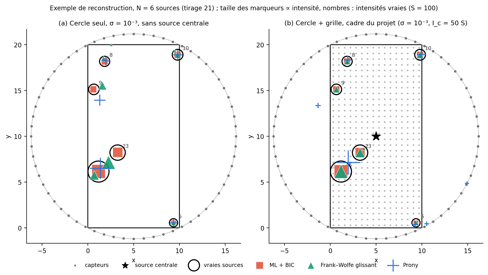

*Figure 1 – Exemple de reconstruction à $N = 6$ (même tirage, n° 21, dans les deux panneaux). Cercles noirs : vraies sources, de surface proportionnelle à l'intensité (nombres : intensités, $S = 100$) ; carrés : ML + BIC ; triangles : Frank–Wolfe ; croix : Prony ; étoile : source centrale ; points : capteurs. (a) Cercle seul, sans source centrale : ML + BIC retrouve les 6 sources (erreur de position maximale 0,06), le Frank–Wolfe et Prony 2 sur 6. (b) Cercle + grille, cadre du projet : ML + BIC et le Frank–Wolfe retrouvent les 6 sources à $10^{-3}$ et $4 \cdot 10^{-3}$ près ; Prony, qui ne voit que le cercle, n'en retrouve aucune.*

---

## 1. Matériel, logiciels et durées

### 1.1 Machine

Tous les calculs ont été faits sur mon ordinateur portable :

| | |
|---|---|
| **Machine** | ordinateur portable HUAWEI, modèle NBLB-WAX9N |
| **Processeur (puce)** | Intel Core i5-10210U (génération Comet Lake, 2019) : 4 cœurs physiques, 8 fils d'exécution, 1,6 GHz de base, jusqu'à 4,2 GHz en turbo, enveloppe thermique de 15 W |
| **Carte graphique** | Intel UHD Graphics (puce graphique intégrée au processeur, 1 Go de mémoire partagée, pilote 27.20.100.8984) |
| **Mémoire vive** | 7,8 Go |
| **Système** | Windows 11 Famille |
| **Logiciels** | Python 3.14.0, NumPy 2.3.3, SciPy 1.16.2, scikit-learn 1.7.2, PyTorch 2.9.0 (version CPU), Matplotlib, Typst 0.15.1 |

**La carte graphique n'a pas servi.** Une puce Intel UHD intégrée n'a pas de support CUDA, et PyTorch est installé en version CPU. Surtout, les méthodes comparées sont écrites en NumPy/SciPy (optimisation L-BFGS-B, moindres carrés, décompositions de petites matrices) : ce sont des calculs séquentiels sur des matrices de quelques centaines de lignes, que la carte graphique n'accélérerait pas. **Tout le calcul est sur le processeur**, avec un parallélisme par tirage : chaque processus traite un tirage complet, et les bibliothèques d'algèbre linéaire sont limitées à un fil par processus pour éviter la sur-souscription.

### 1.2 Durées réelles

| Calcul | Durée | Processus |
|---|---:|---:|
| Essai rapide (`--quick`, 10 tirages, 3 points par balayage, avec la descente) | 13,9 min | 6 |
| Comparaison complète, cercle (14 400 tâches) | 15,0 min | 6 |
| Comparaison complète, cercle + grille (14 400 tâches) | 78,4 min | 6 |
| Relance des 105 tirages en timeout, limite portée à 300 s | 38 min | 6 |
| Cas à deux sources : réussite, causes, conditionnement (1 800 tirages) | 80,4 min | 2 |
| Cas à deux sources : bassins d'attraction (864 départs) | 35,7 min | 2 |
| Recalcul de toutes les métriques et figures depuis `results/sources/` | 2 min | 1 |

Les deux premiers gros calculs ont tourné en même temps : 8 processus sur 4 cœurs physiques. **Les temps de calcul mesurés par tirage sont donc des temps « sous charge »**, plus longs (d'environ un facteur 1,5 à 2) que sur une machine au repos ; les comparaisons entre méthodes restent valables, car toutes ont subi la même charge.

La descente de gradient a été retirée des balayages généraux : un premier lancement avec elle avançait au rythme d'environ 6 h, la descente prenant à elle seule plus de 90 % du temps. Elle est étudiée en détail dans le cas à deux sources (section 6), qui est le cas où Orano l'a testée.

## 2. Le problème et les méthodes

### 2.1 Le problème

On cherche $N$ sources ponctuelles de plutonium, de positions $z_i$ et d'intensités $I_i > 0$, dans le hangar $D = [0, 10] \times [0, 20]$. Un capteur placé en $s_k$ mesure

$$\Phi_\theta(s_k) = \sum_{i=1}^N \frac{I_i}{\lVert s_k - z_i \rVert^2},$$

plus le signal d'une source centrale connue, d'intensité $I_c$, placée en $c = (5, 10)$. Le bruit est relatif : le capteur lit $y_k^{\text{brut}} (1 + \sigma \varepsilon_k)$ avec $\varepsilon_k \sim \mathcal N(0, 1)$. On retire le signal de la source centrale, mais **son bruit reste** : l'écart type au capteur $k$ vaut $\sigma_k = \sigma y_k^{\text{brut}}$, dominé par la source centrale dès que $I_c$ est grand devant la somme $S = \sum I_i = 100$.

Deux dispositions de capteurs sont comparées :
- **cercle** : 64 capteurs régulièrement répartis sur le cercle de centre $c$ passant par les coins de $D$ (rayon $\sqrt{125} \approx 11{,}2$) ;
- **cercle + grille** : les mêmes 64 capteurs plus une grille régulière de $16 \times 32 = 512$ capteurs dans $D$, soit 576 capteurs.

### 2.2 Les méthodes, telles qu'elles sont dans le dépôt

Les méthodes sont utilisées **sans modification**, avec les réglages déjà présents dans le dépôt.

- **Prony** (`src/particle_sources/inversion/prony.py`, `prony_circle`). Les mesures du cercle sont vues comme une fonction sur le cercle ; ses coefficients de Fourier forment une matrice de Hankel dont le rang est le nombre de sources, et les sources sont les racines d'un polynôme. Le rang est lu avec le seuil relatif `rank_tol = 0.005` de `config/reconstruction.yaml`. **Prony n'utilise que les capteurs du cercle**, y compris dans la configuration cercle + grille.
- **ML + BIC** (`sparse_sources`, `greedy_ml`). Maximum de vraisemblance : moindres carrés pondérés par $1/\sigma_k^2$, résolus par L-BFGS-B, en ajoutant les sources une par une à partir d'une recherche exhaustive sur une grille de positions candidates ; le nombre de sources est choisi par le critère BIC ($k_{\max} = 20$).
- **Frank–Wolfe glissant** (`sliding_frank_wolfe`). Problème BLASSO sur les mesures, capteurs blanchis (divisés par $\sigma_k$) et noyau normalisé, pénalité $\lambda = 1{,}5 \sqrt{M}$ ($M$ = nombre de capteurs), 40 itérations au plus, comme dans `sparse_sources/tester_fw.py`.
- **Descente de gradient d'Orano** (`sparse_sources/orano.py`, `descente_projetee`). Descente de gradient sur $\theta = (z_i, I_i)$ normalisés, pas d'Armijo, déplacement limité à 5 % du domaine, projection des positions sur $D$ et des intensités sur $\mathbb R_+$, 20 000 itérations au plus. Le critère est la somme des carrés des résidus **non pondérée**, divisée par $\lVert y \rVert^2$. Elle reçoit le vrai $N$ ; les positions de départ sont tirées uniformément dans $D$ et les intensités de départ valent $S/N$.
- **Gauss–Newton** (`orano.gauss_newton`, région de confiance de `scipy.optimize.least_squares`) : même critère que la descente, même point de départ, même $N$. Il sert de **témoin** dans le cas à deux sources : il permet de séparer ce qui vient du critère et ce qui vient de l'algorithme.

## 3. Protocole de comparaison

**Situations.** Pour chaque $N \in \{2, 4, 6, 10\}$ et chaque tirage, les positions $z_i$ sont uniformes dans $D$ et les intensités suivent une loi de Dirichlet de somme $S = 100$. Le générateur aléatoire est initialisé par $(N, \text{tirage})$ seulement : **toutes les méthodes et les deux dispositions de capteurs voient exactement les mêmes sources et le même bruit**.

**Fusion des sources proches.** Une méthode peut représenter une source par deux ou trois sources très proches, ce qui n'est pas une vraie erreur (le Frank–Wolfe le fait souvent). Avant de mesurer l'erreur, on fusionne donc les sources estimées distantes de moins de $\delta = 0{,}1$ (regroupement hiérarchique à lien simple ; intensité = somme, position = barycentre pondéré par les intensités), et de même les vraies sources. Les sources fusionnées sont ensuite appariées aux vraies par l'algorithme hongrois.

**Trois indicateurs**, chacun répondant à une seule question :
- **taux de détection** : la part des vraies sources retrouvées à moins de 0,1 (0,5 % de la largeur du hangar) ;
- **précision** : l'erreur de position $d_i = \lVert \hat z_i - z_i \rVert$ et l'erreur d'intensité relative $r_i = |\hat I_i - I_i| / I_i$, sur les seules sources détectées ;
- **masse parasite** : la somme des intensités des sources estimées en trop, rapportée à $S$. Une petite source parasite de 0,1 % de $S$ est inoffensive ; compter les sources en trop la pénaliserait autant qu'une grosse fausse source.

**Score global.** Pour classer les méthodes d'un seul nombre, on garde

$$E = \frac{1}{N'} \sum_{i=1}^{N'} (0{,}75\, d_i + 0{,}25\, r_i),$$

sur les $N'$ vraies sources après fusion, avec $d_i \le 5$ et $r_i \le 1$, une source manquée comptant $(5, 1)$. Une source manquée ajoute donc $4/N$ à $E$ ; $E < 0{,}01$ veut dire que les sources sont trouvées à quelques centimètres près. On rapporte la **médiane** de $E$ sur les 100 tirages, avec un intervalle de confiance à 95 % par bootstrap (2 000 rééchantillonnages) : elle décrit le tirage typique et n'est pas dominée par les quelques tirages où une source est manquée, ce qui est acceptable quand $N$ est grand. Ces échecs restent visibles dans le taux de détection. La moyenne est donnée dans l'annexe.

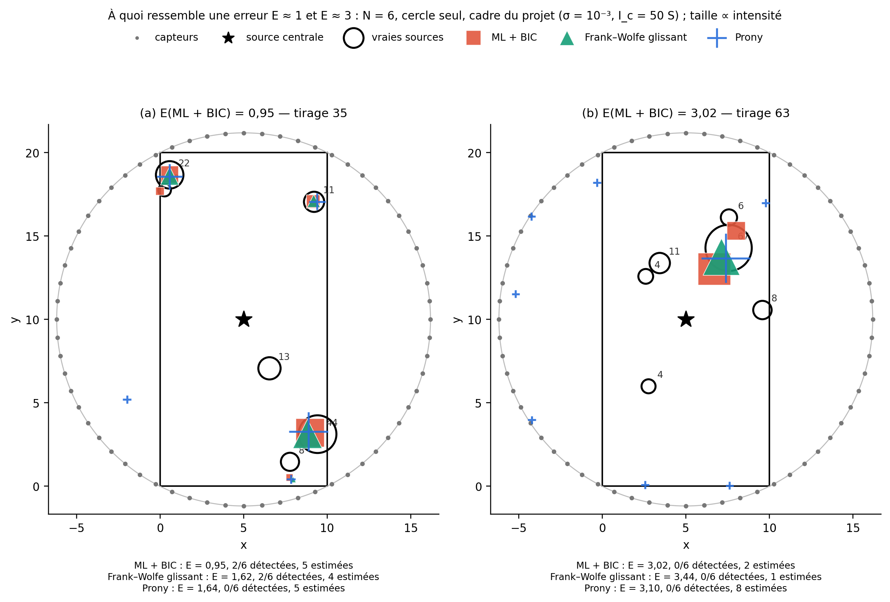

*Figure 1 bis – Deux tirages à $N = 6$ sur le cercle seul, dans le cadre du projet, choisis pour que l'erreur de ML + BIC vaille environ 1 (a) et 3 (b). Sous chaque panneau : $E$, nombre de sources détectées à moins de 0,1 et nombre de sources estimées, pour chaque méthode.*

**Ce que veut dire $E$.** Avec $E \approx 1$ (a), ML + BIC voit l'essentiel : 4 sources sur 6 sont à moins de 0,5 (dont 2 à moins de 0,1), une est à 0,9 et une est manquée. Avec $E \approx 3$ (b), il ne renvoie que 2 sources, au voisinage de la source la plus forte (intensité 67) : les deux sources appariées sont à 0,9 et 1,5 de leur cible, et les 4 autres sont manquées. Repère simple : chaque source manquée ajoute $4/N$ à $E$, soit 0,67 à $N = 6$.

**Balayages.** Chaque balayage fait varier un paramètre autour du cadre par défaut $I_c = 50 S$, $\sigma = 10^{-3}$ :
- bruit $\sigma \in \{10^{-4}, \dots, 10^{-2}\}$, 7 valeurs régulièrement espacées en échelle log ;
- source centrale $I_c / S \in \{0, 10, 25, 50, 100, 200\}$ ;
- nombre de sources $N$.

Chaque point compte 100 tirages, soit 48 points × 100 tirages × 3 méthodes = 14 400 calculs par disposition.

**Timeout.** Un calcul qui dépasse 60 s est arrêté et compté comme un échec complet (toutes les sources manquées). Les 105 calculs concernés ont été relancés une fois avec une limite de 300 s : 103 ont abouti (63 s en médiane, 228 s au plus). Il reste 2 timeouts, pour ML + BIC sur un même tirage (n° 67, cercle + grille, $N = 10$, $I_c/S = 10$ et 25).

## 4. Résultats en fonction du nombre de sources

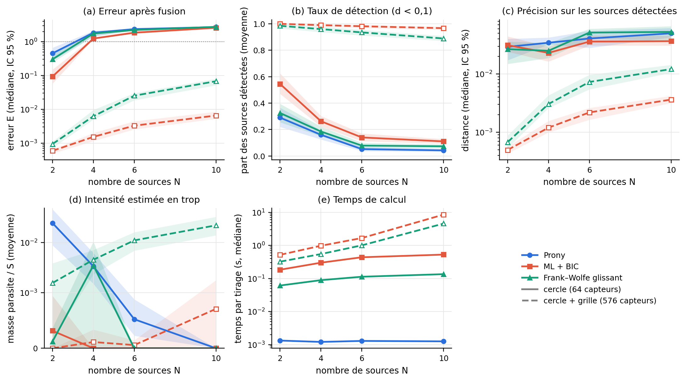

*Figure 2 – Cadre par défaut ($\sigma = 10^{-3}$, $I_c = 50 S$), en fonction du nombre de sources. (a) Erreur $E$ médiane ; (b) taux de détection ; (c) précision : erreur de position médiane sur les sources détectées ; (d) masse parasite moyenne ; (e) temps de calcul médian. Bandes : intervalles de confiance à 95 %. Traits pleins : cercle ; pointillés : cercle + grille (Prony n'utilise que le cercle).*

**Sur le cercle, aucune méthode ne dépasse deux sources.** À $N = 2$, ML + BIC est le meilleur ($E = 0{,}093$ [0,058 ; 0,15], 55 % des sources détectées, bon $N$ dans 92 % des tirages), devant le Frank–Wolfe ($E = 0{,}30$ ; 33 %) et Prony ($0{,}45$ ; 29 %). Dès $N = 4$, les trois méthodes ont $E > 1$ et ne détectent plus qu'une source sur quatre ou cinq (26 % pour ML + BIC), puis une sur dix à $N = 10$. Les quelques sources détectées le sont à 0,02 – 0,05 près, mais ce chiffre est biaisé : seules comptent celles qui sont déjà à moins de 0,1. Le bruit de la source centrale noie l'information : vu depuis le cercle, le signal des sources recherchées est trop faible et trop lisse pour séparer plus de deux sources.

**Avec la grille, le problème change de nature.** ML + BIC détecte 100 % des sources à $N = 2$ et encore 97 % à $N = 10$, avec une erreur de position médiane de $5 \cdot 10^{-4}$ à $3{,}6 \cdot 10^{-3}$. **Les capteurs intérieurs voient chaque source de près** : la grille a un pas de 0,625, donc chaque source a un capteur à moins de 0,45 ; elle y produit un signal plusieurs centaines de fois plus fort que sur les capteurs du cercle, alors que le bruit de la source centrale, lui, ne change pas d'ordre de grandeur.

**Le Frank–Wolfe profite aussi de la grille**, mais moins : il détecte 98 % puis 89 % des sources, il est 3 fois moins précis à $N = 10$ ($1{,}2 \cdot 10^{-2}$), et son erreur $E$ est 1,6 fois celle de ML + BIC à $N = 2$ et 10 fois à $N = 10$. Il surestime aussi le nombre de sources (bon $N$ dans 21 % des tirages à $N = 10$, 1,3 source en trop en moyenne) : la pénalité $\lambda$ laisse passer de petites sources parasites, qui ne pèsent toutefois que 2 % de $S$ (0,07 % pour ML + BIC).

**Prony ne change pas** avec la grille, puisqu'il n'utilise que le cercle. Il surestime le nombre de sources dès que la source centrale est présente (2,6 sources en trop en moyenne à $N = 2$).

### Tableau de synthèse (cadre par défaut)

$E$ : médiane ; détection : part des vraies sources retrouvées à moins de 0,1 ; précision : erreur de position médiane sur les sources détectées (unités du hangar) ; masse parasite en pourcentage de $S$ ; temps médian. Prony n'utilise que les 64 capteurs du cercle.

| Méthode | $N$ | $E$ cercle | détection | $\hat N = N$ | $E$ cercle + grille | détection | précision | $\hat N = N$ | masse parasite | temps |
|---|---:|---:|---:|---:|---:|---:|---:|---:|---:|---:|
| Prony | 2 | 0,45 | 29 % | 16 % | 0,45 | 29 % | 0,029 | 16 % | 2,5 % | 1,5 ms |
| | 4 | 1,84 | 16 % | 19 % | 1,84 | 16 % | 0,034 | 19 % | 0,3 % | 1,3 ms |
| | 6 | 2,36 | 5 % | 20 % | 2,36 | 5 % | 0,041 | 20 % | 0,05 % | 1,4 ms |
| | 10 | 2,71 | 4 % | 2 % | 2,71 | 4 % | 0,050 | 2 % | 0 % | 1,5 ms |
| **ML + BIC** | 2 | **0,093** | **55 %** | 92 % | **$5{,}9 \cdot 10^{-4}$** | **100 %** | **$5{,}0 \cdot 10^{-4}$** | 100 % | 0 % | 0,52 s |
| | 4 | **1,24** | **26 %** | 23 % | **$1{,}5 \cdot 10^{-3}$** | **99 %** | **$1{,}2 \cdot 10^{-3}$** | 93 % | 0,01 % | 0,98 s |
| | 6 | **1,85** | **14 %** | 0 % | **$3{,}3 \cdot 10^{-3}$** | **98 %** | **$2{,}2 \cdot 10^{-3}$** | 93 % | 0,006 % | 1,7 s |
| | 10 | **2,59** | **11 %** | 0 % | **$6{,}5 \cdot 10^{-3}$** | **97 %** | **$3{,}6 \cdot 10^{-3}$** | 85 % | 0,07 % | 8,6 s |
| Frank–Wolfe | 2 | 0,30 | 33 % | 82 % | $9{,}4 \cdot 10^{-4}$ | 98 % | $6{,}7 \cdot 10^{-4}$ | 89 % | 0,2 % | 0,32 s |
| | 4 | 1,75 | 19 % | 17 % | $6{,}2 \cdot 10^{-3}$ | 96 % | $3{,}1 \cdot 10^{-3}$ | 57 % | 0,5 % | 0,55 s |
| | 6 | 2,22 | 8 % | 1 % | $2{,}5 \cdot 10^{-2}$ | 94 % | $7{,}3 \cdot 10^{-3}$ | 27 % | 1,1 % | 1,0 s |
| | 10 | 2,76 | 7 % | 0 % | $6{,}8 \cdot 10^{-2}$ | 89 % | $1{,}2 \cdot 10^{-2}$ | 21 % | 2,2 % | 4,6 s |

## 5. Effet du bruit et de la source centrale

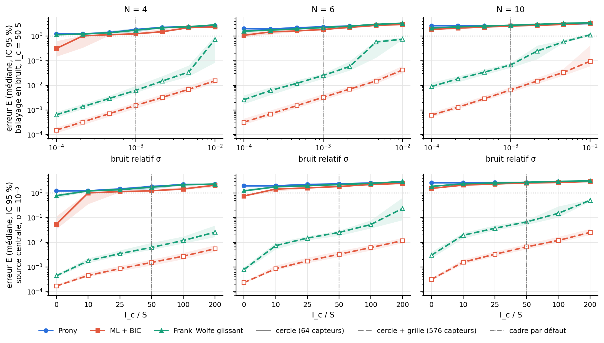

*Figure 3 – Erreur $E$ médiane et son intervalle de confiance à 95 %, pour $N = 4$, 6 et 10. En haut : en fonction du bruit relatif $\sigma$, avec $I_c = 50 S$. En bas : en fonction de l'intensité de la source centrale rapportée à la somme des autres, avec $\sigma = 10^{-3}$. Traits pleins : cercle ; pointillés : cercle + grille ; trait mixte : cadre par défaut.*

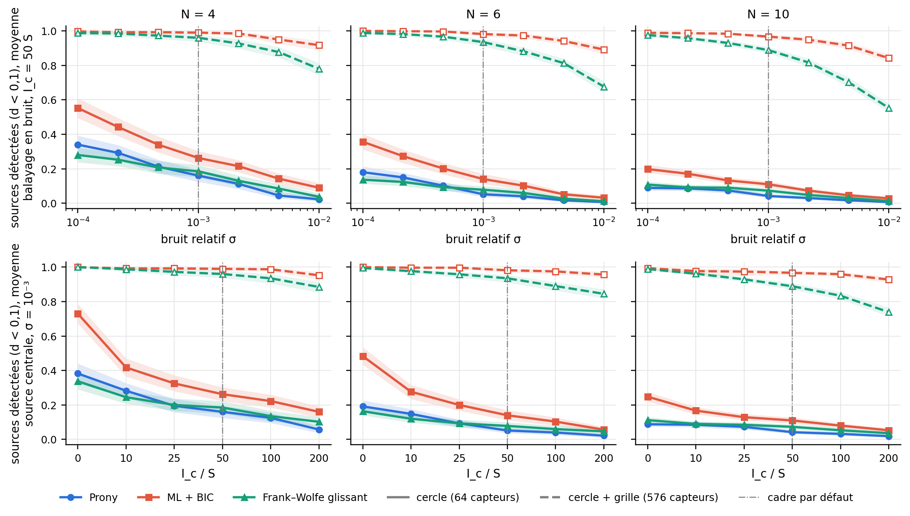

*Figure 4 – Taux de détection (part des vraies sources retrouvées à moins de 0,1), mêmes balayages et mêmes conventions que la figure 3.*

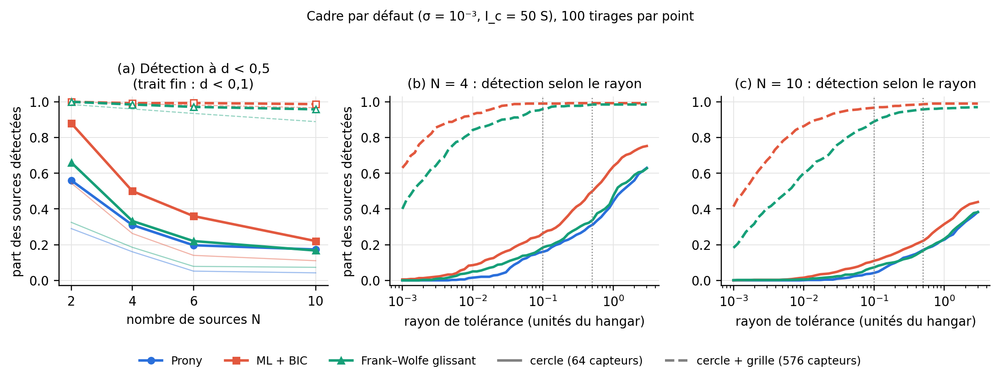

*Figure 4 bis – Cadre par défaut. (a) Taux de détection à $d < 0{,}5$ (trait épais) et à $d < 0{,}1$ (trait fin) en fonction de $N$. (b) et (c) Taux de détection en fonction du rayon de tolérance, pour $N = 4$ et $N = 10$ : chaque courbe est la proportion des vraies sources trouvées à moins de ce rayon. Pointillés verticaux : 0,1 et 0,5.*

**Détection à 0,5.** Avec un rayon de tolérance de 0,5 au lieu de 0,1, la grille ne change presque rien (ML + BIC passe de 97 % à 99 % à $N = 10$, le Frank–Wolfe de 89 % à 96 %) : ses sources sont trouvées bien plus près que 0,1. Sur le cercle, la détection double à peu près : ML + BIC détecte 88 % des sources à $N = 2$ (contre 55 % à 0,1), 50 % à $N = 4$ (26 %), 36 % à $N = 6$ (14 %) et 22 % à $N = 10$ (11 %). Le cercle situe donc souvent les sources « à peu près » (à quelques dizaines de centimètres), mais pas précisément. Les panneaux (b) et (c) se lisent comme une fonction de répartition des erreurs de position : avec la grille, la courbe de ML + BIC atteint 90 % dès un rayon d'environ $4 \cdot 10^{-3}$ à $N = 4$ et $2 \cdot 10^{-2}$ à $N = 10$, celle du Frank–Wolfe vers $10^{-2}$ et $10^{-1}$ ; sur le cercle, même à un rayon de 3, ML + BIC ne dépasse pas 75 % à $N = 4$ et 45 % à $N = 10$, parce que les sources restantes sont tout simplement manquées.

**Bruit.** Avec la grille, l'erreur médiane de ML + BIC est proportionnelle à $\sigma$ pour tous les $N$ : à $N = 4$, de $1{,}5 \cdot 10^{-4}$ à $1{,}5 \cdot 10^{-2}$ quand $\sigma$ va de $10^{-4}$ à $10^{-2}$. C'est le comportement attendu d'un estimateur du maximum de vraisemblance, dont l'erreur suit le bruit. Son taux de détection reste au-dessus de 84 % même à $\sigma = 10^{-2}$ et $N = 10$. Le Frank–Wolfe a une erreur médiane 4 à 15 fois plus grande, puis décroche au-delà de $\sigma \approx 5 \cdot 10^{-3}$ : à $\sigma = 10^{-2}$, il ne détecte plus que 78 % des sources à $N = 4$ et 55 % à $N = 10$. Sur le cercle, seul ML + BIC à $N = 4$ et $\sigma = 10^{-4}$ passe sous $E = 1$ (médiane 0,31, 55 % des sources détectées).

**Source centrale.** Elle agit exactement comme le bruit. L'écart type au capteur $k$ vaut $\sigma_k = \sigma y_k^{\text{brut}}$, et $y_k^{\text{brut}}$ est dominé par la source centrale : multiplier $I_c$ par 10 revient à peu près à multiplier $\sigma$ par 10. Sans source centrale, ML + BIC retrouve 4 sources sur le cercle ($E = 0{,}054$, 73 % des sources détectées, bon $N$ dans 84 % des tirages) ; avec $I_c = 10 S$ seulement, il n'y arrive plus ($E = 1{,}02$, 42 %). Avec la grille, ML + BIC reste à $E < 3 \cdot 10^{-2}$ et détecte au moins 93 % des sources jusqu'à $I_c = 200 S$ et $N = 10$, quand le Frank–Wolfe tombe à $E = 0{,}51$ et 74 %.

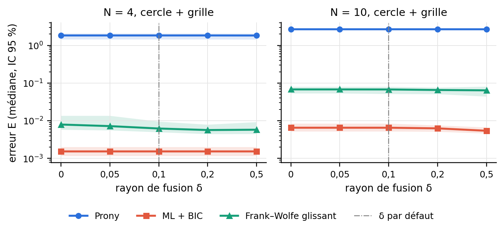

*Figure 5 – Erreur $E$ médiane en fonction du rayon de fusion $\delta$ ($\delta = 0$ : pas de fusion), cadre par défaut, cercle + grille, $N = 4$ et 10.*

**Sensibilité au rayon de fusion.** La fusion ne change rien pour ML + BIC et Prony, qui ne renvoient presque jamais deux sources à moins de 0,1 l'une de l'autre. Elle profite au seul Frank–Wolfe avec la grille, et modestement : son erreur médiane à $N = 4$ passe de $8{,}0 \cdot 10^{-3}$ sans fusion à $6{,}2 \cdot 10^{-3}$ avec $\delta = 0{,}1$, et sa masse parasite de 1,2 % à 0,5 % de $S$. Entre $\delta = 0{,}05$ et $\delta = 0{,}2$, aucune conclusion ne change.

**Temps de calcul.** Prony prend 1,3 à 1,5 ms quel que soit $N$ (une décomposition de matrice de Hankel de taille fixe). ML + BIC prend 0,2 à 0,5 s sur le cercle et 0,5 à 8,6 s avec la grille ; le Frank–Wolfe 0,06 à 0,14 s sur le cercle et 0,3 à 4,6 s avec la grille. Le BIC ajoute des sources tant que la vraisemblance s'améliore assez : à bruit faible et avec 576 capteurs, chaque ajout est accepté longtemps et chaque optimisation coûte cher, d'où quelques calculs de plus d'une minute.

## 6. Le cas à deux sources : pourquoi la descente échoue

### 6.1 Dispositif

Orano n'a testé la descente qu'à **deux sources**, en faisant varier le rapport d'intensité $x = I_1 / I_2$. J'ai refait cette expérience avec 100 tirages par valeur de $x \in \{1, 3, 10, 30, 100, 300\}$ : les positions sont celles des tirages à $N = 2$ de la comparaison, et les intensités valent $I_1 = S x / (x + 1)$, $I_2 = S / (x + 1)$. Trois cadres :
- **cas test d'Orano** : cercle, sans bruit, sans source centrale ($\sigma = 0$, $I_c = 0$) ;
- **projet, cercle** : $\sigma = 10^{-3}$, $I_c = 50 S$ ;
- **projet, cercle + grille** : idem avec les 576 capteurs.

Un tirage est une **réussite** si chacune des deux vraies sources est retrouvée à moins de 0,1, après fusion des sources estimées distantes de moins de $\delta = 0{,}1$ : une méthode qui coupe une source en deux morceaux voisins n'est pas pénalisée. La descente et Gauss–Newton reçoivent $N = 2$ et partent **du même point**.

### 6.2 Taux de réussite

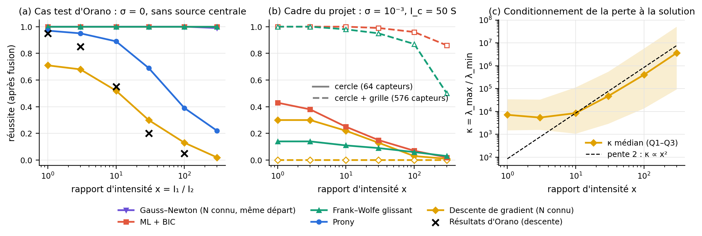

*Figure 6 – Cas à deux sources, 100 tirages par point, réussite après fusion. (a) Cas test d'Orano : Gauss–Newton, ML + BIC et le Frank–Wolfe sont confondus à 100 % ; croix : résultats annoncés par Orano. (b) Cadre du projet, sur le cercle (traits pleins) et avec la grille (pointillés). (c) Conditionnement $\kappa$ de $J^\top J$ aux vraies sources (médiane et quartiles).*

| Cadre | Méthode | $x = 1$ | 3 | 10 | 30 | 100 | 300 |
|---|---|---:|---:|---:|---:|---:|---:|
| Orano (synthèse) | descente | 95 % | 85 % | 55 % | 20 % | 5 % | — |
| **cas test d'Orano** | descente | 71 % | 68 % | 52 % | 30 % | 13 % | 2 % |
| | Gauss–Newton | 100 % | 100 % | 100 % | 100 % | 100 % | 99 % |
| | ML + BIC | 100 % | 100 % | 100 % | 100 % | 100 % | 100 % |
| | Frank–Wolfe | 100 % | 100 % | 100 % | 100 % | 100 % | 100 % |
| | Prony | 97 % | 95 % | 89 % | 69 % | 39 % | 22 % |
| **projet, cercle** | descente | 30 % | 30 % | 22 % | 13 % | 3 % | 1 % |
| | Gauss–Newton | 43 % | 40 % | 27 % | 16 % | 7 % | 2 % |
| | ML + BIC | 43 % | 38 % | 25 % | 15 % | 7 % | 2 % |
| | Frank–Wolfe | 14 % | 14 % | 11 % | 9 % | 6 % | 3 % |
| | Prony | 16 % | 16 % | 12 % | 9 % | 1 % | 0 % |
| | GN depuis la vérité | 43 % | 40 % | 27 % | 16 % | 7 % | 2 % |
| **projet, cercle + grille** | descente | 0 % | 0 % | 0 % | 0 % | 0 % | 0 % |
| | Gauss–Newton | 0 % | 0 % | 0 % | 0 % | 0 % | 0 % |
| | ML + BIC | 100 % | 100 % | 100 % | 99 % | 96 % | 86 % |
| | Frank–Wolfe | 100 % | 100 % | 98 % | 95 % | 87 % | 50 % |
| | Prony | 16 % | 16 % | 12 % | 9 % | 1 % | 0 % |
| | GN depuis la vérité | 100 % | 100 % | 99 % | 97 % | 93 % | 87 % |

« GN depuis la vérité » : Gauss–Newton parti des vraies sources ; c'est ce qu'une méthode parfaite atteindrait avec ces données (limite statistique).

**Dans le cas test d'Orano, on retrouve la même tendance qu'Orano** : la réussite de la descente baisse fortement avec $x$ (71 % → 2 %), alors que Gauss–Newton, ML + BIC et le Frank–Wolfe réussissent presque toujours. Mes chiffres sont plus bas qu'Orano à $x$ petit (71 % contre 95 % à $x = 1$) : les positions de départ sont ici uniformes dans tout le hangar, ce qui est exigeant. **L'ordre de grandeur et la pente sont les mêmes.**

**Le point essentiel est Gauss–Newton** : avec le même critère, le même point de départ et le même $N$, il réussit 100 % des tirages sans bruit jusqu'à $x = 100$. **Le problème de la descente n'est donc ni le critère ni l'initialisation, c'est l'algorithme** : un pas de gradient ne tient pas compte de la courbure, et la courbure est très inégale selon les directions (section 6.4).

**Dans le cadre du projet sur le cercle**, toutes les méthodes s'effondrent, mais pour une autre raison : le bruit. ML + BIC réussit exactement aussi souvent que Gauss–Newton parti des vraies sources (43 % à $x = 1$, 7 % à $x = 100$) : **il est à la limite statistique**, aucune méthode ne peut faire mieux avec ces données. La descente (30 % à $x = 1$) et le Frank–Wolfe (14 %) restent en dessous.

**Avec la grille, la descente et Gauss–Newton échouent à 100 %, alors que ML + BIC réussit 86 à 100 %**, au niveau de la limite statistique (87 à 100 %). Le Frank–Wolfe suit jusqu'à $x = 30$ (95 %) puis décroche (50 % à $x = 300$). L'échec de la descente et de Gauss–Newton vient de **l'initialisation** : avec le critère non pondéré, la perte est hérissée de pics sur les capteurs, avec des plateaux entre eux, et la descente s'y arrête loin des vraies sources (figure 9). ML + BIC évite ce piège parce qu'il place chaque source par une recherche exhaustive sur une grille avant d'optimiser, et parce qu'il pondère les capteurs par leur bruit.

### 6.3 Causes des échecs


*Figure 7 – Issue de chaque descente, par cadre et par rapport d'intensité $x$ (100 tirages par barre).*

Pour chaque échec de la descente, j'ai cherché la cause, dans cet ordre : **source éteinte** (l'intensité d'une source est tombée à 0) ; **budget épuisé** (20 000 itérations sans atteindre la précision) ; **limite statistique** (la perte finale est au plus celle du minimum voisin de la vérité) ; **bloquée au bord** ; **minimum local** (tout le reste).

| Cadre (600 descentes) | réussite | budget épuisé | source éteinte | limite stat. | bord | min. local |
|---|---:|---:|---:|---:|---:|---:|
| cas test d'Orano | 236 | 329 | 35 | 0 | 0 | 0 |
| projet, cercle | 99 | 392 | 30 | 79 | 0 | 0 |
| projet, cercle + grille | 0 | 36 | 1 | 0 | 177 | 386 |

- **Budget épuisé** (sur le cercle, 55 % des descentes du cas test d'Orano). La descente avance, mais trop lentement : à $x = 1$, 26 descentes sur 100 n'ont pas fini en 20 000 itérations ; à $x = 300$, 89 sur 100. Même les descentes réussies prennent 10 900 itérations en médiane.
- **Source éteinte** (6 % des descentes sur le cercle). Quand une source est loin de sa cible, la descente fait baisser son intensité ; la projection sur $\mathbb R_+$ la met à 0. Or le gradient par rapport à la position d'une source est proportionnel à son intensité ($\partial \Phi / \partial z_i = I_i \nabla_z G$) : **une source d'intensité nulle ne bouge plus jamais**.
- **Bloquée au bord et minimum local** (grille, 94 % des descentes). Avec la grille, la descente s'arrête vite (774 itérations en médiane) parce que le pas d'Armijo devient négligeable : elle est dans un minimum local dont la perte est en médiane 1 400 fois celle du bon minimum.

### 6.4 Conditionnement

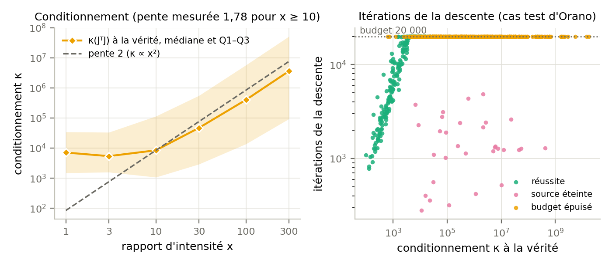

*Figure 8 – À gauche : conditionnement $\kappa$ de $J^\top J$ (critère d'Orano, paramètres normalisés) aux vraies sources, en fonction de $x$ ; droite de pente 2 en référence. À droite : itérations de la descente en fonction de $\kappa$, cas test d'Orano.*

Le nombre d'itérations d'une descente de gradient sur une cuvette quadratique est proportionnel au conditionnement $\kappa = \lambda_{\max} / \lambda_{\min}$ de la hessienne (ici $J^\top J$). La médiane de $\kappa$ aux vraies sources vaut $7 \cdot 10^3$ à $x = 1$, $4{,}7 \cdot 10^4$ à $x = 30$, $4 \cdot 10^5$ à $x = 100$ et $3{,}6 \cdot 10^6$ à $x = 300$. **Pour $x \ge 10$, la pente en échelle log-log vaut 1,8**, proche du $\kappa \ge c x^2$ annoncé par Orano : la position de la source faible n'agit sur les mesures qu'à travers $I_2 \nabla G$, donc la colonne correspondante de $J$ est $x$ fois plus petite, et la valeur propre associée de $J^\top J$ est $x^2$ fois plus petite.

Avec $\kappa \approx 4 \cdot 10^5$ à $x = 100$, **20 000 itérations ne peuvent pas suffire**. Gauss–Newton, qui résout $J^\top J \delta = -J^\top r$ à chaque pas, corrige la courbure et converge en quelques dizaines d'itérations (11 à 34 ms).

### 6.5 Paysage de la perte


*Figure 9 – Perte d'Orano en fonction de la position de la source faible et trajectoire de la descente, sur le cercle et sur cercle + grille ; cas test d'Orano, $x = 30$, tirage 1. À droite, distance de chaque source estimée à la vraie source la plus proche au fil des itérations.*

**Sur le cercle**, la perte vue depuis la source faible est une vallée large et très plate : la descente y entre vite, puis avance à petits pas ; dans l'exemple, la source faible reste à 1 de sa cible après 20 000 itérations. **Avec la grille**, la carte est hérissée d'un pic sur chacun des 512 capteurs (singularité en $1/r^2$), avec un plateau entre les pics ; la descente s'arrête au bout de 572 itérations, ses deux sources toujours à environ 9 de leurs cibles.

### 6.6 Bassins d'attraction

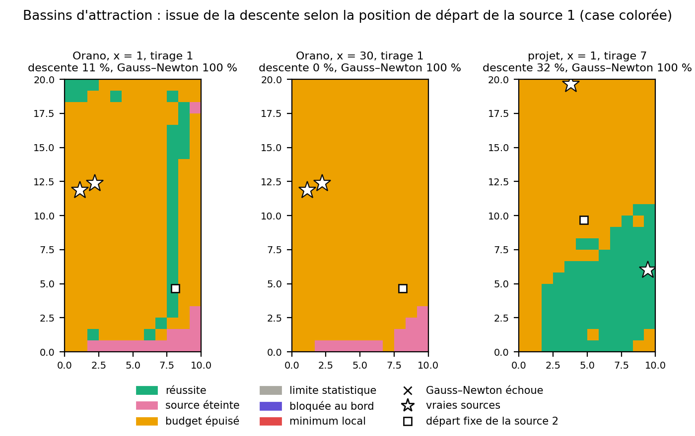

*Figure 10 – Issue de la descente selon la position de départ de la source 1 (la source 2 part toujours du même point), sur une grille de $12 \times 24$ départs ; croix : départs depuis lesquels Gauss–Newton échoue (il n'y en a aucun). Critère de réussite sans fusion.*

- **cas test d'Orano, $x = 1$, tirage 1** (sources à 1,2 l'une de l'autre) : la descente réussit depuis 32 départs sur 288 (11 %), dans une bande étroite ;
- **même tirage, $x = 30$** : la descente ne réussit depuis **aucun** départ ;
- **cadre du projet, $x = 1$, tirage 7** (sources éloignées de 14,8) : la descente réussit depuis 92 départs (32 %).

**Gauss–Newton réussit depuis les 288 départs dans les trois situations** : il n'y a pas de mauvais minimum local, c'est la descente qui ne parcourt pas assez vite le chemin vers la bonne solution.

### 6.7 Distance entre les sources et temps

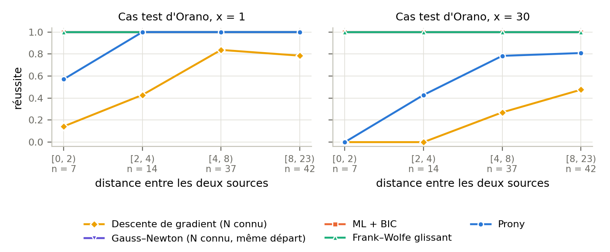

*Figure 11 – Réussite de la descente en fonction de la distance entre les deux sources, cas test d'Orano, $x = 1$ et $x = 30$ (critère sans fusion).*

Dans le cas test d'Orano à $x = 1$, la descente réussit dans 1 cas sur 7 quand les sources sont à moins de 2 l'une de l'autre, et environ 80 % au-delà de 4. À $x = 30$, elle ne réussit jamais quand les sources sont à moins de 4 l'une de l'autre : une source faible proche d'une source forte est « cachée » dans son signal.


*Figure 12 – Temps de calcul médian par tirage en fonction de $x$.*

Dans le cas test d'Orano, les temps médians sont de 7,3 à 8,8 s pour la descente, 11 à 34 ms pour Gauss–Newton, 0,13 à 0,22 s pour ML + BIC, 73 à 106 ms pour le Frank–Wolfe et 1 ms pour Prony. Gauss–Newton est 200 à 700 fois plus rapide que la descente, et réussit beaucoup plus souvent.

> **Bilan du cas à deux sources.** La descente de gradient d'Orano échoue pour deux raisons qui s'additionnent :
> 1. **une raison d'algorithme** : le pas de gradient ignore la courbure, alors que $\kappa$ croît comme $x^{1,8}$ ; Gauss–Newton, avec le même critère et le même départ, règle ce problème ;
> 2. **une raison de paramétrisation** : la projection des intensités sur $\mathbb R_+$ peut éteindre une source, qui ne bouge alors plus jamais.
>
> Avec la grille, s'y ajoute **une raison de critère** : la perte non pondérée a des minima locaux partout. Dans le cadre bruité du projet sur le cercle, la limite n'est plus l'algorithme mais l'information : ML + BIC est à la limite statistique.

## 7. À retenir

1. La descente de gradient d'Orano échoue dès deux sources ; Gauss–Newton, avec le même critère et le même départ, montre que l'échec vient de l'algorithme.
2. **ML + BIC est la meilleure méthode dans tous les cas**, sans réglage : il détecte le plus de sources, estime correctement $N$, ne crée presque pas de sources parasites et localise les sources avec une erreur proportionnelle au bruit.
3. **Le facteur limitant est la disposition des capteurs, pas la méthode.** Sur le cercle seul, avec la source centrale du projet, aucune méthode ne dépasse deux sources ; avec des capteurs dans le hangar, ML + BIC détecte 97 % de 10 sources et les localise à $4 \cdot 10^{-3}$ près.
4. Le Frank–Wolfe est un bon second, deux fois plus rapide, mais moins précis, et il surestime $N$ ; Prony est instantané mais ne sert que d'initialisation.

## 8. Anomalies et limites

- **Prony surestime le nombre de sources.** Avec le seuil de rang du projet (`rank_tol = 0.005`), Prony renvoie en moyenne 2,6 sources en trop à $N = 2$ dans le cadre par défaut. Sans bruit, c'est l'inverse : à $x$ grand, il ne voit souvent qu'une source, parce que la source faible passe sous le seuil. Je n'ai pas modifié ce seuil, conformément à la consigne.
- **ML + BIC utilise L-BFGS-B**, pas Gauss–Newton : la synthèse d'Orano parle de « Prony + ML » optimisé par Gauss–Newton. Les conclusions ne changent pas (même minimum), seuls les temps diffèrent.
- **Temps sous charge** : 8 processus sur 4 cœurs physiques. Les temps absolus sont surestimés d'un facteur 1,5 à 2 environ ; les rapports entre méthodes sont fiables.
- **Précision sur le cercle biaisée** : elle n'est calculée que sur les sources détectées, donc déjà à moins de 0,1 ; elle vaut mécaniquement 0,02 à 0,05.
- **Timeouts** : il en reste 2 sur 28 800 calculs (ML + BIC, tirage 67), comptés comme des échecs complets ; ils ne changent pas les médianes.
- **Aucun bug évident** n'a été trouvé dans les méthodes : en particulier, le blanchiment du noyau du Frank–Wolfe (`sparse_sources/kernel.py`) est cohérent avec la conversion des intensités en unités physiques.

## 9. Reproduire les résultats

```
python -m compare.run --all                 # comparaison complète (≈ 1 h 30 ici)
python -m compare.run --all --relancer-timeouts --timeout 300   # relancer les tirages en timeout
python -m compare.run --figures             # recalculer métriques, figures et annexe depuis results/sources/ (≈ 2 min)
python -m compare.run --figures --delta 0.2 # idem avec un autre rayon de fusion
python -m compare.deux_sources --all        # cas à deux sources (≈ 2 h avec 2 processus)
python -m compare.figures_synthese          # figures de rapport/images/ seulement
python -m compare.annexe                    # annexe chiffrée (Typst et Markdown)
typst compile --root . rapport/compte_rendu_comparaison.typ   # PDF du compte rendu
```

Les calculs reprennent où ils s'étaient arrêtés : les sources estimées sont écrites au fil de l'eau dans `results/sources/`.

**Fichiers produits.**
- `results/sources/comparaison_<config>.jsonl`, `results/sources/deux_sources.jsonl` : vraies sources et sources estimées de chaque tirage ;
- `results/<balayage>_<config>.csv` : une ligne par tirage (nouvelle et ancienne métrique) ;
- `results/agrege_<balayage>_<config>.csv` : médiane et moyenne de $E$ avec IC 95 %, détection, précision, masse parasite, temps ;
- `results/delta_<config>.csv` : sensibilité au rayon de fusion ;
- `results/archive_metrique_ancienne/` : résultats avec l'ancienne métrique ;
- `rapport/images/` : toutes les images ;
- `rapport/synthese_resultats.typ` (aperçu : `rapport/apercu_synthese.typ`), `rapport/annexe_donnees.typ`, et ce fichier.

---


<!-- ANNEXE : début (généré par python -m compare.annexe) -->

## Annexe : valeurs numériques des figures

Toutes les valeurs ci-dessous sont recalculées depuis results/ (sources estimées de chaque tirage dans results/sources/) par python -m compare.annexe ; ce sont exactement celles qui sont tracées.

Métrique (δ = 0,1) : les sources estimées, puis les vraies sources, sont fusionnées par regroupement hiérarchique à lien simple au seuil δ (intensité = somme, position = barycentre pondéré par les intensités) ; appariement hongrois ; E = (1/N') Σ (0,75 d_i + 0,25 r_i) sur les N' vraies sources fusionnées, d_i ≤ 5, r_i ≤ 1, source manquée = (5, 1) ; le nombre de sources estimé n'entre pas dans E. Masse parasite (à part) = somme des intensités des sources estimées non appariées / S. Détection : part des vraies sources (fusionnées) appariées à moins de 0,1, moyenne sur les tirages. Précision : erreur moyenne de position d (et d'intensité relative r) sur les seules sources détectées, médiane sur les tirages. Agrégation de E : médiane sur les 100 tirages et intervalle de confiance à 95 % par bootstrap (2 000 rééchantillonnages) ; la moyenne est donnée à titre de comparaison, ainsi que la médiane de l'ancienne métrique (sans fusion). « N̂ = N » : proportion de tirages où le nombre brut de sources estimées vaut N. Médiane [Q1 ; Q3] : temps et conditionnement.

### A.1 Paramètres communs à toutes les figures

| Paramètre | Valeur |
|---|---|
| Hangar D | [0, 10] × [0, 20] |
| Centre c (source centrale) | (5, 10) |
| Cercle de capteurs | 64 capteurs, centre c, rayon √125 ≈ 11,18 |
| Grille de capteurs | 16 × 32 = 512 capteurs dans D (pas 0,625) |
| Somme des intensités S | 100 (intensités ~ S · Dirichlet(1, …, 1)) |
| Nombres de sources N | 2, 4, 6, 10 |
| Bruit relatif σ (balayage a) | 1·10⁻⁴ / 2,15·10⁻⁴ / 4,64·10⁻⁴ / 0,001 / 0,00215 / 0,00464 / 0,01 |
| I_c / S (balayage b) | 0 / 10 / 25 / 50 / 100 / 200 |
| Cadre par défaut | σ = 10⁻³, I_c = 50 S = 5 000 |
| Tirages par point | 100 (graine : (N, tirage, flux, 20261123)) |
| Erreur E | (1/N) Σ (α d_i + β r_i), α = 0,75, β = 0,25 |
| Plafonds (source manquée) | d = 5, r = 1 |
| Timeout | 60 s par tirage et par méthode ; les tirages arrêtés à 60 s ont été relancés une fois avec 300 s (4 processus) ; 300 s dans le cas à deux sources |
| Prony | seuil de rang rank_tol = 0,005 ; capteurs du cercle seulement |
| ML + BIC | L-BFGS-B, ajout glouton, k_max = 20 |
| Frank–Wolfe glissant | blanchi, noyau normalisé, λ = 1,5 √M, 40 itérations au plus |
| Descente d'Orano | 20 000 itérations au plus, Armijo c = 10⁻⁴, pas initial 10⁻², déplacement ≤ 5 % du domaine, intensités initiales S / N |
| Cas à deux sources | x = I₁ / I₂ ∈ {1, 3, 10, 30, 100, 300}, I₁ = S x / (x + 1), I₂ = S / (x + 1) ; réussite : N̂ = 2 et d_max < 0,1 |
| Cadres à deux sources | Orano : σ = 0, I_c = 0 ; projet : σ = 10⁻³, I_c = 50 S |
| Réussite d'Orano (synthèse) | 95 / 85 / 55 / 20 / 5 % pour x = 1 / 3 / 10 / 30 / 100 |

### A.2 Balayage en bruit (fig_balayages, ligne du haut)

I_c = 50 S.

#### Bruit — cercle

| N | σ | Méthode | E médiane [IC 95 %] | détection | précision d | masse parasite | N̂ = N | E moyenne | E ancienne (médiane) |
|---:|---:|---|---:|---:|---:|---:|---:|---:|---:|
| 2 | 1·10⁻⁴ | Prony | 0,017 [0,011 ; 0,0208] | 86 % | 0,0145 | 0 | 92 % | 0,196 | 0,017 |
| 2 | 1·10⁻⁴ | ML + BIC | 0,00927 [0,00559 ; 0,0147] | 93 % | 0,00995 | 3,92·10⁻⁵ | 98 % | 0,0516 | 0,00927 |
| 2 | 1·10⁻⁴ | Frank–Wolfe | 0,0301 [0,0248 ; 0,0402] | 80 % | 0,0191 | 1,25·10⁻⁵ | 97 % | 0,123 | 0,0301 |
| 2 | 2,15·10⁻⁴ | Prony | 0,0402 [0,0247 ; 0,0763] | 68 % | 0,0219 | 6,9·10⁻⁴ | 64 % | 0,289 | 0,0402 |
| 2 | 2,15·10⁻⁴ | ML + BIC | 0,0198 [0,0121 ; 0,0318] | 86 % | 0,0162 | 8,18·10⁻⁵ | 97 % | 0,0978 | 0,0198 |
| 2 | 2,15·10⁻⁴ | Frank–Wolfe | 0,0657 [0,0537 ; 0,0872] | 64 % | 0,0211 | 2,69·10⁻⁵ | 93 % | 0,235 | 0,0657 |
| 2 | 4,64·10⁻⁴ | Prony | 0,153 [0,0807 ; 0,278] | 46 % | 0,0234 | 0,00569 | 33 % | 0,558 | 0,153 |
| 2 | 4,64·10⁻⁴ | ML + BIC | 0,0425 [0,0261 ; 0,0695] | 72 % | 0,024 | 1,65·10⁻⁴ | 93 % | 0,206 | 0,0425 |
| 2 | 4,64·10⁻⁴ | Frank–Wolfe | 0,141 [0,114 ; 0,191] | 44 % | 0,0217 | 5,75·10⁻⁵ | 90 % | 0,373 | 0,141 |
| 2 | 0,001 | Prony | 0,453 [0,28 ; 0,661] | 29 % | 0,0293 | 0,0247 | 16 % | 0,792 | 0,453 |
| 2 | 0,001 | ML + BIC | 0,0932 [0,0576 ; 0,149] | 55 % | 0,0313 | 3,15·10⁻⁴ | 92 % | 0,317 | 0,0932 |
| 2 | 0,001 | Frank–Wolfe | 0,302 [0,242 ; 0,43] | 32 % | 0,0267 | 1,22·10⁻⁴ | 82 % | 0,63 | 0,302 |
| 2 | 0,00215 | Prony | 0,986 [0,695 ; 1,37] | 22 % | 0,0442 | 0,0487 | 13 % | 1,18 | 0,986 |
| 2 | 0,00215 | ML + BIC | 0,212 [0,129 ; 0,312] | 36 % | 0,0314 | 5,59·10⁻⁴ | 82 % | 0,606 | 0,212 |
| 2 | 0,00215 | Frank–Wolfe | 0,845 [0,582 ; 1,33] | 24 % | 0,0315 | 2,55·10⁻⁴ | 63 % | 1,14 | 0,845 |
| 2 | 0,00464 | Prony | 1,64 [1,4 ; 2,02] | 14 % | 0,0383 | 0,0598 | 9 % | 1,71 | 1,64 |
| 2 | 0,00464 | ML + BIC | 0,443 [0,311 ; 0,691] | 24 % | 0,0263 | 9,26·10⁻⁴ | 67 % | 0,986 | 0,443 |
| 2 | 0,00464 | Frank–Wolfe | 2,03 [1,43 ; 2,12] | 18 % | 0,0467 | 5,14·10⁻⁴ | 42 % | 1,66 | 2,03 |
| 2 | 0,01 | Prony | 2,14 [2 ; 2,27] | 9 % | 0,0573 | 0,0844 | 6 % | 2,08 | 2,14 |
| 2 | 0,01 | ML + BIC | 2,05 [1,03 ; 2,16] | 17 % | 0,0434 | 0,00159 | 44 % | 1,54 | 2,05 |
| 2 | 0,01 | Frank–Wolfe | 2,19 [2,12 ; 2,27] | 10 % | 0,0408 | 0 | 22 % | 2,15 | 2,19 |
| 4 | 1·10⁻⁴ | Prony | 1,23 [1,14 ; 1,34] | 34 % | 0,0288 | 0 | 18 % | 1,27 | 1,23 |
| 4 | 1·10⁻⁴ | ML + BIC | 0,314 [0,147 ; 0,627] | 55 % | 0,0206 | 0,0022 | 66 % | 0,592 | 0,314 |
| 4 | 1·10⁻⁴ | Frank–Wolfe | 1,13 [1,06 ; 1,17] | 28 % | 0,015 | 0,042 | 29 % | 1,06 | 1,13 |
| 4 | 2,15·10⁻⁴ | Prony | 1,23 [1,13 ; 1,34] | 29 % | 0,0272 | 3,11·10⁻⁵ | 28 % | 1,33 | 1,23 |
| 4 | 2,15·10⁻⁴ | ML + BIC | 1,02 [0,339 ; 1,06] | 44 % | 0,0203 | 0 | 52 % | 0,793 | 1,02 |
| 4 | 2,15·10⁻⁴ | Frank–Wolfe | 1,21 [1,17 ; 1,34] | 25 % | 0,0192 | 0,0323 | 28 % | 1,24 | 1,21 |
| 4 | 4,64·10⁻⁴ | Prony | 1,39 [1,26 ; 1,62] | 21 % | 0,0287 | 0,00119 | 22 % | 1,52 | 1,39 |
| 4 | 4,64·10⁻⁴ | ML + BIC | 1,13 [1,06 ; 1,22] | 34 % | 0,0241 | 0 | 38 % | 1,06 | 1,13 |
| 4 | 4,64·10⁻⁴ | Frank–Wolfe | 1,36 [1,27 ; 1,51] | 21 % | 0,0178 | 0,017 | 22 % | 1,48 | 1,36 |
| 4 | 0,001 | Prony | 1,84 [1,46 ; 2,1] | 16 % | 0,0344 | 0,00337 | 19 % | 1,83 | 1,84 |
| 4 | 0,001 | ML + BIC | 1,24 [1,18 ; 1,35] | 26 % | 0,023 | 0 | 23 % | 1,3 | 1,24 |
| 4 | 0,001 | Frank–Wolfe | 1,75 [1,44 ; 2,1] | 18 % | 0,0251 | 0,00352 | 17 % | 1,81 | 1,75 |
| 4 | 0,00215 | Prony | 2,26 [2,06 ; 2,43] | 11 % | 0,0544 | 0,0059 | 18 % | 2,22 | 2,26 |
| 4 | 0,00215 | ML + BIC | 1,5 [1,38 ; 1,98] | 22 % | 0,0288 | 0 | 13 % | 1,66 | 1,5 |
| 4 | 0,00215 | Frank–Wolfe | 2,17 [2,13 ; 2,28] | 13 % | 0,0314 | 0 | 8 % | 2,13 | 2,17 |
| 4 | 0,00464 | Prony | 2,38 [2,26 ; 2,56] | 4 % | 0,0567 | 0,0316 | 13 % | 2,41 | 2,38 |
| 4 | 0,00464 | ML + BIC | 2,19 [2,1 ; 2,23] | 14 % | 0,0432 | 0 | 3 % | 2,1 | 2,19 |
| 4 | 0,00464 | Frank–Wolfe | 2,4 [2,32 ; 2,53] | 8 % | 0,0448 | 0 | 3 % | 2,46 | 2,4 |
| 4 | 0,01 | Prony | 2,65 [2,42 ; 2,89] | 2 % | 0,0564 | 0,024 | 13 % | 2,65 | 2,65 |
| 4 | 0,01 | ML + BIC | 2,34 [2,28 ; 2,44] | 9 % | 0,0565 | 0 | 0 % | 2,43 | 2,34 |
| 4 | 0,01 | Frank–Wolfe | 2,85 [2,64 ; 3,13] | 4 % | 0,0502 | 0 | 0 % | 2,83 | 2,85 |
| 6 | 1·10⁻⁴ | Prony | 2,01 [1,74 ; 2,16] | 18 % | 0,0423 | 0 | 0 % | 1,95 | 2,01 |
| 6 | 1·10⁻⁴ | ML + BIC | 1,08 [0,911 ; 1,36] | 36 % | 0,0263 | 0 | 18 % | 1,14 | 1,08 |
| 6 | 1·10⁻⁴ | Frank–Wolfe | 1,6 [1,35 ; 1,7] | 14 % | 0,0277 | 0,0091 | 16 % | 1,56 | 1,6 |
| 6 | 2,15·10⁻⁴ | Prony | 1,93 [1,71 ; 2,14] | 15 % | 0,0408 | 2,03·10⁻⁶ | 2 % | 1,95 | 1,93 |
| 6 | 2,15·10⁻⁴ | ML + BIC | 1,48 [1,19 ; 1,57] | 27 % | 0,0318 | 0 | 11 % | 1,35 | 1,48 |
| 6 | 2,15·10⁻⁴ | Frank–Wolfe | 1,74 [1,63 ; 1,86] | 12 % | 0,0443 | 0,00621 | 10 % | 1,75 | 1,74 |
| 6 | 4,64·10⁻⁴ | Prony | 2,2 [2,07 ; 2,32] | 10 % | 0,0476 | 0,00286 | 21 % | 2,2 | 2,2 |
| 6 | 4,64·10⁻⁴ | ML + BIC | 1,62 [1,51 ; 1,71] | 20 % | 0,033 | 0 | 6 % | 1,62 | 1,62 |
| 6 | 4,64·10⁻⁴ | Frank–Wolfe | 1,95 [1,85 ; 2,04] | 9 % | 0,0477 | 0,00332 | 6 % | 1,98 | 1,95 |
| 6 | 0,001 | Prony | 2,36 [2,19 ; 2,45] | 5 % | 0,0407 | 5,22·10⁻⁴ | 20 % | 2,34 | 2,36 |
| 6 | 0,001 | ML + BIC | 1,85 [1,72 ; 2,05] | 14 % | 0,0361 | 0 | 0 % | 1,91 | 1,85 |
| 6 | 0,001 | Frank–Wolfe | 2,22 [2,13 ; 2,31] | 8 % | 0,0515 | 0 | 1 % | 2,25 | 2,22 |
| 6 | 0,00215 | Prony | 2,57 [2,42 ; 2,73] | 4 % | 0,0542 | 0,00379 | 26 % | 2,55 | 2,57 |
| 6 | 0,00215 | ML + BIC | 2,26 [2,16 ; 2,33] | 10 % | 0,0559 | 0 | 0 % | 2,22 | 2,26 |
| 6 | 0,00215 | Frank–Wolfe | 2,54 [2,44 ; 2,7] | 6 % | 0,0513 | 0 | 0 % | 2,57 | 2,54 |
| 6 | 0,00464 | Prony | 2,87 [2,71 ; 2,97] | 2 % | 0,0556 | 0,00254 | 26 % | 2,81 | 2,87 |
| 6 | 0,00464 | ML + BIC | 2,73 [2,46 ; 2,9] | 5 % | 0,0451 | 0 | 0 % | 2,62 | 2,73 |
| 6 | 0,00464 | Frank–Wolfe | 3 [2,9 ; 3,08] | 3 % | 0,0525 | 0 | 0 % | 2,96 | 3 |
| 6 | 0,01 | Prony | 2,98 [2,88 ; 3,16] | 1 % | 0,0419 | 0,00259 | 21 % | 2,99 | 2,98 |
| 6 | 0,01 | ML + BIC | 2,97 [2,87 ; 3,01] | 3 % | 0,048 | 0 | 0 % | 2,88 | 2,97 |
| 6 | 0,01 | Frank–Wolfe | 3,32 [3,24 ; 3,43] | 1 % | 0,0511 | 0 | 0 % | 3,27 | 3,32 |
| 10 | 1·10⁻⁴ | Prony | 2,63 [2,61 ; 2,68] | 9 % | 0,0438 | 0 | 0 % | 2,61 | 2,63 |
| 10 | 1·10⁻⁴ | ML + BIC | 1,87 [1,78 ; 1,99] | 20 % | 0,0181 | 0 | 0 % | 1,89 | 1,87 |
| 10 | 1·10⁻⁴ | Frank–Wolfe | 2,14 [2,03 ; 2,27] | 11 % | 0,0321 | 4,67·10⁻⁶ | 3 % | 2,14 | 2,14 |
| 10 | 2,15·10⁻⁴ | Prony | 2,62 [2,56 ; 2,67] | 9 % | 0,0454 | 0 | 0 % | 2,6 | 2,62 |
| 10 | 2,15·10⁻⁴ | ML + BIC | 2,11 [1,91 ; 2,24] | 17 % | 0,024 | 0 | 0 % | 2,1 | 2,11 |
| 10 | 2,15·10⁻⁴ | Frank–Wolfe | 2,36 [2,3 ; 2,41] | 9 % | 0,035 | 0 | 0 % | 2,33 | 2,36 |
| 10 | 4,64·10⁻⁴ | Prony | 2,64 [2,57 ; 2,71] | 7 % | 0,0481 | 0 | 1 % | 2,63 | 2,64 |
| 10 | 4,64·10⁻⁴ | ML + BIC | 2,32 [2,24 ; 2,37] | 13 % | 0,0262 | 0 | 0 % | 2,32 | 2,32 |
| 10 | 4,64·10⁻⁴ | Frank–Wolfe | 2,56 [2,43 ; 2,67] | 9 % | 0,0503 | 0 | 0 % | 2,52 | 2,56 |
| 10 | 0,001 | Prony | 2,71 [2,62 ; 2,79] | 4 % | 0,05 | 0 | 2 % | 2,74 | 2,71 |
| 10 | 0,001 | ML + BIC | 2,59 [2,4 ; 2,66] | 11 % | 0,0366 | 0 | 0 % | 2,52 | 2,59 |
| 10 | 0,001 | Frank–Wolfe | 2,76 [2,66 ; 2,87] | 7 % | 0,0529 | 0 | 0 % | 2,76 | 2,76 |
| 10 | 0,00215 | Prony | 2,9 [2,77 ; 3] | 3 % | 0,0611 | 0 | 5 % | 2,92 | 2,9 |
| 10 | 0,00215 | ML + BIC | 2,71 [2,68 ; 2,87] | 7 % | 0,0437 | 0 | 0 % | 2,76 | 2,71 |
| 10 | 0,00215 | Frank–Wolfe | 3 [2,95 ; 3,06] | 5 % | 0,052 | 0 | 0 % | 2,97 | 3 |
| 10 | 0,00464 | Prony | 3,07 [2,97 ; 3,15] | 2 % | 0,0745 | 1,05·10⁻⁷ | 3 % | 3,09 | 3,07 |
| 10 | 0,00464 | ML + BIC | 3 [2,95 ; 3,06] | 5 % | 0,0501 | 0 | 0 % | 2,97 | 3 |
| 10 | 0,00464 | Frank–Wolfe | 3,3 [3,18 ; 3,36] | 3 % | 0,0445 | 0 | 0 % | 3,25 | 3,3 |
| 10 | 0,01 | Prony | 3,2 [3,14 ; 3,29] | 1 % | 0,0645 | 4,31·10⁻⁷ | 1 % | 3,22 | 3,2 |
| 10 | 0,01 | ML + BIC | 3,28 [3,09 ; 3,34] | 3 % | 0,0573 | 0 | 0 % | 3,21 | 3,28 |
| 10 | 0,01 | Frank–Wolfe | 3,45 [3,42 ; 3,51] | 1 % | 0,0566 | 0 | 0 % | 3,49 | 3,45 |

#### Bruit — cercle + grille

| N | σ | Méthode | E médiane [IC 95 %] | détection | précision d | masse parasite | N̂ = N | E moyenne | E ancienne (médiane) |
|---:|---:|---|---:|---:|---:|---:|---:|---:|---:|
| 2 | 1·10⁻⁴ | Prony | 0,017 [0,011 ; 0,0208] | 86 % | 0,0145 | 0 | 92 % | 0,196 | 0,017 |
| 2 | 1·10⁻⁴ | ML + BIC | 5,92·10⁻⁵ [4,92·10⁻⁵ ; 6,44·10⁻⁵] | 100 % | 4,94·10⁻⁵ | 0 | 100 % | 1,29·10⁻⁴ | 5,92·10⁻⁵ |
| 2 | 1·10⁻⁴ | Frank–Wolfe | 9,54·10⁻⁵ [7,27·10⁻⁵ ; 1,13·10⁻⁴] | 100 % | 7,56·10⁻⁵ | 1,49·10⁻⁴ | 84 % | 4,97·10⁻⁴ | 9,84·10⁻⁵ |
| 2 | 2,15·10⁻⁴ | Prony | 0,0402 [0,0247 ; 0,0763] | 68 % | 0,0219 | 6,9·10⁻⁴ | 64 % | 0,289 | 0,0402 |
| 2 | 2,15·10⁻⁴ | ML + BIC | 1,27·10⁻⁴ [1,06·10⁻⁴ ; 1,39·10⁻⁴] | 100 % | 1,06·10⁻⁴ | 0 | 100 % | 2,8·10⁻⁴ | 1,27·10⁻⁴ |
| 2 | 2,15·10⁻⁴ | Frank–Wolfe | 2,06·10⁻⁴ [1,58·10⁻⁴ ; 2,46·10⁻⁴] | 100 % | 1,66·10⁻⁴ | 0,00108 | 83 % | 0,00149 | 2,19·10⁻⁴ |
| 2 | 4,64·10⁻⁴ | Prony | 0,153 [0,0807 ; 0,278] | 46 % | 0,0234 | 0,00569 | 33 % | 0,558 | 0,153 |
| 2 | 4,64·10⁻⁴ | ML + BIC | 2,74·10⁻⁴ [2,28·10⁻⁴ ; 2,99·10⁻⁴] | 100 % | 2,3·10⁻⁴ | 0 | 100 % | 6,24·10⁻⁴ | 2,74·10⁻⁴ |
| 2 | 4,64·10⁻⁴ | Frank–Wolfe | 4,37·10⁻⁴ [3,33·10⁻⁴ ; 5,23·10⁻⁴] | 100 % | 3,25·10⁻⁴ | 0,00101 | 84 % | 0,00288 | 4,56·10⁻⁴ |
| 2 | 0,001 | Prony | 0,453 [0,28 ; 0,661] | 29 % | 0,0293 | 0,0247 | 16 % | 0,792 | 0,453 |
| 2 | 0,001 | ML + BIC | 5,9·10⁻⁴ [4,91·10⁻⁴ ; 6,43·10⁻⁴] | 100 % | 4,96·10⁻⁴ | 0 | 100 % | 0,00161 | 5,9·10⁻⁴ |
| 2 | 0,001 | Frank–Wolfe | 9,38·10⁻⁴ [7,16·10⁻⁴ ; 0,00111] | 98 % | 6,74·10⁻⁴ | 0,00157 | 89 % | 0,00687 | 9,97·10⁻⁴ |
| 2 | 0,00215 | Prony | 0,986 [0,695 ; 1,37] | 22 % | 0,0442 | 0,0487 | 13 % | 1,18 | 0,986 |
| 2 | 0,00215 | ML + BIC | 0,00127 [0,00105 ; 0,00138] | 98 % | 0,00101 | 0 | 100 % | 0,00387 | 0,00127 |
| 2 | 0,00215 | Frank–Wolfe | 0,00198 [0,00153 ; 0,00237] | 97 % | 0,00134 | 0,00227 | 88 % | 0,0478 | 0,00217 |
| 2 | 0,00464 | Prony | 1,64 [1,4 ; 2,02] | 14 % | 0,0383 | 0,0598 | 9 % | 1,71 | 1,64 |
| 2 | 0,00464 | ML + BIC | 0,00274 [0,00229 ; 0,00297] | 98 % | 0,00213 | 0 | 100 % | 0,0066 | 0,00274 |
| 2 | 0,00464 | Frank–Wolfe | 0,00428 [0,00325 ; 0,00513] | 96 % | 0,00285 | 0,00462 | 82 % | 0,148 | 0,00449 |
| 2 | 0,01 | Prony | 2,14 [2 ; 2,27] | 9 % | 0,0573 | 0,0844 | 6 % | 2,08 | 2,14 |
| 2 | 0,01 | ML + BIC | 0,00595 [0,00494 ; 0,00659] | 98 % | 0,00457 | 0 | 100 % | 0,0119 | 0,00595 |
| 2 | 0,01 | Frank–Wolfe | 0,00957 [0,00691 ; 0,012] | 92 % | 0,00527 | 0,00203 | 81 % | 0,294 | 0,00957 |
| 4 | 1·10⁻⁴ | Prony | 1,23 [1,14 ; 1,34] | 34 % | 0,0288 | 0 | 18 % | 1,27 | 1,23 |
| 4 | 1·10⁻⁴ | ML + BIC | 1,52·10⁻⁴ [1,16·10⁻⁴ ; 1,98·10⁻⁴] | 100 % | 1,26·10⁻⁴ | 1,13·10⁻⁵ | 95 % | 0,0108 | 1,52·10⁻⁴ |
| 4 | 1·10⁻⁴ | Frank–Wolfe | 6,42·10⁻⁴ [5,04·10⁻⁴ ; 8,33·10⁻⁴] | 99 % | 3,64·10⁻⁴ | 0,00201 | 47 % | 0,0252 | 8,39·10⁻⁴ |
| 4 | 2,15·10⁻⁴ | Prony | 1,23 [1,13 ; 1,34] | 29 % | 0,0272 | 3,11·10⁻⁵ | 28 % | 1,33 | 1,23 |
| 4 | 2,15·10⁻⁴ | ML + BIC | 3,28·10⁻⁴ [2,5·10⁻⁴ ; 4,27·10⁻⁴] | 99 % | 2,63·10⁻⁴ | 2,44·10⁻⁵ | 94 % | 0,021 | 3,28·10⁻⁴ |
| 4 | 2,15·10⁻⁴ | Frank–Wolfe | 0,00136 [0,00108 ; 0,00175] | 98 % | 7,55·10⁻⁴ | 0,003 | 47 % | 0,0379 | 0,00175 |
| 4 | 4,64·10⁻⁴ | Prony | 1,39 [1,26 ; 1,62] | 21 % | 0,0287 | 0,00119 | 22 % | 1,52 | 1,39 |
| 4 | 4,64·10⁻⁴ | ML + BIC | 7,07·10⁻⁴ [5,38·10⁻⁴ ; 9,22·10⁻⁴] | 99 % | 5,66·10⁻⁴ | 5,24·10⁻⁵ | 94 % | 0,0222 | 7,07·10⁻⁴ |
| 4 | 4,64·10⁻⁴ | Frank–Wolfe | 0,00294 [0,00232 ; 0,00378] | 97 % | 0,00153 | 0,00222 | 52 % | 0,0518 | 0,00371 |
| 4 | 0,001 | Prony | 1,84 [1,46 ; 2,1] | 16 % | 0,0344 | 0,00337 | 19 % | 1,83 | 1,84 |
| 4 | 0,001 | ML + BIC | 0,00153 [0,00115 ; 0,002] | 99 % | 0,0012 | 1,12·10⁻⁴ | 93 % | 0,0332 | 0,00153 |
| 4 | 0,001 | Frank–Wolfe | 0,00624 [0,00501 ; 0,0096] | 96 % | 0,00305 | 0,00456 | 57 % | 0,0775 | 0,00796 |
| 4 | 0,00215 | Prony | 2,26 [2,06 ; 2,43] | 11 % | 0,0544 | 0,0059 | 18 % | 2,22 | 2,26 |
| 4 | 0,00215 | ML + BIC | 0,00322 [0,00247 ; 0,0043] | 98 % | 0,00246 | 7,22·10⁻⁵ | 94 % | 0,0367 | 0,00322 |
| 4 | 0,00215 | Frank–Wolfe | 0,0149 [0,0115 ; 0,0235] | 93 % | 0,00593 | 0,0105 | 54 % | 0,136 | 0,0181 |
| 4 | 0,00464 | Prony | 2,38 [2,26 ; 2,56] | 4 % | 0,0567 | 0,0316 | 13 % | 2,41 | 2,38 |
| 4 | 0,00464 | ML + BIC | 0,00687 [0,00554 ; 0,00965] | 95 % | 0,00457 | 1,81·10⁻⁴ | 91 % | 0,075 | 0,00687 |
| 4 | 0,00464 | Frank–Wolfe | 0,0346 [0,0227 ; 0,0638] | 88 % | 0,0104 | 0,00834 | 49 % | 0,372 | 0,0362 |
| 4 | 0,01 | Prony | 2,65 [2,42 ; 2,89] | 2 % | 0,0564 | 0,024 | 13 % | 2,65 | 2,65 |
| 4 | 0,01 | ML + BIC | 0,0153 [0,0122 ; 0,0211] | 92 % | 0,00861 | 1·10⁻⁴ | 87 % | 0,152 | 0,0153 |
| 4 | 0,01 | Frank–Wolfe | 0,726 [0,0843 ; 1,01] | 78 % | 0,0142 | 0,00602 | 46 % | 0,659 | 0,726 |
| 6 | 1·10⁻⁴ | Prony | 2,01 [1,74 ; 2,16] | 18 % | 0,0423 | 0 | 0 % | 1,95 | 2,01 |
| 6 | 1·10⁻⁴ | ML + BIC | 3,19·10⁻⁴ [2,56·10⁻⁴ ; 4,48·10⁻⁴] | 100 % | 2,49·10⁻⁴ | 2,38·10⁻⁶ | 98 % | 6,38·10⁻⁴ | 3,19·10⁻⁴ |
| 6 | 1·10⁻⁴ | Frank–Wolfe | 0,00262 [0,00174 ; 0,00395] | 99 % | 0,00137 | 0,00257 | 22 % | 0,0133 | 0,00422 |
| 6 | 2,15·10⁻⁴ | Prony | 1,93 [1,71 ; 2,14] | 15 % | 0,0408 | 2,03·10⁻⁶ | 2 % | 1,95 | 1,93 |
| 6 | 2,15·10⁻⁴ | ML + BIC | 6,9·10⁻⁴ [5,51·10⁻⁴ ; 9,6·10⁻⁴] | 100 % | 5,33·10⁻⁴ | 5,13·10⁻⁶ | 98 % | 0,0016 | 6,9·10⁻⁴ |
| 6 | 2,15·10⁻⁴ | Frank–Wolfe | 0,00618 [0,00403 ; 0,00834] | 98 % | 0,00322 | 0,00674 | 27 % | 0,0207 | 0,00771 |
| 6 | 4,64·10⁻⁴ | Prony | 2,2 [2,07 ; 2,32] | 10 % | 0,0476 | 0,00286 | 21 % | 2,2 | 2,2 |
| 6 | 4,64·10⁻⁴ | ML + BIC | 0,0015 [0,00119 ; 0,00205] | 100 % | 0,00114 | 1,11·10⁻⁵ | 97 % | 0,00959 | 0,0015 |
| 6 | 4,64·10⁻⁴ | Frank–Wolfe | 0,0121 [0,00888 ; 0,0162] | 97 % | 0,00535 | 0,00918 | 28 % | 0,0394 | 0,015 |
| 6 | 0,001 | Prony | 2,36 [2,19 ; 2,45] | 5 % | 0,0407 | 5,22·10⁻⁴ | 20 % | 2,34 | 2,36 |
| 6 | 0,001 | ML + BIC | 0,00328 [0,00255 ; 0,00444] | 98 % | 0,00219 | 5,76·10⁻⁵ | 93 % | 0,0324 | 0,00328 |
| 6 | 0,001 | Frank–Wolfe | 0,0253 [0,0185 ; 0,0301] | 93 % | 0,0073 | 0,0111 | 27 % | 0,117 | 0,0263 |
| 6 | 0,00215 | Prony | 2,57 [2,42 ; 2,73] | 4 % | 0,0542 | 0,00379 | 26 % | 2,55 | 2,57 |
| 6 | 0,00215 | ML + BIC | 0,00703 [0,00546 ; 0,00885] | 97 % | 0,00399 | 8,74·10⁻⁵ | 92 % | 0,0451 | 0,00703 |
| 6 | 0,00215 | Frank–Wolfe | 0,0584 [0,04 ; 0,0939] | 88 % | 0,0102 | 0,0156 | 34 % | 0,283 | 0,0584 |
| 6 | 0,00464 | Prony | 2,87 [2,71 ; 2,97] | 2 % | 0,0556 | 0,00254 | 26 % | 2,81 | 2,87 |
| 6 | 0,00464 | ML + BIC | 0,015 [0,0118 ; 0,0204] | 94 % | 0,0074 | 8,71·10⁻⁵ | 86 % | 0,116 | 0,015 |
| 6 | 0,00464 | Frank–Wolfe | 0,575 [0,133 ; 0,677] | 81 % | 0,0142 | 0,0138 | 37 % | 0,466 | 0,567 |
| 6 | 0,01 | Prony | 2,98 [2,88 ; 3,16] | 1 % | 0,0419 | 0,00259 | 21 % | 2,99 | 2,98 |
| 6 | 0,01 | ML + BIC | 0,042 [0,0316 ; 0,0618] | 89 % | 0,0127 | 1,08·10⁻⁴ | 71 % | 0,249 | 0,042 |
| 6 | 0,01 | Frank–Wolfe | 0,747 [0,714 ; 0,863] | 68 % | 0,0187 | 0,00434 | 24 % | 0,894 | 0,747 |
| 10 | 1·10⁻⁴ | Prony | 2,63 [2,61 ; 2,68] | 9 % | 0,0438 | 0 | 0 % | 2,61 | 2,63 |
| 10 | 1·10⁻⁴ | ML + BIC | 6,19·10⁻⁴ [5,07·10⁻⁴ ; 7,86·10⁻⁴] | 99 % | 4,44·10⁻⁴ | 2,27·10⁻⁴ | 94 % | 0,0164 | 6,19·10⁻⁴ |
| 10 | 1·10⁻⁴ | Frank–Wolfe | 0,00896 [0,00729 ; 0,0129] | 98 % | 0,00375 | 0,012 | 8 % | 0,0302 | 0,0118 |
| 10 | 2,15·10⁻⁴ | Prony | 2,62 [2,56 ; 2,67] | 9 % | 0,0454 | 0 | 0 % | 2,6 | 2,62 |
| 10 | 2,15·10⁻⁴ | ML + BIC | 0,00129 [0,00109 ; 0,00168] | 99 % | 9,12·10⁻⁴ | 1,22·10⁻⁴ | 95 % | 0,0178 | 0,00129 |
| 10 | 2,15·10⁻⁴ | Frank–Wolfe | 0,0184 [0,0133 ; 0,0233] | 96 % | 0,00599 | 0,0166 | 10 % | 0,0574 | 0,0201 |
| 10 | 4,64·10⁻⁴ | Prony | 2,64 [2,57 ; 2,71] | 7 % | 0,0481 | 0 | 1 % | 2,63 | 2,64 |
| 10 | 4,64·10⁻⁴ | ML + BIC | 0,00286 [0,00237 ; 0,00372] | 98 % | 0,00192 | 6,81·10⁻⁴ | 93 % | 0,0279 | 0,00286 |
| 10 | 4,64·10⁻⁴ | Frank–Wolfe | 0,0342 [0,0267 ; 0,0441] | 93 % | 0,00808 | 0,0222 | 17 % | 0,0852 | 0,0349 |
| 10 | 0,001 | Prony | 2,71 [2,62 ; 2,79] | 4 % | 0,05 | 0 | 2 % | 2,74 | 2,71 |
| 10 | 0,001 | ML + BIC | 0,00654 [0,00524 ; 0,00852] | 97 % | 0,00364 | 7,1·10⁻⁴ | 85 % | 0,0539 | 0,00654 |
| 10 | 0,001 | Frank–Wolfe | 0,0678 [0,0517 ; 0,0807] | 89 % | 0,0121 | 0,0222 | 21 % | 0,172 | 0,068 |
| 10 | 0,00215 | Prony | 2,9 [2,77 ; 3] | 3 % | 0,0611 | 0 | 5 % | 2,92 | 2,9 |
| 10 | 0,00215 | ML + BIC | 0,0151 [0,0116 ; 0,0203] | 95 % | 0,0068 | 1,9·10⁻⁴ | 81 % | 0,087 | 0,0151 |
| 10 | 0,00215 | Frank–Wolfe | 0,246 [0,115 ; 0,411] | 82 % | 0,0156 | 0,0171 | 30 % | 0,295 | 0,246 |
| 10 | 0,00464 | Prony | 3,07 [2,97 ; 3,15] | 2 % | 0,0745 | 1,05·10⁻⁷ | 3 % | 3,09 | 3,07 |
| 10 | 0,00464 | ML + BIC | 0,0336 [0,025 ; 0,0478] | 92 % | 0,0109 | 7,81·10⁻⁵ | 69 % | 0,154 | 0,0336 |
| 10 | 0,00464 | Frank–Wolfe | 0,584 [0,532 ; 0,694] | 70 % | 0,0221 | 0,00736 | 24 % | 0,639 | 0,584 |
| 10 | 0,01 | Prony | 3,2 [3,14 ; 3,29] | 1 % | 0,0645 | 4,31·10⁻⁷ | 1 % | 3,22 | 3,2 |
| 10 | 0,01 | ML + BIC | 0,0949 [0,0597 ; 0,418] | 84 % | 0,0185 | 2,59·10⁻⁵ | 57 % | 0,276 | 0,0949 |
| 10 | 0,01 | Frank–Wolfe | 1,12 [0,994 ; 1,29] | 55 % | 0,0251 | 0 | 15 % | 1,15 | 1,13 |

### A.3 Balayage en source centrale (fig_balayages, ligne du bas)

σ = 10⁻³.

#### Source centrale — cercle

| N | I_c / S | Méthode | E médiane [IC 95 %] | détection | précision d | masse parasite | N̂ = N | E moyenne | E ancienne (médiane) |
|---:|---:|---|---:|---:|---:|---:|---:|---:|---:|
| 2 | 0 | Prony | 0,00667 [0,00521 ; 0,00973] | 92 % | 0,00684 | 0 | 92 % | 0,178 | 0,00667 |
| 2 | 0 | ML + BIC | 0,00307 [0,0021 ; 0,00441] | 96 % | 0,00346 | 0 | 99 % | 0,0316 | 0,00307 |
| 2 | 0 | Frank–Wolfe | 0,00671 [0,00524 ; 0,00952] | 94 % | 0,00743 | 0 | 99 % | 0,0413 | 0,00671 |
| 2 | 10 | Prony | 0,0473 [0,0244 ; 0,0827] | 68 % | 0,0243 | 5,8·10⁻⁴ | 62 % | 0,278 | 0,0473 |
| 2 | 10 | ML + BIC | 0,0212 [0,0128 ; 0,031] | 86 % | 0,0179 | 8,26·10⁻⁵ | 97 % | 0,124 | 0,0212 |
| 2 | 10 | Frank–Wolfe | 0,0652 [0,0513 ; 0,0838] | 65 % | 0,0224 | 0 | 94 % | 0,228 | 0,0652 |
| 2 | 25 | Prony | 0,183 [0,0879 ; 0,386] | 44 % | 0,0252 | 0,0084 | 32 % | 0,626 | 0,183 |
| 2 | 25 | ML + BIC | 0,0468 [0,0289 ; 0,0743] | 69 % | 0,0241 | 1,79·10⁻⁴ | 93 % | 0,214 | 0,0468 |
| 2 | 25 | Frank–Wolfe | 0,157 [0,124 ; 0,202] | 44 % | 0,0235 | 0 | 91 % | 0,388 | 0,157 |
| 2 | 50 | Prony | 0,453 [0,28 ; 0,661] | 29 % | 0,0293 | 0,0247 | 16 % | 0,792 | 0,453 |
| 2 | 50 | ML + BIC | 0,0932 [0,0576 ; 0,149] | 55 % | 0,0313 | 3,15·10⁻⁴ | 92 % | 0,317 | 0,0932 |
| 2 | 50 | Frank–Wolfe | 0,302 [0,242 ; 0,43] | 32 % | 0,0267 | 1,22·10⁻⁴ | 82 % | 0,63 | 0,302 |
| 2 | 100 | Prony | 0,982 [0,653 ; 1,31] | 22 % | 0,0386 | 0,0518 | 12 % | 1,19 | 0,982 |
| 2 | 100 | ML + BIC | 0,194 [0,122 ; 0,283] | 38 % | 0,0364 | 5,28·10⁻⁴ | 82 % | 0,589 | 0,194 |
| 2 | 100 | Frank–Wolfe | 0,772 [0,529 ; 1,09] | 26 % | 0,0289 | 4,48·10⁻⁴ | 65 % | 1,08 | 0,772 |
| 2 | 200 | Prony | 1,41 [1,19 ; 1,98] | 16 % | 0,0426 | 0,0487 | 7 % | 1,59 | 1,41 |
| 2 | 200 | ML + BIC | 0,375 [0,265 ; 0,586] | 26 % | 0,0299 | 8,4·10⁻⁴ | 72 % | 0,88 | 0,375 |
| 2 | 200 | Frank–Wolfe | 2,01 [1,13 ; 2,07] | 18 % | 0,0333 | 0,00104 | 48 % | 1,54 | 2,01 |
| 4 | 0 | Prony | 1,23 [1,14 ; 1,34] | 38 % | 0,0299 | 0 | 17 % | 1,28 | 1,23 |
| 4 | 0 | ML + BIC | 0,0543 [0,0352 ; 0,115] | 73 % | 0,0152 | 0,00208 | 84 % | 0,301 | 0,0543 |
| 4 | 0 | Frank–Wolfe | 0,788 [0,629 ; 0,906] | 34 % | 0,0147 | 0,0383 | 33 % | 0,79 | 0,788 |
| 4 | 10 | Prony | 1,24 [1,14 ; 1,35] | 28 % | 0,0276 | 2,09·10⁻⁵ | 28 % | 1,34 | 1,24 |
| 4 | 10 | ML + BIC | 1,02 [0,36 ; 1,08] | 42 % | 0,0205 | 0 | 51 % | 0,808 | 1,02 |
| 4 | 10 | Frank–Wolfe | 1,23 [1,17 ; 1,35] | 24 % | 0,0225 | 0,0322 | 28 % | 1,25 | 1,23 |
| 4 | 25 | Prony | 1,47 [1,24 ; 1,64] | 20 % | 0,031 | 0,00214 | 20 % | 1,54 | 1,47 |
| 4 | 25 | ML + BIC | 1,15 [1,08 ; 1,23] | 32 % | 0,0226 | 0 | 37 % | 1,08 | 1,15 |
| 4 | 25 | Frank–Wolfe | 1,37 [1,28 ; 1,5] | 20 % | 0,0186 | 0,0137 | 23 % | 1,52 | 1,37 |
| 4 | 50 | Prony | 1,84 [1,46 ; 2,1] | 16 % | 0,0344 | 0,00337 | 19 % | 1,83 | 1,84 |
| 4 | 50 | ML + BIC | 1,24 [1,18 ; 1,35] | 26 % | 0,023 | 0 | 23 % | 1,3 | 1,24 |
| 4 | 50 | Frank–Wolfe | 1,75 [1,44 ; 2,1] | 18 % | 0,0251 | 0,00352 | 17 % | 1,81 | 1,75 |
| 4 | 100 | Prony | 2,23 [2,03 ; 2,36] | 12 % | 0,0578 | 0,0113 | 14 % | 2,18 | 2,23 |
| 4 | 100 | ML + BIC | 1,47 [1,34 ; 1,78] | 22 % | 0,0281 | 0 | 13 % | 1,63 | 1,47 |
| 4 | 100 | Frank–Wolfe | 2,17 [2,1 ; 2,27] | 14 % | 0,0282 | 0 | 9 % | 2,08 | 2,17 |
| 4 | 200 | Prony | 2,29 [2,2 ; 2,49] | 6 % | 0,0603 | 0,0244 | 11 % | 2,35 | 2,29 |
| 4 | 200 | ML + BIC | 2,1 [1,77 ; 2,21] | 16 % | 0,0375 | 0 | 7 % | 1,95 | 2,1 |
| 4 | 200 | Frank–Wolfe | 2,33 [2,24 ; 2,4] | 10 % | 0,0363 | 0 | 3 % | 2,37 | 2,33 |
| 6 | 0 | Prony | 1,97 [1,72 ; 2,17] | 19 % | 0,0415 | 0 | 0 % | 1,95 | 1,97 |
| 6 | 0 | ML + BIC | 0,764 [0,736 ; 0,829] | 48 % | 0,0261 | 0,00178 | 33 % | 0,76 | 0,764 |
| 6 | 0 | Frank–Wolfe | 1,23 [1,13 ; 1,45] | 16 % | 0,0352 | 0,022 | 26 % | 1,31 | 1,23 |
| 6 | 10 | Prony | 1,98 [1,73 ; 2,16] | 15 % | 0,0445 | 2,32·10⁻⁶ | 2 % | 1,97 | 1,98 |
| 6 | 10 | ML + BIC | 1,46 [1,17 ; 1,57] | 28 % | 0,0339 | 0 | 10 % | 1,36 | 1,46 |
| 6 | 10 | Frank–Wolfe | 1,79 [1,67 ; 1,88] | 12 % | 0,0483 | 0,00318 | 11 % | 1,78 | 1,79 |
| 6 | 25 | Prony | 2,24 [2,08 ; 2,41] | 9 % | 0,0475 | 5,77·10⁻⁴ | 18 % | 2,22 | 2,24 |
| 6 | 25 | ML + BIC | 1,62 [1,54 ; 1,73] | 20 % | 0,0346 | 0 | 4 % | 1,65 | 1,62 |
| 6 | 25 | Frank–Wolfe | 1,98 [1,91 ; 2,09] | 9 % | 0,0519 | 8,24·10⁻⁵ | 6 % | 2,02 | 1,98 |
| 6 | 50 | Prony | 2,36 [2,19 ; 2,45] | 5 % | 0,0407 | 5,22·10⁻⁴ | 20 % | 2,34 | 2,36 |
| 6 | 50 | ML + BIC | 1,85 [1,72 ; 2,05] | 14 % | 0,0361 | 0 | 0 % | 1,91 | 1,85 |
| 6 | 50 | Frank–Wolfe | 2,22 [2,13 ; 2,31] | 8 % | 0,0515 | 0 | 1 % | 2,25 | 2,22 |
| 6 | 100 | Prony | 2,58 [2,43 ; 2,73] | 4 % | 0,0468 | 0,00247 | 24 % | 2,53 | 2,58 |
| 6 | 100 | ML + BIC | 2,23 [2,14 ; 2,31] | 10 % | 0,0495 | 0 | 0 % | 2,18 | 2,23 |
| 6 | 100 | Frank–Wolfe | 2,48 [2,35 ; 2,64] | 6 % | 0,0384 | 0 | 0 % | 2,51 | 2,48 |
| 6 | 200 | Prony | 2,72 [2,6 ; 2,87] | 2 % | 0,0546 | 0,00304 | 23 % | 2,74 | 2,72 |
| 6 | 200 | ML + BIC | 2,48 [2,33 ; 2,66] | 6 % | 0,0584 | 0 | 0 % | 2,5 | 2,48 |
| 6 | 200 | Frank–Wolfe | 2,97 [2,88 ; 3,03] | 5 % | 0,0536 | 0 | 0 % | 2,88 | 2,97 |
| 10 | 0 | Prony | 2,63 [2,6 ; 2,7] | 9 % | 0,0421 | 0 | 0 % | 2,61 | 2,63 |
| 10 | 0 | ML + BIC | 1,55 [1,48 ; 1,68] | 25 % | 0,0215 | 0 | 0 % | 1,59 | 1,55 |
| 10 | 0 | Frank–Wolfe | 1,88 [1,74 ; 1,97] | 11 % | 0,0322 | 0,00301 | 8 % | 1,9 | 1,88 |
| 10 | 10 | Prony | 2,62 [2,56 ; 2,69] | 8 % | 0,0449 | 0 | 0 % | 2,61 | 2,62 |
| 10 | 10 | ML + BIC | 2,11 [1,94 ; 2,24] | 17 % | 0,0301 | 0 | 0 % | 2,11 | 2,11 |
| 10 | 10 | Frank–Wolfe | 2,36 [2,31 ; 2,41] | 9 % | 0,0354 | 0 | 0 % | 2,35 | 2,36 |
| 10 | 25 | Prony | 2,71 [2,6 ; 2,73] | 7 % | 0,0434 | 0 | 2 % | 2,67 | 2,71 |
| 10 | 25 | ML + BIC | 2,34 [2,28 ; 2,43] | 13 % | 0,0293 | 0 | 0 % | 2,34 | 2,34 |
| 10 | 25 | Frank–Wolfe | 2,57 [2,45 ; 2,68] | 8 % | 0,0515 | 0 | 0 % | 2,56 | 2,57 |
| 10 | 50 | Prony | 2,71 [2,62 ; 2,79] | 4 % | 0,05 | 0 | 2 % | 2,74 | 2,71 |
| 10 | 50 | ML + BIC | 2,59 [2,4 ; 2,66] | 11 % | 0,0366 | 0 | 0 % | 2,52 | 2,59 |
| 10 | 50 | Frank–Wolfe | 2,76 [2,66 ; 2,87] | 7 % | 0,0529 | 0 | 0 % | 2,76 | 2,76 |
| 10 | 100 | Prony | 2,92 [2,79 ; 3,01] | 3 % | 0,0633 | 0 | 5 % | 2,92 | 2,92 |
| 10 | 100 | ML + BIC | 2,68 [2,66 ; 2,85] | 8 % | 0,0458 | 0 | 0 % | 2,73 | 2,68 |
| 10 | 100 | Frank–Wolfe | 2,97 [2,9 ; 3,05] | 5 % | 0,0512 | 0 | 0 % | 2,94 | 2,97 |
| 10 | 200 | Prony | 3,08 [2,98 ; 3,16] | 2 % | 0,0611 | 0 | 3 % | 3,08 | 3,08 |
| 10 | 200 | ML + BIC | 2,97 [2,92 ; 3,02] | 5 % | 0,0476 | 0 | 0 % | 2,92 | 2,97 |
| 10 | 200 | Frank–Wolfe | 3,17 [3,1 ; 3,28] | 4 % | 0,0416 | 0 | 0 % | 3,17 | 3,17 |

#### Source centrale — cercle + grille

| N | I_c / S | Méthode | E médiane [IC 95 %] | détection | précision d | masse parasite | N̂ = N | E moyenne | E ancienne (médiane) |
|---:|---:|---|---:|---:|---:|---:|---:|---:|---:|
| 2 | 0 | Prony | 0,00667 [0,00521 ; 0,00973] | 92 % | 0,00684 | 0 | 92 % | 0,178 | 0,00667 |
| 2 | 0 | ML + BIC | 1,2·10⁻⁴ [1,13·10⁻⁴ ; 1,37·10⁻⁴] | 100 % | 1,39·10⁻⁴ | 2,85·10⁻⁸ | 98 % | 1,6·10⁻⁴ | 1,2·10⁻⁴ |
| 2 | 0 | Frank–Wolfe | 2,7·10⁻⁴ [2,29·10⁻⁴ ; 2,93·10⁻⁴] | 100 % | 2,96·10⁻⁴ | 0,00207 | 87 % | 0,00274 | 2,72·10⁻⁴ |
| 2 | 10 | Prony | 0,0473 [0,0244 ; 0,0827] | 68 % | 0,0243 | 5,8·10⁻⁴ | 62 % | 0,278 | 0,0473 |
| 2 | 10 | ML + BIC | 2,47·10⁻⁴ [2,29·10⁻⁴ ; 2,87·10⁻⁴] | 100 % | 2,29·10⁻⁴ | 0 | 100 % | 4,17·10⁻⁴ | 2,47·10⁻⁴ |
| 2 | 10 | Frank–Wolfe | 4,34·10⁻⁴ [3,57·10⁻⁴ ; 5,06·10⁻⁴] | 100 % | 4,35·10⁻⁴ | 0,00102 | 87 % | 0,00205 | 4,34·10⁻⁴ |
| 2 | 25 | Prony | 0,183 [0,0879 ; 0,386] | 44 % | 0,0252 | 0,0084 | 32 % | 0,626 | 0,183 |
| 2 | 25 | ML + BIC | 3,86·10⁻⁴ [3,43·10⁻⁴ ; 4,33·10⁻⁴] | 100 % | 3,27·10⁻⁴ | 0 | 100 % | 7,79·10⁻⁴ | 3,86·10⁻⁴ |
| 2 | 25 | Frank–Wolfe | 5,74·10⁻⁴ [4,94·10⁻⁴ ; 7,17·10⁻⁴] | 100 % | 5,04·10⁻⁴ | 0,00101 | 85 % | 0,00336 | 5,97·10⁻⁴ |
| 2 | 50 | Prony | 0,453 [0,28 ; 0,661] | 29 % | 0,0293 | 0,0247 | 16 % | 0,792 | 0,453 |
| 2 | 50 | ML + BIC | 5,9·10⁻⁴ [4,91·10⁻⁴ ; 6,43·10⁻⁴] | 100 % | 4,96·10⁻⁴ | 0 | 100 % | 0,00161 | 5,9·10⁻⁴ |
| 2 | 50 | Frank–Wolfe | 9,38·10⁻⁴ [7,16·10⁻⁴ ; 0,00111] | 98 % | 6,74·10⁻⁴ | 0,00157 | 89 % | 0,00687 | 9,97·10⁻⁴ |
| 2 | 100 | Prony | 0,982 [0,653 ; 1,31] | 22 % | 0,0386 | 0,0518 | 12 % | 1,19 | 0,982 |
| 2 | 100 | ML + BIC | 9,79·10⁻⁴ [7,7·10⁻⁴ ; 0,00107] | 99 % | 7,91·10⁻⁴ | 0 | 100 % | 0,00328 | 9,79·10⁻⁴ |
| 2 | 100 | Frank–Wolfe | 0,0015 [0,00112 ; 0,00175] | 98 % | 9,96·10⁻⁴ | 0,00242 | 84 % | 0,0279 | 0,0016 |
| 2 | 200 | Prony | 1,41 [1,19 ; 1,98] | 16 % | 0,0426 | 0,0487 | 7 % | 1,59 | 1,41 |
| 2 | 200 | ML + BIC | 0,0017 [0,00132 ; 0,00191] | 98 % | 0,00127 | 0 | 100 % | 0,00533 | 0,0017 |
| 2 | 200 | Frank–Wolfe | 0,00255 [0,00204 ; 0,00291] | 96 % | 0,00161 | 0,00415 | 77 % | 0,146 | 0,00264 |
| 4 | 0 | Prony | 1,23 [1,14 ; 1,34] | 38 % | 0,0299 | 0 | 17 % | 1,28 | 1,23 |
| 4 | 0 | ML + BIC | 1,69·10⁻⁴ [1,6·10⁻⁴ ; 1,9·10⁻⁴] | 100 % | 1,67·10⁻⁴ | 1,85·10⁻¹⁸ | 98 % | 2,39·10⁻⁴ | 1,69·10⁻⁴ |
| 4 | 0 | Frank–Wolfe | 4,41·10⁻⁴ [3,91·10⁻⁴ ; 5,09·10⁻⁴] | 100 % | 4,48·10⁻⁴ | 3,16·10⁻⁴ | 79 % | 0,00178 | 4,56·10⁻⁴ |
| 4 | 10 | Prony | 1,24 [1,14 ; 1,35] | 28 % | 0,0276 | 2,09·10⁻⁵ | 28 % | 1,34 | 1,24 |
| 4 | 10 | ML + BIC | 4,52·10⁻⁴ [4,01·10⁻⁴ ; 5,91·10⁻⁴] | 99 % | 4·10⁻⁴ | 2,88·10⁻⁵ | 94 % | 0,0211 | 4,52·10⁻⁴ |
| 4 | 10 | Frank–Wolfe | 0,00179 [0,00143 ; 0,00227] | 99 % | 0,00132 | 0,00261 | 57 % | 0,0381 | 0,00208 |
| 4 | 25 | Prony | 1,47 [1,24 ; 1,64] | 20 % | 0,031 | 0,00214 | 20 % | 1,54 | 1,47 |
| 4 | 25 | ML + BIC | 8,57·10⁻⁴ [6,92·10⁻⁴ ; 0,00111] | 99 % | 6,95·10⁻⁴ | 6,32·10⁻⁵ | 94 % | 0,0225 | 8,57·10⁻⁴ |
| 4 | 25 | Frank–Wolfe | 0,00349 [0,00292 ; 0,00474] | 97 % | 0,00197 | 0,0035 | 59 % | 0,0524 | 0,00442 |
| 4 | 50 | Prony | 1,84 [1,46 ; 2,1] | 16 % | 0,0344 | 0,00337 | 19 % | 1,83 | 1,84 |
| 4 | 50 | ML + BIC | 0,00153 [0,00115 ; 0,002] | 99 % | 0,0012 | 1,12·10⁻⁴ | 93 % | 0,0332 | 0,00153 |
| 4 | 50 | Frank–Wolfe | 0,00624 [0,00501 ; 0,0096] | 96 % | 0,00305 | 0,00456 | 57 % | 0,0775 | 0,00796 |
| 4 | 100 | Prony | 2,23 [2,03 ; 2,36] | 12 % | 0,0578 | 0,0113 | 14 % | 2,18 | 2,23 |
| 4 | 100 | ML + BIC | 0,00274 [0,00206 ; 0,00375] | 99 % | 0,00208 | 3,3·10⁻⁵ | 93 % | 0,0359 | 0,00274 |
| 4 | 100 | Frank–Wolfe | 0,0119 [0,00897 ; 0,0173] | 94 % | 0,00474 | 0,0117 | 46 % | 0,133 | 0,0151 |
| 4 | 200 | Prony | 2,29 [2,2 ; 2,49] | 6 % | 0,0603 | 0,0244 | 11 % | 2,35 | 2,29 |
| 4 | 200 | ML + BIC | 0,0055 [0,00419 ; 0,00764] | 95 % | 0,0034 | 2,27·10⁻⁴ | 90 % | 0,0625 | 0,0055 |
| 4 | 200 | Frank–Wolfe | 0,0259 [0,0165 ; 0,0483] | 88 % | 0,00725 | 0,00877 | 45 % | 0,329 | 0,0313 |
| 6 | 0 | Prony | 1,97 [1,72 ; 2,17] | 19 % | 0,0415 | 0 | 0 % | 1,95 | 1,97 |
| 6 | 0 | ML + BIC | 2,31·10⁻⁴ [2,21·10⁻⁴ ; 2,47·10⁻⁴] | 100 % | 2,05·10⁻⁴ | 1,58·10⁻⁶ | 97 % | 3,49·10⁻⁴ | 2,31·10⁻⁴ |
| 6 | 0 | Frank–Wolfe | 7,85·10⁻⁴ [6,69·10⁻⁴ ; 9,7·10⁻⁴] | 100 % | 7,84·10⁻⁴ | 8,06·10⁻⁴ | 57 % | 0,00414 | 9,33·10⁻⁴ |
| 6 | 10 | Prony | 1,98 [1,73 ; 2,16] | 15 % | 0,0445 | 2,32·10⁻⁶ | 2 % | 1,97 | 1,98 |
| 6 | 10 | ML + BIC | 8,49·10⁻⁴ [7,42·10⁻⁴ ; 0,00115] | 100 % | 6,86·10⁻⁴ | 4,61·10⁻⁵ | 96 % | 0,00201 | 8,49·10⁻⁴ |
| 6 | 10 | Frank–Wolfe | 0,00736 [0,00518 ; 0,00973] | 98 % | 0,00355 | 0,004 | 35 % | 0,0227 | 0,00913 |
| 6 | 25 | Prony | 2,24 [2,08 ; 2,41] | 9 % | 0,0475 | 5,77·10⁻⁴ | 18 % | 2,22 | 2,24 |
| 6 | 25 | ML + BIC | 0,00177 [0,00143 ; 0,0024] | 100 % | 0,00135 | 1,28·10⁻⁵ | 97 % | 0,00999 | 0,00177 |
| 6 | 25 | Frank–Wolfe | 0,0149 [0,0122 ; 0,0177] | 96 % | 0,00631 | 0,00872 | 34 % | 0,0406 | 0,0163 |
| 6 | 50 | Prony | 2,36 [2,19 ; 2,45] | 5 % | 0,0407 | 5,22·10⁻⁴ | 20 % | 2,34 | 2,36 |
| 6 | 50 | ML + BIC | 0,00328 [0,00255 ; 0,00444] | 98 % | 0,00219 | 5,76·10⁻⁵ | 93 % | 0,0324 | 0,00328 |
| 6 | 50 | Frank–Wolfe | 0,0253 [0,0185 ; 0,0301] | 93 % | 0,0073 | 0,0111 | 27 % | 0,117 | 0,0263 |
| 6 | 100 | Prony | 2,58 [2,43 ; 2,73] | 4 % | 0,0468 | 0,00247 | 24 % | 2,53 | 2,58 |
| 6 | 100 | ML + BIC | 0,00612 [0,00468 ; 0,00786] | 98 % | 0,00355 | 8,14·10⁻⁵ | 92 % | 0,0442 | 0,00612 |
| 6 | 100 | Frank–Wolfe | 0,0528 [0,0371 ; 0,0787] | 89 % | 0,00827 | 0,0159 | 34 % | 0,25 | 0,0529 |
| 6 | 200 | Prony | 2,72 [2,6 ; 2,87] | 2 % | 0,0546 | 0,00304 | 23 % | 2,74 | 2,72 |
| 6 | 200 | ML + BIC | 0,0117 [0,00933 ; 0,0152] | 96 % | 0,00581 | 1,06·10⁻⁴ | 90 % | 0,078 | 0,0117 |
| 6 | 200 | Frank–Wolfe | 0,238 [0,08 ; 0,649] | 84 % | 0,013 | 0,0204 | 28 % | 0,397 | 0,238 |
| 10 | 0 | Prony | 2,63 [2,6 ; 2,7] | 9 % | 0,0421 | 0 | 0 % | 2,61 | 2,63 |
| 10 | 0 | ML + BIC | 3,16·10⁻⁴ [2,86·10⁻⁴ ; 3,56·10⁻⁴] | 99 % | 2,65·10⁻⁴ | 9,69·10⁻⁵ | 97 % | 0,00733 | 3,16·10⁻⁴ |
| 10 | 0 | Frank–Wolfe | 0,003 [0,00226 ; 0,00409] | 99 % | 0,0016 | 0,00429 | 30 % | 0,0234 | 0,00323 |
| 10 | 10 | Prony | 2,62 [2,56 ; 2,69] | 8 % | 0,0449 | 0 | 0 % | 2,61 | 2,62 |
| 10 | 10 | ML + BIC | 0,00157 [0,0013 ; 0,00203] | 98 % | 0,00105 | 1,46·10⁻⁴ | 93 % | 0,0623 | 0,00157 |
| 10 | 10 | Frank–Wolfe | 0,0195 [0,0143 ; 0,0245] | 96 % | 0,00632 | 0,012 | 21 % | 0,0594 | 0,0205 |
| 10 | 25 | Prony | 2,71 [2,6 ; 2,73] | 7 % | 0,0434 | 0 | 2 % | 2,67 | 2,71 |
| 10 | 25 | ML + BIC | 0,00329 [0,00272 ; 0,00425] | 97 % | 0,00201 | 1,19·10⁻⁴ | 93 % | 0,0679 | 0,00329 |
| 10 | 25 | Frank–Wolfe | 0,0374 [0,0308 ; 0,0487] | 93 % | 0,00935 | 0,019 | 22 % | 0,1 | 0,0401 |
| 10 | 50 | Prony | 2,71 [2,62 ; 2,79] | 4 % | 0,05 | 0 | 2 % | 2,74 | 2,71 |
| 10 | 50 | ML + BIC | 0,00654 [0,00524 ; 0,00852] | 97 % | 0,00364 | 7,1·10⁻⁴ | 85 % | 0,0539 | 0,00654 |
| 10 | 50 | Frank–Wolfe | 0,0678 [0,0517 ; 0,0807] | 89 % | 0,0121 | 0,0222 | 21 % | 0,172 | 0,068 |
| 10 | 100 | Prony | 2,92 [2,79 ; 3,01] | 3 % | 0,0633 | 0 | 5 % | 2,92 | 2,92 |
| 10 | 100 | ML + BIC | 0,012 [0,00987 ; 0,0168] | 96 % | 0,00649 | 1,02·10⁻⁴ | 84 % | 0,0726 | 0,012 |
| 10 | 100 | Frank–Wolfe | 0,151 [0,103 ; 0,288] | 83 % | 0,0158 | 0,0248 | 24 % | 0,271 | 0,151 |
| 10 | 200 | Prony | 3,08 [2,98 ; 3,16] | 2 % | 0,0611 | 0 | 3 % | 3,08 | 3,08 |
| 10 | 200 | ML + BIC | 0,0253 [0,02 ; 0,0352] | 93 % | 0,0102 | 8,98·10⁻⁵ | 74 % | 0,13 | 0,0253 |
| 10 | 200 | Frank–Wolfe | 0,509 [0,451 ; 0,551] | 74 % | 0,0191 | 0,0154 | 22 % | 0,518 | 0,509 |

### A.4 Nombre de sources (fig_nsources)

Cadre par défaut (σ = 10⁻³, I_c = 50 S). Précision d et r : médianes sur les tirages des erreurs moyennes de position et d'intensité relative des sources détectées ; fausses : nombre moyen de sources estimées (après fusion) non appariées ; N̂ = N : nombre brut de sources estimées égal à N.

#### cercle

| Méthode | N | E médiane [IC 95 %] | détection [IC 95 %] | précision d [IC 95 %] | précision r | masse parasite [IC 95 %] | fausses | N̂ = N | E moyenne | timeouts |
|---|---:|---:|---:|---:|---:|---:|---:|---:|---:|---:|
| Prony | 2 | 0,453 [0,28 ; 0,661] | 0,29 [0,22 ; 0,365] | 0,0293 [0,0172 ; 0,0402] | 0,00978 | 0,0247 [0,00888 ; 0,0465] | 2,6 | 16 % | 0,792 | 0 |
| Prony | 4 | 1,84 [1,46 ; 2,1] | 0,16 [0,125 ; 0,195] | 0,0344 [0,0321 ; 0,0423] | 0,0224 | 0,00337 [0,00151 ; 0,00621] | 1,4 | 19 % | 1,83 | 0 |
| Prony | 6 | 2,36 [2,19 ; 2,45] | 0,0517 [0,0367 ; 0,0683] | 0,0407 [0,0281 ; 0,0552] | 0,0397 | 5,22·10⁻⁴ [2,26·10⁻⁴ ; 8,8·10⁻⁴] | 0,66 | 20 % | 2,34 | 0 |
| Prony | 10 | 2,71 [2,62 ; 2,79] | 0,042 [0,032 ; 0,054] | 0,05 [0,0427 ; 0,0618] | 0,0539 | 0 [0 ; 0] | 0 | 2 % | 2,74 | 0 |
| ML + BIC | 2 | 0,0932 [0,0576 ; 0,149] | 0,545 [0,47 ; 0,625] | 0,0313 [0,0243 ; 0,0443] | 0,00802 | 3,15·10⁻⁴ [0 ; 9,45·10⁻⁴] | 0,01 | 92 % | 0,317 | 0 |
| ML + BIC | 4 | 1,24 [1,18 ; 1,35] | 0,263 [0,223 ; 0,302] | 0,023 [0,0164 ; 0,0296] | 0,0173 | 0 [0 ; 0] | 0 | 23 % | 1,3 | 0 |
| ML + BIC | 6 | 1,85 [1,72 ; 2,05] | 0,14 [0,112 ; 0,17] | 0,0361 [0,0308 ; 0,0457] | 0,0377 | 0 [0 ; 0] | 0 | 0 % | 1,91 | 0 |
| ML + BIC | 10 | 2,59 [2,4 ; 2,66] | 0,11 [0,093 ; 0,128] | 0,0366 [0,0308 ; 0,0454] | 0,0481 | 0 [0 ; 0] | 0 | 0 % | 2,52 | 0 |
| Frank–Wolfe | 2 | 0,302 [0,242 ; 0,43] | 0,325 [0,255 ; 0,395] | 0,0267 [0,0149 ; 0,0359] | 0,0098 | 1,22·10⁻⁴ [0 ; 3,66·10⁻⁴] | 0,01 | 82 % | 0,63 | 0 |
| Frank–Wolfe | 4 | 1,75 [1,44 ; 2,1] | 0,185 [0,15 ; 0,223] | 0,0251 [0,0188 ; 0,0342] | 0,0219 | 0,00352 [0 ; 0,0106] | 0,01 | 17 % | 1,81 | 0 |
| Frank–Wolfe | 6 | 2,22 [2,13 ; 2,31] | 0,0783 [0,0583 ; 0,1] | 0,0515 [0,0406 ; 0,0597] | 0,0615 | 0 [0 ; 0] | 0 | 1 % | 2,25 | 0 |
| Frank–Wolfe | 10 | 2,76 [2,66 ; 2,87] | 0,073 [0,058 ; 0,088] | 0,0529 [0,0373 ; 0,0662] | 0,0909 | 0 [0 ; 0] | 0 | 0 % | 2,76 | 0 |

#### cercle + grille

| Méthode | N | E médiane [IC 95 %] | détection [IC 95 %] | précision d [IC 95 %] | précision r | masse parasite [IC 95 %] | fausses | N̂ = N | E moyenne | timeouts |
|---|---:|---:|---:|---:|---:|---:|---:|---:|---:|---:|
| Prony | 2 | 0,453 [0,28 ; 0,661] | 0,29 [0,22 ; 0,365] | 0,0293 [0,0172 ; 0,0402] | 0,00978 | 0,0247 [0,00888 ; 0,0465] | 2,6 | 16 % | 0,792 | 0 |
| Prony | 4 | 1,84 [1,46 ; 2,1] | 0,16 [0,125 ; 0,195] | 0,0344 [0,0321 ; 0,0423] | 0,0224 | 0,00337 [0,00151 ; 0,00621] | 1,4 | 19 % | 1,83 | 0 |
| Prony | 6 | 2,36 [2,19 ; 2,45] | 0,0517 [0,0367 ; 0,0683] | 0,0407 [0,0281 ; 0,0552] | 0,0397 | 5,22·10⁻⁴ [2,26·10⁻⁴ ; 8,8·10⁻⁴] | 0,66 | 20 % | 2,34 | 0 |
| Prony | 10 | 2,71 [2,62 ; 2,79] | 0,042 [0,032 ; 0,054] | 0,05 [0,0427 ; 0,0618] | 0,0539 | 0 [0 ; 0] | 0 | 2 % | 2,74 | 0 |
| ML + BIC | 2 | 5,9·10⁻⁴ [4,91·10⁻⁴ ; 6,43·10⁻⁴] | 1 [1 ; 1] | 4,96·10⁻⁴ [4,3·10⁻⁴ ; 5,65·10⁻⁴] | 7,8·10⁻⁴ | 0 [0 ; 0] | 0 | 100 % | 0,00161 | 0 |
| ML + BIC | 4 | 0,00153 [0,00115 ; 0,002] | 0,99 [0,98 ; 0,998] | 0,0012 [9,94·10⁻⁴ ; 0,00156] | 0,00199 | 1,12·10⁻⁴ [9,85·10⁻²⁰ ; 3,37·10⁻⁴] | 0,04 | 93 % | 0,0332 | 0 |
| ML + BIC | 6 | 0,00328 [0,00255 ; 0,00444] | 0,982 [0,968 ; 0,992] | 0,00219 [0,00164 ; 0,00261] | 0,00363 | 5,76·10⁻⁵ [0 ; 1,44·10⁻⁴] | 0,03 | 93 % | 0,0324 | 0 |
| ML + BIC | 10 | 0,00654 [0,00524 ; 0,00852] | 0,967 [0,955 ; 0,978] | 0,00364 [0,00317 ; 0,00422] | 0,00778 | 7,1·10⁻⁴ [4,04·10⁻⁵ ; 0,00178] | 0,12 | 85 % | 0,0539 | 0 |
| Frank–Wolfe | 2 | 9,38·10⁻⁴ [7,16·10⁻⁴ ; 0,00111] | 0,985 [0,965 ; 1] | 6,74·10⁻⁴ [5,32·10⁻⁴ ; 8,81·10⁻⁴] | 0,00111 | 0,00157 [1,68·10⁻⁴ ; 0,00387] | 0,08 | 89 % | 0,00687 | 0 |
| Frank–Wolfe | 4 | 0,00624 [0,00501 ; 0,0096] | 0,96 [0,938 ; 0,98] | 0,00305 [0,0026 ; 0,00431] | 0,00955 | 0,00456 [0,00233 ; 0,00715] | 0,34 | 57 % | 0,0775 | 0 |
| Frank–Wolfe | 6 | 0,0253 [0,0185 ; 0,0301] | 0,935 [0,912 ; 0,955] | 0,0073 [0,00545 ; 0,00969] | 0,0233 | 0,0111 [0,00693 ; 0,0162] | 0,79 | 27 % | 0,117 | 0 |
| Frank–Wolfe | 10 | 0,0678 [0,0517 ; 0,0807] | 0,889 [0,87 ; 0,908] | 0,0121 [0,0105 ; 0,0144] | 0,0514 | 0,0222 [0,014 ; 0,0329] | 1,3 | 21 % | 0,172 | 0 |

### A.5 Sensibilité au rayon de fusion δ (fig_delta)

Cadre par défaut (σ = 10⁻³, I_c = 50 S) ; δ = 0 : pas de fusion (ancienne métrique). La figure ne montre que cercle + grille, N = 4 et 10.

#### cercle

| δ | N | Méthode | E médiane [IC 95 %] | E moyenne | masse parasite [IC 95 %] |
|---:|---:|---|---:|---:|---:|
| 0 | 2 | Prony | 0,453 [0,28 ; 0,661] | 0,792 | 0,0247 [0,00888 ; 0,0465] |
| 0,05 | 2 | Prony | 0,453 [0,28 ; 0,661] | 0,792 | 0,0247 [0,00888 ; 0,0465] |
| 0,1 | 2 | Prony | 0,453 [0,28 ; 0,661] | 0,792 | 0,0247 [0,00888 ; 0,0465] |
| 0,2 | 2 | Prony | 0,453 [0,28 ; 0,661] | 0,792 | 0,0247 [0,00888 ; 0,0465] |
| 0,5 | 2 | Prony | 0,453 [0,28 ; 0,661] | 0,792 | 0,0247 [0,00888 ; 0,0465] |
| 0 | 2 | ML + BIC | 0,0932 [0,0576 ; 0,149] | 0,317 | 3,15·10⁻⁴ [0 ; 9,45·10⁻⁴] |
| 0,05 | 2 | ML + BIC | 0,0932 [0,0576 ; 0,149] | 0,317 | 3,15·10⁻⁴ [0 ; 9,45·10⁻⁴] |
| 0,1 | 2 | ML + BIC | 0,0932 [0,0576 ; 0,149] | 0,317 | 3,15·10⁻⁴ [0 ; 9,45·10⁻⁴] |
| 0,2 | 2 | ML + BIC | 0,0932 [0,0576 ; 0,149] | 0,317 | 3,15·10⁻⁴ [0 ; 9,45·10⁻⁴] |
| 0,5 | 2 | ML + BIC | 0,0932 [0,0576 ; 0,149] | 0,317 | 3,15·10⁻⁴ [0 ; 9,45·10⁻⁴] |
| 0 | 2 | Frank–Wolfe | 0,302 [0,242 ; 0,43] | 0,63 | 1,22·10⁻⁴ [0 ; 3,66·10⁻⁴] |
| 0,05 | 2 | Frank–Wolfe | 0,302 [0,242 ; 0,43] | 0,63 | 1,22·10⁻⁴ [0 ; 3,66·10⁻⁴] |
| 0,1 | 2 | Frank–Wolfe | 0,302 [0,242 ; 0,43] | 0,63 | 1,22·10⁻⁴ [0 ; 3,66·10⁻⁴] |
| 0,2 | 2 | Frank–Wolfe | 0,302 [0,242 ; 0,43] | 0,63 | 1,22·10⁻⁴ [0 ; 3,66·10⁻⁴] |
| 0,5 | 2 | Frank–Wolfe | 0,31 [0,242 ; 0,43] | 0,649 | 1,22·10⁻⁴ [0 ; 3,66·10⁻⁴] |
| 0 | 4 | Prony | 1,84 [1,46 ; 2,1] | 1,83 | 0,00337 [0,00151 ; 0,00621] |
| 0,05 | 4 | Prony | 1,84 [1,46 ; 2,1] | 1,83 | 0,00337 [0,00151 ; 0,00621] |
| 0,1 | 4 | Prony | 1,84 [1,46 ; 2,1] | 1,83 | 0,00337 [0,00151 ; 0,00621] |
| 0,2 | 4 | Prony | 1,84 [1,46 ; 2,1] | 1,83 | 0,00337 [0,00151 ; 0,00621] |
| 0,5 | 4 | Prony | 1,84 [1,45 ; 2,09] | 1,82 | 0,00337 [0,00151 ; 0,00621] |
| 0 | 4 | ML + BIC | 1,24 [1,18 ; 1,35] | 1,3 | 0 [0 ; 0] |
| 0,05 | 4 | ML + BIC | 1,24 [1,18 ; 1,35] | 1,3 | 0 [0 ; 0] |
| 0,1 | 4 | ML + BIC | 1,24 [1,18 ; 1,35] | 1,3 | 0 [0 ; 0] |
| 0,2 | 4 | ML + BIC | 1,24 [1,18 ; 1,35] | 1,3 | 0 [0 ; 0] |
| 0,5 | 4 | ML + BIC | 1,24 [1,18 ; 1,35] | 1,29 | 0 [0 ; 0] |
| 0 | 4 | Frank–Wolfe | 1,75 [1,44 ; 2,1] | 1,81 | 0,00352 [0 ; 0,0106] |
| 0,05 | 4 | Frank–Wolfe | 1,75 [1,44 ; 2,1] | 1,81 | 0,00352 [0 ; 0,0106] |
| 0,1 | 4 | Frank–Wolfe | 1,75 [1,44 ; 2,1] | 1,81 | 0,00352 [0 ; 0,0106] |
| 0,2 | 4 | Frank–Wolfe | 1,75 [1,44 ; 2,1] | 1,81 | 0,00352 [0 ; 0,0106] |
| 0,5 | 4 | Frank–Wolfe | 1,7 [1,43 ; 2,05] | 1,8 | 0,00352 [0 ; 0,0106] |
| 0 | 6 | Prony | 2,36 [2,19 ; 2,45] | 2,34 | 5,22·10⁻⁴ [2,26·10⁻⁴ ; 8,8·10⁻⁴] |
| 0,05 | 6 | Prony | 2,36 [2,19 ; 2,45] | 2,34 | 5,22·10⁻⁴ [2,26·10⁻⁴ ; 8,8·10⁻⁴] |
| 0,1 | 6 | Prony | 2,36 [2,19 ; 2,45] | 2,34 | 5,22·10⁻⁴ [2,26·10⁻⁴ ; 8,8·10⁻⁴] |
| 0,2 | 6 | Prony | 2,36 [2,19 ; 2,45] | 2,34 | 5,22·10⁻⁴ [2,26·10⁻⁴ ; 8,8·10⁻⁴] |
| 0,5 | 6 | Prony | 2,36 [2,19 ; 2,45] | 2,34 | 5,22·10⁻⁴ [2,26·10⁻⁴ ; 8,8·10⁻⁴] |
| 0 | 6 | ML + BIC | 1,85 [1,72 ; 2,05] | 1,91 | 0 [0 ; 0] |
| 0,05 | 6 | ML + BIC | 1,85 [1,72 ; 2,05] | 1,91 | 0 [0 ; 0] |
| 0,1 | 6 | ML + BIC | 1,85 [1,72 ; 2,05] | 1,91 | 0 [0 ; 0] |
| 0,2 | 6 | ML + BIC | 1,85 [1,72 ; 2,05] | 1,91 | 0 [0 ; 0] |
| 0,5 | 6 | ML + BIC | 1,85 [1,72 ; 2,02] | 1,91 | 0 [0 ; 0] |
| 0 | 6 | Frank–Wolfe | 2,22 [2,13 ; 2,31] | 2,25 | 0 [0 ; 0] |
| 0,05 | 6 | Frank–Wolfe | 2,22 [2,13 ; 2,31] | 2,25 | 0 [0 ; 0] |
| 0,1 | 6 | Frank–Wolfe | 2,22 [2,13 ; 2,31] | 2,25 | 0 [0 ; 0] |
| 0,2 | 6 | Frank–Wolfe | 2,22 [2,13 ; 2,31] | 2,25 | 0 [0 ; 0] |
| 0,5 | 6 | Frank–Wolfe | 2,23 [2,13 ; 2,31] | 2,25 | 0 [0 ; 0] |
| 0 | 10 | Prony | 2,71 [2,62 ; 2,79] | 2,74 | 0 [0 ; 0] |
| 0,05 | 10 | Prony | 2,71 [2,62 ; 2,79] | 2,74 | 0 [0 ; 0] |
| 0,1 | 10 | Prony | 2,71 [2,62 ; 2,79] | 2,74 | 0 [0 ; 0] |
| 0,2 | 10 | Prony | 2,71 [2,6 ; 2,79] | 2,74 | 0 [0 ; 0] |
| 0,5 | 10 | Prony | 2,71 [2,6 ; 2,79] | 2,72 | 0 [0 ; 0] |
| 0 | 10 | ML + BIC | 2,59 [2,4 ; 2,66] | 2,52 | 0 [0 ; 0] |
| 0,05 | 10 | ML + BIC | 2,59 [2,4 ; 2,66] | 2,52 | 0 [0 ; 0] |
| 0,1 | 10 | ML + BIC | 2,59 [2,4 ; 2,66] | 2,52 | 0 [0 ; 0] |
| 0,2 | 10 | ML + BIC | 2,59 [2,4 ; 2,66] | 2,52 | 0 [0 ; 0] |
| 0,5 | 10 | ML + BIC | 2,55 [2,37 ; 2,63] | 2,49 | 0 [0 ; 0] |
| 0 | 10 | Frank–Wolfe | 2,76 [2,66 ; 2,87] | 2,76 | 0 [0 ; 0] |
| 0,05 | 10 | Frank–Wolfe | 2,76 [2,66 ; 2,87] | 2,76 | 0 [0 ; 0] |
| 0,1 | 10 | Frank–Wolfe | 2,76 [2,66 ; 2,87] | 2,76 | 0 [0 ; 0] |
| 0,2 | 10 | Frank–Wolfe | 2,76 [2,66 ; 2,87] | 2,76 | 0 [0 ; 0] |
| 0,5 | 10 | Frank–Wolfe | 2,74 [2,63 ; 2,85] | 2,74 | 0 [0 ; 0] |

#### cercle + grille

| δ | N | Méthode | E médiane [IC 95 %] | E moyenne | masse parasite [IC 95 %] |
|---:|---:|---|---:|---:|---:|
| 0 | 2 | Prony | 0,453 [0,28 ; 0,661] | 0,792 | 0,0247 [0,00888 ; 0,0465] |
| 0,05 | 2 | Prony | 0,453 [0,28 ; 0,661] | 0,792 | 0,0247 [0,00888 ; 0,0465] |
| 0,1 | 2 | Prony | 0,453 [0,28 ; 0,661] | 0,792 | 0,0247 [0,00888 ; 0,0465] |
| 0,2 | 2 | Prony | 0,453 [0,28 ; 0,661] | 0,792 | 0,0247 [0,00888 ; 0,0465] |
| 0,5 | 2 | Prony | 0,453 [0,28 ; 0,661] | 0,792 | 0,0247 [0,00888 ; 0,0465] |
| 0 | 2 | ML + BIC | 5,9·10⁻⁴ [4,91·10⁻⁴ ; 6,43·10⁻⁴] | 0,00161 | 0 [0 ; 0] |
| 0,05 | 2 | ML + BIC | 5,9·10⁻⁴ [4,91·10⁻⁴ ; 6,43·10⁻⁴] | 0,00161 | 0 [0 ; 0] |
| 0,1 | 2 | ML + BIC | 5,9·10⁻⁴ [4,91·10⁻⁴ ; 6,43·10⁻⁴] | 0,00161 | 0 [0 ; 0] |
| 0,2 | 2 | ML + BIC | 5,9·10⁻⁴ [4,91·10⁻⁴ ; 6,43·10⁻⁴] | 0,00161 | 0 [0 ; 0] |
| 0,5 | 2 | ML + BIC | 5,9·10⁻⁴ [4,91·10⁻⁴ ; 6,43·10⁻⁴] | 0,00161 | 0 [0 ; 0] |
| 0 | 2 | Frank–Wolfe | 9,97·10⁻⁴ [7,23·10⁻⁴ ; 0,00116] | 0,00723 | 0,00279 [7,38·10⁻⁴ ; 0,00539] |
| 0,05 | 2 | Frank–Wolfe | 9,51·10⁻⁴ [7,16·10⁻⁴ ; 0,00113] | 0,00699 | 0,00197 [2,88·10⁻⁴ ; 0,00441] |
| 0,1 | 2 | Frank–Wolfe | 9,38·10⁻⁴ [7,16·10⁻⁴ ; 0,00111] | 0,00687 | 0,00157 [1,68·10⁻⁴ ; 0,00387] |
| 0,2 | 2 | Frank–Wolfe | 9,38·10⁻⁴ [7,16·10⁻⁴ ; 0,00113] | 0,00633 | 4,16·10⁻⁴ [3,31·10⁻⁵ ; 9,03·10⁻⁴] |
| 0,5 | 2 | Frank–Wolfe | 9,38·10⁻⁴ [7,16·10⁻⁴ ; 0,00113] | 0,00633 | 0 [0 ; 0] |
| 0 | 4 | Prony | 1,84 [1,46 ; 2,1] | 1,83 | 0,00337 [0,00151 ; 0,00621] |
| 0,05 | 4 | Prony | 1,84 [1,46 ; 2,1] | 1,83 | 0,00337 [0,00151 ; 0,00621] |
| 0,1 | 4 | Prony | 1,84 [1,46 ; 2,1] | 1,83 | 0,00337 [0,00151 ; 0,00621] |
| 0,2 | 4 | Prony | 1,84 [1,46 ; 2,1] | 1,83 | 0,00337 [0,00151 ; 0,00621] |
| 0,5 | 4 | Prony | 1,84 [1,45 ; 2,09] | 1,82 | 0,00337 [0,00151 ; 0,00621] |
| 0 | 4 | ML + BIC | 0,00153 [0,00115 ; 0,002] | 0,0332 | 1,12·10⁻⁴ [9,85·10⁻²⁰ ; 3,37·10⁻⁴] |
| 0,05 | 4 | ML + BIC | 0,00153 [0,00115 ; 0,002] | 0,0332 | 1,12·10⁻⁴ [9,85·10⁻²⁰ ; 3,37·10⁻⁴] |
| 0,1 | 4 | ML + BIC | 0,00153 [0,00115 ; 0,002] | 0,0332 | 1,12·10⁻⁴ [9,85·10⁻²⁰ ; 3,37·10⁻⁴] |
| 0,2 | 4 | ML + BIC | 0,00153 [0,00115 ; 0,002] | 0,0332 | 1,12·10⁻⁴ [9,85·10⁻²⁰ ; 3,37·10⁻⁴] |
| 0,5 | 4 | ML + BIC | 0,00153 [0,00115 ; 0,002] | 0,0232 | 1,12·10⁻⁴ [9,85·10⁻²⁰ ; 3,37·10⁻⁴] |
| 0 | 4 | Frank–Wolfe | 0,00796 [0,00582 ; 0,0137] | 0,0714 | 0,012 [0,0069 ; 0,0179] |
| 0,05 | 4 | Frank–Wolfe | 0,00722 [0,0056 ; 0,0137] | 0,0711 | 0,0107 [0,00613 ; 0,0159] |
| 0,1 | 4 | Frank–Wolfe | 0,00624 [0,00501 ; 0,0096] | 0,0775 | 0,00456 [0,00233 ; 0,00715] |
| 0,2 | 4 | Frank–Wolfe | 0,00568 [0,00447 ; 0,00796] | 0,0767 | 0,00216 [7,88·10⁻⁴ ; 0,00384] |
| 0,5 | 4 | Frank–Wolfe | 0,00579 [0,00448 ; 0,00932] | 0,0667 | 1,58·10⁻⁴ [0 ; 4,21·10⁻⁴] |
| 0 | 6 | Prony | 2,36 [2,19 ; 2,45] | 2,34 | 5,22·10⁻⁴ [2,26·10⁻⁴ ; 8,8·10⁻⁴] |
| 0,05 | 6 | Prony | 2,36 [2,19 ; 2,45] | 2,34 | 5,22·10⁻⁴ [2,26·10⁻⁴ ; 8,8·10⁻⁴] |
| 0,1 | 6 | Prony | 2,36 [2,19 ; 2,45] | 2,34 | 5,22·10⁻⁴ [2,26·10⁻⁴ ; 8,8·10⁻⁴] |
| 0,2 | 6 | Prony | 2,36 [2,19 ; 2,45] | 2,34 | 5,22·10⁻⁴ [2,26·10⁻⁴ ; 8,8·10⁻⁴] |
| 0,5 | 6 | Prony | 2,36 [2,19 ; 2,45] | 2,34 | 5,22·10⁻⁴ [2,26·10⁻⁴ ; 8,8·10⁻⁴] |
| 0 | 6 | ML + BIC | 0,00328 [0,00255 ; 0,00444] | 0,0324 | 5,76·10⁻⁵ [0 ; 1,44·10⁻⁴] |
| 0,05 | 6 | ML + BIC | 0,00328 [0,00255 ; 0,00444] | 0,0324 | 5,76·10⁻⁵ [0 ; 1,44·10⁻⁴] |
| 0,1 | 6 | ML + BIC | 0,00328 [0,00255 ; 0,00444] | 0,0324 | 5,76·10⁻⁵ [0 ; 1,44·10⁻⁴] |
| 0,2 | 6 | ML + BIC | 0,00328 [0,00255 ; 0,00444] | 0,0324 | 5,76·10⁻⁵ [0 ; 1,44·10⁻⁴] |
| 0,5 | 6 | ML + BIC | 0,00316 [0,0024 ; 0,00444] | 0,0323 | 5,76·10⁻⁵ [0 ; 1,44·10⁻⁴] |
| 0 | 6 | Frank–Wolfe | 0,0263 [0,0215 ; 0,0313] | 0,119 | 0,0206 [0,0136 ; 0,029] |
| 0,05 | 6 | Frank–Wolfe | 0,0263 [0,0189 ; 0,0313] | 0,119 | 0,0192 [0,0123 ; 0,0275] |
| 0,1 | 6 | Frank–Wolfe | 0,0253 [0,0185 ; 0,0301] | 0,117 | 0,0111 [0,00693 ; 0,0162] |
| 0,2 | 6 | Frank–Wolfe | 0,0203 [0,0164 ; 0,0289] | 0,126 | 0,0059 [0,0024 ; 0,0105] |
| 0,5 | 6 | Frank–Wolfe | 0,0194 [0,0151 ; 0,0268] | 0,138 | 3,94·10⁻⁴ [2,33·10⁻⁵ ; 9,12·10⁻⁴] |
| 0 | 10 | Prony | 2,71 [2,62 ; 2,79] | 2,74 | 0 [0 ; 0] |
| 0,05 | 10 | Prony | 2,71 [2,62 ; 2,79] | 2,74 | 0 [0 ; 0] |
| 0,1 | 10 | Prony | 2,71 [2,62 ; 2,79] | 2,74 | 0 [0 ; 0] |
| 0,2 | 10 | Prony | 2,71 [2,6 ; 2,79] | 2,74 | 0 [0 ; 0] |
| 0,5 | 10 | Prony | 2,71 [2,6 ; 2,79] | 2,72 | 0 [0 ; 0] |
| 0 | 10 | ML + BIC | 0,00654 [0,00524 ; 0,00852] | 0,0539 | 7,1·10⁻⁴ [4,04·10⁻⁵ ; 0,00178] |
| 0,05 | 10 | ML + BIC | 0,00654 [0,00524 ; 0,00852] | 0,0539 | 7,1·10⁻⁴ [4,04·10⁻⁵ ; 0,00178] |
| 0,1 | 10 | ML + BIC | 0,00654 [0,00524 ; 0,00852] | 0,0539 | 7,1·10⁻⁴ [4,04·10⁻⁵ ; 0,00178] |
| 0,2 | 10 | ML + BIC | 0,00629 [0,00515 ; 0,00759] | 0,046 | 7,13·10⁻⁴ [4,52·10⁻⁵ ; 0,00178] |
| 0,5 | 10 | ML + BIC | 0,00543 [0,00462 ; 0,00673] | 0,0344 | 8,3·10⁻⁴ [1,14·10⁻⁴ ; 0,00194] |
| 0 | 10 | Frank–Wolfe | 0,068 [0,0536 ; 0,0807] | 0,172 | 0,0257 [0,0173 ; 0,0364] |
| 0,05 | 10 | Frank–Wolfe | 0,068 [0,0536 ; 0,0807] | 0,172 | 0,0249 [0,0165 ; 0,0354] |
| 0,1 | 10 | Frank–Wolfe | 0,0678 [0,0517 ; 0,0807] | 0,172 | 0,0222 [0,014 ; 0,0329] |
| 0,2 | 10 | Frank–Wolfe | 0,0657 [0,0513 ; 0,0767] | 0,178 | 0,0148 [0,00774 ; 0,0246] |
| 0,5 | 10 | Frank–Wolfe | 0,0643 [0,0443 ; 0,0814] | 0,204 | 0,00155 [3,25·10⁻⁴ ; 0,00316] |

### A.6 Temps de calcul (fig_nsources c)

Temps par tirage en secondes, cadre par défaut : médiane [Q1 ; Q3] et maximum hors timeout. Mesuré avec 8 processus sur 4 cœurs (Intel Core i5-10210U).

| Disposition | Méthode | N | temps (s) | max (s) |
|---|---|---:|---:|---:|
| cercle | Prony | 2 | 0,00132 [0,00109 ; 0,00144] | 0,00159 |
| cercle | Prony | 4 | 0,0012 [9,65·10⁻⁴ ; 0,00132] | 0,00154 |
| cercle | Prony | 6 | 0,00129 [0,00112 ; 0,00138] | 0,00195 |
| cercle | Prony | 10 | 0,00125 [0,00113 ; 0,00137] | 0,00188 |
| cercle | ML + BIC | 2 | 0,185 [0,17 ; 0,21] | 0,314 |
| cercle | ML + BIC | 4 | 0,301 [0,248 ; 0,41] | 0,836 |
| cercle | ML + BIC | 6 | 0,44 [0,295 ; 0,561] | 1,35 |
| cercle | ML + BIC | 10 | 0,529 [0,412 ; 0,864] | 2,6 |
| cercle | Frank–Wolfe | 2 | 0,0613 [0,0526 ; 0,0736] | 0,128 |
| cercle | Frank–Wolfe | 4 | 0,0892 [0,059 ; 0,12] | 0,248 |
| cercle | Frank–Wolfe | 6 | 0,113 [0,0908 ; 0,162] | 0,325 |
| cercle | Frank–Wolfe | 10 | 0,135 [0,0966 ; 0,19] | 0,493 |
| cercle + grille | Prony | 2 | 0,00147 [0,00124 ; 0,0016] | 0,00253 |
| cercle + grille | Prony | 4 | 0,0013 [0,00106 ; 0,00141] | 0,00195 |
| cercle + grille | Prony | 6 | 0,00138 [0,00109 ; 0,00151] | 0,12 |
| cercle + grille | Prony | 10 | 0,00148 [0,00135 ; 0,00176] | 0,206 |
| cercle + grille | ML + BIC | 2 | 0,521 [0,463 ; 0,571] | 43,9 |
| cercle + grille | ML + BIC | 4 | 0,981 [0,873 ; 1,1] | 8,3 |
| cercle + grille | ML + BIC | 6 | 1,68 [1,5 ; 1,91] | 36,3 |
| cercle + grille | ML + BIC | 10 | 8,61 [6,7 ; 13,5] | 92,7 |
| cercle + grille | Frank–Wolfe | 2 | 0,324 [0,305 ; 0,35] | 3,85 |
| cercle + grille | Frank–Wolfe | 4 | 0,55 [0,481 ; 0,7] | 11,7 |
| cercle + grille | Frank–Wolfe | 6 | 1,01 [0,779 ; 1,29] | 4,32 |
| cercle + grille | Frank–Wolfe | 10 | 4,6 [2,99 ; 6,44] | 12,6 |

#### Timeouts sur l'ensemble des balayages

| Disposition | Méthode | calculs | timeouts | exceptions |
|---|---|---:|---:|---:|
| cercle | Prony | 4800 | 0 | 0 |
| cercle | ML + BIC | 4800 | 0 | 0 |
| cercle | Frank–Wolfe | 4800 | 0 | 0 |
| cercle + grille | Prony | 4800 | 0 | 0 |
| cercle + grille | ML + BIC | 4800 | 2 | 0 |
| cercle + grille | Frank–Wolfe | 4800 | 0 | 0 |

### A.7 Réussite à deux sources (fig_deux_sources a et b)

Réussite après fusion (δ = 0,1) : chaque vraie source appariée à moins de 0,1, quel que soit le nombre de sources estimées ; entre parenthèses, l'ancien critère (N̂ = 2 et chaque source à moins de 0,1). 100 tirages par point. « GN depuis la vérité » : Gauss–Newton parti des vraies sources (ce qu'une méthode parfaite atteindrait avec ce critère et ces données).

| Cadre | Méthode | x = 1 | x = 3 | x = 10 | x = 30 | x = 100 | x = 300 |
|---|---|---:|---:|---:|---:|---:|---:|
| Orano (synthèse) | descente | 95 % | 85 % | 55 % | 20 % | 5 % | — |
| cas test d'Orano | Descente | 71 % (71 %) | 68 % (68 %) | 52 % (52 %) | 30 % (30 %) | 13 % (13 %) | 2 % (2 %) |
| cas test d'Orano | Gauss–Newton | 100 % (100 %) | 100 % (100 %) | 100 % (100 %) | 100 % (100 %) | 100 % (100 %) | 99 % (99 %) |
| cas test d'Orano | ML + BIC | 100 % (100 %) | 100 % (100 %) | 100 % (100 %) | 100 % (100 %) | 100 % (100 %) | 100 % (100 %) |
| cas test d'Orano | Frank–Wolfe | 100 % (100 %) | 100 % (100 %) | 100 % (100 %) | 100 % (100 %) | 100 % (100 %) | 100 % (100 %) |
| cas test d'Orano | Prony | 97 % (97 %) | 95 % (95 %) | 89 % (89 %) | 69 % (69 %) | 39 % (39 %) | 22 % (22 %) |
| cas test d'Orano | GN depuis la vérité | 100 % (100 %) | 100 % (100 %) | 100 % (100 %) | 100 % (100 %) | 100 % (100 %) | 100 % (100 %) |
| projet, cercle | Descente | 30 % (30 %) | 30 % (30 %) | 22 % (22 %) | 13 % (13 %) | 3 % (3 %) | 1 % (1 %) |
| projet, cercle | Gauss–Newton | 43 % (43 %) | 40 % (40 %) | 27 % (27 %) | 16 % (16 %) | 7 % (7 %) | 2 % (2 %) |
| projet, cercle | ML + BIC | 43 % (43 %) | 38 % (38 %) | 25 % (25 %) | 15 % (15 %) | 7 % (7 %) | 2 % (2 %) |
| projet, cercle | Frank–Wolfe | 14 % (13 %) | 14 % (13 %) | 11 % (10 %) | 9 % (9 %) | 6 % (6 %) | 3 % (3 %) |
| projet, cercle | Prony | 16 % (11 %) | 16 % (10 %) | 12 % (4 %) | 9 % (4 %) | 1 % (1 %) | 0 % (0 %) |
| projet, cercle | GN depuis la vérité | 43 % (43 %) | 40 % (40 %) | 27 % (27 %) | 16 % (16 %) | 7 % (7 %) | 2 % (2 %) |
| projet, cercle + grille | Descente | 0 % (0 %) | 0 % (0 %) | 0 % (0 %) | 0 % (0 %) | 0 % (0 %) | 0 % (0 %) |
| projet, cercle + grille | Gauss–Newton | 0 % (0 %) | 0 % (0 %) | 0 % (0 %) | 0 % (0 %) | 0 % (0 %) | 0 % (0 %) |
| projet, cercle + grille | ML + BIC | 100 % (100 %) | 100 % (100 %) | 100 % (99 %) | 99 % (98 %) | 96 % (95 %) | 86 % (85 %) |
| projet, cercle + grille | Frank–Wolfe | 100 % (91 %) | 100 % (88 %) | 98 % (83 %) | 95 % (79 %) | 87 % (66 %) | 50 % (36 %) |
| projet, cercle + grille | Prony | 16 % (11 %) | 16 % (10 %) | 12 % (4 %) | 9 % (4 %) | 1 % (1 %) | 0 % (0 %) |
| projet, cercle + grille | GN depuis la vérité | 100 % (100 %) | 100 % (100 %) | 99 % (99 %) | 97 % (97 %) | 93 % (93 %) | 87 % (87 %) |

### A.8 Issue des descentes

Nombre de descentes (sur 100) dans chaque catégorie.

| Cadre | x | réussite | source éteinte | budget épuisé | limite statistique | bloquée au bord | minimum local |
|---|---:|---:|---:|---:|---:|---:|---:|
| cas test d'Orano | 1 | 71 | 3 | 26 | 0 | 0 | 0 |
| cas test d'Orano | 3 | 68 | 4 | 28 | 0 | 0 | 0 |
| cas test d'Orano | 10 | 52 | 5 | 43 | 0 | 0 | 0 |
| cas test d'Orano | 30 | 30 | 7 | 63 | 0 | 0 | 0 |
| cas test d'Orano | 100 | 13 | 7 | 80 | 0 | 0 | 0 |
| cas test d'Orano | 300 | 2 | 9 | 89 | 0 | 0 | 0 |
| projet, cercle | 1 | 30 | 3 | 46 | 21 | 0 | 0 |
| projet, cercle | 3 | 30 | 4 | 45 | 21 | 0 | 0 |
| projet, cercle | 10 | 22 | 5 | 56 | 17 | 0 | 0 |
| projet, cercle | 30 | 13 | 5 | 70 | 12 | 0 | 0 |
| projet, cercle | 100 | 3 | 6 | 84 | 7 | 0 | 0 |
| projet, cercle | 300 | 1 | 7 | 91 | 1 | 0 | 0 |
| projet, cercle + grille | 1 | 0 | 0 | 7 | 0 | 31 | 62 |
| projet, cercle + grille | 3 | 0 | 0 | 4 | 0 | 32 | 64 |
| projet, cercle + grille | 10 | 0 | 0 | 4 | 0 | 31 | 65 |
| projet, cercle + grille | 30 | 0 | 1 | 7 | 0 | 28 | 64 |
| projet, cercle + grille | 100 | 0 | 0 | 7 | 0 | 27 | 66 |
| projet, cercle + grille | 300 | 0 | 0 | 7 | 0 | 28 | 65 |

### A.9 Conditionnement et itérations (fig_deux_sources c)

| Cadre | x | κ à la vérité | itérations | itér. (réussites) | budget atteint | d_max descente |
|---|---:|---:|---:|---:|---:|---:|
| cas test d'Orano | 1 | 7126 [1502 ; 34485] | 20000 [5229 ; 20000] | 16619 | 57 % | 0,0021 [4,93·10⁻⁶ ; 0,171] |
| cas test d'Orano | 3 | 5404 [1584 ; 33450] | 20000 [5457 ; 20000] | 13844 | 53 % | 4,74·10⁻⁴ [5,83·10⁻⁶ ; 0,294] |
| cas test d'Orano | 10 | 8458 [1076 ; 1,15·10⁵] | 20000 [5388 ; 20000] | 7087 | 61 % | 0,0441 [9,65·10⁻⁶ ; 1,87] |
| cas test d'Orano | 30 | 46916 [2917 ; 5,55·10⁵] | 20000 [8877 ; 20000] | 6026 | 70 % | 1,74 [3,68·10⁻⁴ ; 4,23] |
| cas test d'Orano | 100 | 4,03·10⁵ [13739 ; 5,77·10⁶] | 20000 [20000 ; 20000] | 10366 | 84 % | 4,3 [1,66 ; 5] |
| cas test d'Orano | 300 | 3,62·10⁶ [93539 ; 5,16·10⁷] | 20000 [20000 ; 20000] | 18102 | 91 % | 5 [3,76 ; 5] |
| projet, cercle | 1 | 7126 [1502 ; 34485] | 20000 [6932 ; 20000] | 16246 | 58 % | 0,171 [0,0879 ; 0,453] |
| projet, cercle | 3 | 5404 [1584 ; 33450] | 20000 [5668 ; 20000] | 13032 | 56 % | 0,234 [0,0825 ; 0,647] |
| projet, cercle | 10 | 8458 [1076 ; 1,15·10⁵] | 20000 [6496 ; 20000] | 4382 | 60 % | 0,82 [0,115 ; 1,98] |
| projet, cercle | 30 | 46916 [2917 ; 5,55·10⁵] | 20000 [13490 ; 20000] | 4062 | 73 % | 2,09 [0,336 ; 4,05] |
| projet, cercle | 100 | 4,03·10⁵ [13739 ; 5,77·10⁶] | 20000 [20000 ; 20000] | 11936 | 86 % | 4,47 [2,2 ; 5] |
| projet, cercle | 300 | 3,62·10⁶ [93539 ; 5,16·10⁷] | 20000 [20000 ; 20000] | 20000 | 93 % | 5 [3,48 ; 5] |
| projet, cercle + grille | 1 | 1,39·10⁵ [18937 ; 2,03·10⁶] | 778 [537 ; 1647] | — | 7 % | 5 [5 ; 5] |
| projet, cercle + grille | 3 | 1,46·10⁵ [21482 ; 1,3·10⁶] | 732 [562 ; 1885] | — | 4 % | 5 [5 ; 5] |
| projet, cercle + grille | 10 | 1,28·10⁵ [17351 ; 9,93·10⁵] | 710 [541 ; 1748] | — | 4 % | 5 [5 ; 5] |
| projet, cercle + grille | 30 | 1,98·10⁵ [32543 ; 1,59·10⁶] | 792 [566 ; 2192] | — | 7 % | 5 [5 ; 5] |
| projet, cercle + grille | 100 | 1,12·10⁶ [2,11·10⁵ ; 7,93·10⁶] | 814 [548 ; 2136] | — | 7 % | 5 [5 ; 5] |
| projet, cercle + grille | 300 | 1,01·10⁷ [1,89·10⁶ ; 6,85·10⁷] | 839 [541 ; 2283] | — | 7 % | 5 [5 ; 5] |

Pente de log κ en fonction de log x (cas test d'Orano, médianes) : 1,78 pour x ≥ 10, 1,14 sur tous les x (Orano : κ ≥ c x², pente 2). Descentes réussies : 90 % ont κ < 10767, κ maximal 2,03·10⁸.

### A.10 Paysage de la perte

Cas test d'Orano (σ = 0, sans source centrale), x = 30, tirage 1. Vraies sources : (2,21 ; 12,4) et (1,13 ; 11,9), intensités 96,8, 3,23 ; distance 1,19. Départ commun de la descente : (9,9 ; 17,1) et (8,11 ; 4,64), intensités initiales 50 et 50. Carte : perte sur une grille 101 × 201 de positions de la source faible, l'autre source et les intensités à la vérité.

| Disposition | itérations | positions finales | intensités finales | dist. source forte | dist. source faible | perte finale | perte à la vérité |
|---|---:|---|---|---:|---:|---:|---:|
| cercle | 20000 | (2,57 ; 12,6) et (2,08 ; 12,3) | 19,7 / 80,3 | 0,149 | 1,04 | 4,63·10⁻⁹ | 2,84·10⁻³³ |
| cercle + grille | 572 | (10 ; 16,2) et (8,74 ; 6,26) | 2,39 / 1,33 | 8,7 | 9,45 | 0,5 | 2,83·10⁻³⁴ |

### A.11 Bassins d'attraction (ancien critère)

| Situation | vraies sources | départ fixe source 2 | distance | κ | départs | réussite | budget épuisé | source éteinte | GN réussit |
|---|---|---|---:|---:|---:|---:|---:|---:|---:|
| orano, x = 1, tirage 1 | (2,21 ; 12,4) et (1,13 ; 11,9) | (8,11 ; 4,64) | 1,19 | 8,47·10⁶ | 288 | 32 | 240 | 16 | 288 |
| orano, x = 30, tirage 1 | (2,21 ; 12,4) et (1,13 ; 11,9) | (8,11 ; 4,64) | 1,19 | 3,16·10⁷ | 288 | 0 | 273 | 15 | 288 |
| projet, x = 1, tirage 7 | (3,81 ; 19,6) et (9,45 ; 6) | (4,75 ; 9,68) | 14,8 | 20965 | 288 | 92 | 196 | 0 | 288 |

Les départs de la source 1 forment une grille régulière de 12 × 24 points au centre des cases de D (pas 10/12 en abscisse, 20/24 en ordonnée).

### A.12 Distance entre les sources (ancien critère)

| x | distance | tirages | Descente | Gauss–Newton | ML + BIC | Frank–Wolfe | Prony |
|---:|---|---:|---:|---:|---:|---:|---:|
| 1 | [0, 2) | 7 | 14 % | 100 % | 100 % | 100 % | 57 % |
| 1 | [2, 4) | 14 | 43 % | 100 % | 100 % | 100 % | 100 % |
| 1 | [4, 8) | 37 | 84 % | 100 % | 100 % | 100 % | 100 % |
| 1 | [8, 23) | 42 | 79 % | 100 % | 100 % | 100 % | 100 % |
| 30 | [0, 2) | 7 | 0 % | 100 % | 100 % | 100 % | 0 % |
| 30 | [2, 4) | 14 | 0 % | 100 % | 100 % | 100 % | 43 % |
| 30 | [4, 8) | 37 | 27 % | 100 % | 100 % | 100 % | 78 % |
| 30 | [8, 23) | 42 | 48 % | 100 % | 100 % | 100 % | 81 % |

### A.13 Temps à deux sources

Temps médian par tirage, en secondes.

| Cadre | Méthode | x = 1 | x = 3 | x = 10 | x = 30 | x = 100 | x = 300 |
|---|---|---:|---:|---:|---:|---:|---:|
| cas test d'Orano | Descente | 6,33 | 6,19 | 6,33 | 6,4 | 6,48 | 6,48 |
| cas test d'Orano | Gauss–Newton | 0,00965 | 0,0098 | 0,0115 | 0,0146 | 0,0197 | 0,0279 |
| cas test d'Orano | ML + BIC | 0,118 | 0,121 | 0,135 | 0,15 | 0,17 | 0,19 |
| cas test d'Orano | Frank–Wolfe | 0,0646 | 0,0653 | 0,0671 | 0,0718 | 0,0835 | 0,0863 |
| cas test d'Orano | Prony | 8,45·10⁻⁴ | 8,47·10⁻⁴ | 8,46·10⁻⁴ | 8,32·10⁻⁴ | 8,25·10⁻⁴ | 8,37·10⁻⁴ |
| projet, cercle | Descente | 6,35 | 6,27 | 6,29 | 6,53 | 6,54 | 6,67 |
| projet, cercle | Gauss–Newton | 0,0133 | 0,014 | 0,0173 | 0,0232 | 0,0296 | 0,0383 |
| projet, cercle | ML + BIC | 0,172 | 0,169 | 0,171 | 0,159 | 0,122 | 0,108 |
| projet, cercle | Frank–Wolfe | 0,0586 | 0,0577 | 0,0566 | 0,0337 | 0,0313 | 0,031 |
| projet, cercle | Prony | 0,00132 | 0,0013 | 0,00124 | 0,00128 | 0,00129 | 0,00131 |
| projet, cercle + grille | Descente | 0,5 | 0,482 | 0,493 | 0,52 | 0,543 | 0,552 |
| projet, cercle + grille | Gauss–Newton | 0,0276 | 0,029 | 0,03 | 0,029 | 0,0297 | 0,0294 |
| projet, cercle + grille | ML + BIC | 0,494 | 0,491 | 0,497 | 0,5 | 0,531 | 0,542 |
| projet, cercle + grille | Frank–Wolfe | 0,311 | 0,313 | 0,326 | 0,314 | 0,322 | 0,279 |
| projet, cercle + grille | Prony | 0,00133 | 0,00136 | 0,0014 | 0,00135 | 0,00139 | 0,00139 |

<!-- ANNEXE : fin -->
